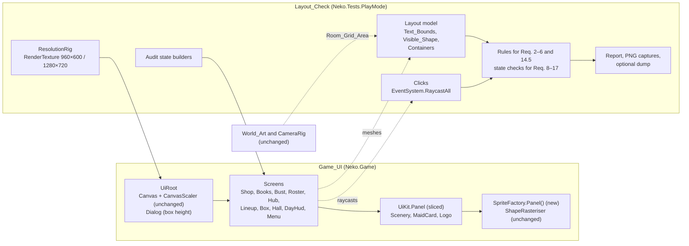
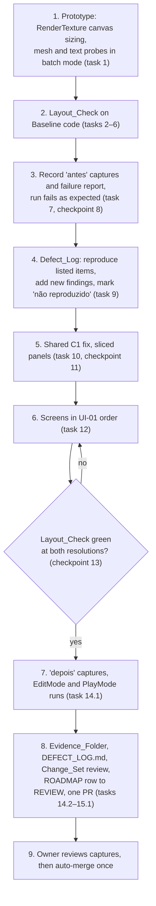

# Design Document: UI-01 layout and legibility

## Overview

UI-01 makes every Screen, the card reveal and the Dialogs fit both Reference_Resolutions (960×600 and 1280×720) with no clipped or colliding text, and adds the Layout_Check that proves it. Three causes explain almost every defect in the requirements:

- **C1**: `UiKit.Panel` draws a rounded rect that covers only the middle 84% of its sprite, stretched over the rect. Children are positioned against the full rect.
- **C2**: the canvas is 1152×720 Canvas_Units at 960×600 and 1280×720 at 1280×720, but screens are laid out for 1280.
- **C3**: labels wrap and the extra lines spill below their rect.

The design fixes C1 once, in the shared panel builder. It fixes C2 and C3 screen by screen, in the UI-01 priority order: Loja, Balanço and Falência, Elenco, then Empresa, Escalação, Caixas, Salão, O dia, Menu and the Dialogs. The canvas scaler, the camera, the palette, the font, the card composition, `Strings.cs` and everything in `Neko.Sim` stay unchanged.

On 02/11/2026 the owner trimmed the Layout_Check to its core rules: text inside its box, no overlaps, fits the window, controls clickable, Salão tiles clickable and a clean Console (Properties 1, 4, 5, 6, 7, 9, 12 and 15). Contrast, text size, navigation, displayed values, the typeface, the card composition and the World_Art pixels are verified by review of the Change_Set and by existing tests (see "Owner decision (02/11/2026): trimmed Layout_Check").

### Decisions at a glance

| Topic | Decision | Main reason |
|---|---|---|
| C1 | `UiKit.Panel` switches to one full-bleed, 9-sliced rounded-rect sprite produced by a new `SpriteFactory.Panel()` method. The corner radius is set in Canvas_Units through `Image.pixelsPerUnitMultiplier`. | Fixes the root cause in one place: the drawn shape equals the rect, corners stop stretching, edges stay crisp. World_Art and `ShapeRasteriser` are untouched. |
| C2 | Keep the scaler (Scale With Screen Size, 1280×720, match height). Every Screen fits a 1152-unit-wide canvas and uses edge anchors so 1280×720 gains side margin. | The only option that keeps every Text_Element at its Baseline pixel size (Requirement 7.1) without enlarging type. The UI-01 contract also forbids changing the base resolution to hide clipping. |
| C3 | Size every label for its Large_Values and Longest_Values, with explicit line allowances for multi-line fields. Keep `VerticalWrapMode.Overflow`. No truncation and no best fit. | Requirement 3.3 forbids dropping characters, and Requirement 7.1 forbids smaller text and new best fit. Overflow keeps a future spill visible to the Layout_Check. |
| Salão vs room | Top bar at most 48 units tall. The stock moves into a 128-unit vertical scroll column on the left (x 8–136) that keeps the Baseline 112×100 stock cards. The placement hint sits on one line in the bottom margin. | The narrowest side margin is 154.4 units (café levels 9–10 at 960×600), so the column stays at least 18.4 units off the tiles at every level and both resolutions. This keeps every Salão Hit_Area off the tiles (Requirement 14.5). Owner decision 2; Requirement 18.3 now asks for vertical scrolling in the Salão stock. |
| Layout_Check | New PlayMode tests under `Assets/_Game/Tests/PlayMode/Layout/`, trimmed on 02/11/2026 to the core rules (Properties 1, 4, 5, 6, 7, 9, 12 and 15). Each Audit_State is booted from a seeded save and measured through a camera RenderTexture at 960×600, 1280×720 and 960×600 again. Geometry comes from the meshes uGUI itself generates; clicks come from `EventSystem.RaycastAll`. | Runs in batch mode through `tools/run-tests.sh PlayMode`, needs no window, works on the Baseline code and on the fixed code. The trim drops contrast measuring, the text-size snapshot, the navigation and World_Art tests and the kernel property tests, so the screen fixes start sooner. |
| Evidence | The Layout_Check writes every capture. Only the Requirement 21.1 set plus one before and after pair per reproduced entry goes to `docs/roadmap/ui-01-evidence/`, together with `DEFECT_LOG.md`, which states the commands that regenerate every other capture and how each criterion that the Layout_Check does not evaluate was verified (Requirement 21.14). | Requirements owner decision 6 and design owner decision 4: about 5–10 MB in the repository instead of 10–20 MB. The owner decision of 02/11/2026 moves the dropped checks to review. |

## Architecture



The delivery order is fixed by Requirements 1, 20.4 and 21: the Layout_Check exists and fails on the Baseline before any Game_UI file changes.



### C1: panels drawn smaller than their boxes

| Option | Effect | Trade-off |
|---|---|---|
| **A. Full-bleed 9-sliced sprite in `UiKit.Panel` (chosen)** | Drawn shape = rect for every panel; corner radius constant in Canvas_Units; crisp edges at any size. | One Shared_Component change touching every Screen. Every panel draws about 19% larger per axis than today for the same rect, so each Screen is re-tuned (which UI-01 does anyway). |
| B. Compensate per screen (as `ShopScreen` does for the furniture icon) | Panels look as today. | Repeated in every Screen and in `Scenery`, `MaidCard` and `UiRoot`, which are shared anyway. Every offset carries a 0.84 factor. Stretched corners ("row ends look stretched") and blurred edges remain. `RectMask2D` still clips at the rect, so lists keep drawing outside their visible panel (Requirement 5.1). |
| C. Keep the sprite, enlarge the image by 1/0.84 inside `UiKit.Panel` | Drawn shape = rect. | Stretched corners and blur remain. The raycast area grows past the drawn panel, so Hit_Areas overlap (Requirement 6.3) unless raycasts move to another object. |
| D. New full-coverage `ShapeId` | Simple to call. | Breaks the protected `ArtTests`: `EveryShapeDrawsSomethingAndDoesNotFillTheWholeSprite` iterates every `ShapeId` and requires coverage below 0.98. Rejected. |

**Panel sprite.** `SpriteFactory.Panel()` returns one cached white sprite: a 66×66 texture holding a rounded rect that touches the texture edges, corner radius 32 px, anti-aliased with the same 1.2 px softness as `ShapeRasteriser`, created with `Sprite.Create(..., pixelsPerUnit: 100, extrude: 0, SpriteMeshType.FullRect, border: (32, 32, 32, 32))`. With the canvas `referencePixelsPerUnit` of 100, one texel is one Canvas_Unit at multiplier 1. The sprite lives in the existing cache, so `SpriteFactory.Clear()` releases it and `SpriteFactoryTests.ClearingReleasesEverything` still holds. `ShapeRasteriser`, `ShapeSpec`, `ShapeId` and every existing `SpriteFactory.Get`, `Layered`, `Furniture` and `Solid` output stay byte-identical, so World_Art (`MaidSpriteBuilder`, `CustomerView`, furniture) is unchanged (Requirement 19.4).

**`UiKit.Panel`.** The signature stays `Panel(parent, size, colour, corner)`. It sets `image.sprite = Sprites.Panel()`, `image.type = Image.Type.Sliced`, and `image.pixelsPerUnitMultiplier = 32 / R`, where R is the radius in Canvas_Units:

- `corner >= 0.5`: R = min(w, h) / 2, a pill (bars, the Menu plates, the Logo rule).
- otherwise: R = lerp(0.04, 0.42, corner) / 0.84 × min(w, h) / 2. This keeps the Baseline roundness measured on the short side, without the stretching on the long side.

| Panel | Size | corner | R (units) |
|---|---|---|---|
| Loja row | 850×62 | 0.20 | 4.3 |
| Empresa plank | 200×84 | 0.30 | 7.7 |
| Stats plaque root | 1020×168 | 0.20 | 11.6 |
| Scroll area | 880×460 | 0.12 | 23.4 |
| Dialog box | 620×320 | 0.35 | 33.0 |

When a rect is smaller than twice the border, uGUI's `GetAdjustedBorders` shrinks the corners proportionally, so short bar fills stay valid. The raycast area is still the rect, which now equals the drawn panel.

**Consequences to re-tune.** Gaps between neighbouring panels shrink because panels draw to their edges. The `ShopScreen` compensation (icon at x = −322, text indent 118) is removed and the row is re-laid. Backdrops, the Scenery wall and the Dialog, Overlay and Falência shades now fill the window. Today a lighter, blurred frame shows at the window edges, and the screen beneath a Dialog stays undimmed at the edges (provisional entry D-ALL-2). The Menu sign draws at its full box, about 19% larger than today, and is re-checked against the tagline at both sway extremes.

### C2: canvas width at 960×600

The scaler computes `scaleFactor` from `Canvas.renderingDisplaySize` (`CanvasScaler.HandleScaleWithScreenSize` in `com.unity.ugui` 2.5.0). With reference 1280×720:

| Option | Scale at 960×600 | Canvas at 960×600 | `Typeface.Tiny` (14) at 960×600 | Card caption (9 × 0.62 → 6 units) | Verdict |
|---|---|---|---|---|---|
| **Match height (Baseline, kept)** | 0.833 | 1152×720 | 11.7 px | 5.0 px (Baseline) | Chosen |
| Match width or Expand | 0.75 | 1280×800 | 10.5 px, below 11 px | 4.5 px, below Baseline | Fails 7.1 unless type grows at 960×600 only |
| Match 0.5 (log mix) | 0.79 | 1215×759 | 11.1 px | 4.7 px, below Baseline | Fails 7.1 for card text |
| Letterbox to 16:9 | 0.75 | 1280×720 in 960×540 | 10.5 px | 4.5 px | Fails 7.1 and wastes 60 px |

Every alternative lowers the pixel size of sub-11 px card text and changes the scaler settings, which Requirement 7.1 forbids, and owner decision 2 rules out enlarging card text. Keeping match height leaves every font at its Baseline pixel size at both resolutions.

**Layout rules for every Screen.**

1. Content fits the safe width: canvas width − 2 × Screen_Margin, which is 1136 units at 960×600 and 1264 at 1280×720.
2. Corner elements (titles, balances, "Voltar") anchor to the canvas edges. Wide elements either stretch between edge offsets or stay centred with a width of at most 1136.
3. No code reads `Screen.width` or the canvas width at Build time. Anchors and layout groups adapt to a resize, so switching resolution with a Screen shown re-lays it without a new `Show` (Requirement 2.3). A Screen that needs a computed width overrides `OnRectTransformDimensionsChange`.

### C3: long text

| Option | Verdict |
|---|---|
| **Size each label for its envelope (chosen)**: widths for Large_Values and Longest_Values, a fixed line allowance for multi-line fields (Elenco traits, flavour and signature; Dialog body; credits; Balanço chip captions), vertical stacks in layout groups. | Keeps Baseline type sizes and every character. |
| Bounded best fit (`resizeTextForBestFit`, minimum 14 units, which is 11.7 px at 960×600) | Rejected since 02/11/2026: Requirement 7.1 forbids enabling best fit on a Text_Element that lacks it in the Baseline. No field needs it today, and shrinking makes sizes vary per value. |
| Truncate or ellipsis | Rejected: drops characters (Requirement 3.3). |
| Change the `UiKit.Label` default to `VerticalWrapMode.Truncate` | Rejected: hides spills by cutting text. The default stays `Overflow`, so any spill is caught by Requirement 3.1. |

## Components and Interfaces

### Shared_Component changes

Requirement 19.8 requires the Defect_Log to justify each change. The table gives that justification. Entry IDs are provisional until the reproduction step (see Data Models).

| File | Change | Resolves | Why a Screen-local change does not resolve it |
|---|---|---|---|
| `Art/SpriteFactory.cs` | Add `Panel()`; existing methods unchanged. | D-ALL-1, D-ALL-2, D-LJ-3 and every C1 instance below | The panel sprite is produced in one place; the stretched corners come from the sprite itself. |
| `Ui/UiKit.cs` | `Panel` uses the sliced sprite and radius rule; nothing else changes. | Same | Every panel in every Screen, `Scenery.Plaque`, `Scenery.Plank`, `MaidCard`, `Logo` and `UiRoot.Dialog` is built here. Option B shows the local alternative. |
| `Ui/UiRoot.cs` | `Dialog` box 620×300 becomes 620×320: the column needs 304 units (28 + 46 + 18 + 110 + 18 + 56 + 28). | D-DG-1 | All Dialogs are built only here. |
| `Ui/MaidCard.cs` | Only what the Layout_Check still reports after the panel fix, for example the position tab height at card scale 0.62. The composition stays (Requirement 19.3). | Card entries confirmed after step 5 | Cards are built only here and are shared by Empresa, Escalação, Elenco and the reveal. |

`UiRoot`'s `CanvasScaler` stays unchanged (Requirement 7.1). `Screen.cs`, `Typeface.cs`, `Scenery.cs`, `Logo.cs` and every colour value stay unchanged unless the Layout_Check proves a defect there.

### Per-screen changes

Exact sizes are tuned against the Layout_Check; the numbers below fix the budget and prove feasibility at 1152 units.

| Screen | Provisional entries (cause) | Change | Requirements |
|---|---|---|---|
| **Loja** `ShopScreen` | D-LJ-1 names start left of the visible row (C1); D-LJ-2 "No estoque" overlaps the price button (layout); D-LJ-3 stretched row ends (C1); D-LJ-4 row text below AA (colour, to reproduce) | Row (850×62, now drawn full) laid left to right: icon slot (Móveis only), name and description column, "No estoque: N" in its own right-aligned slot, price plank at the right padding. The 84% compensation is removed. Only if D-LJ-4 reproduces, with Baseline colours only (Requirement 7.2; ratios estimated from the flat palette colours): description `Palette.Text` instead of `TextDim` (about 3.6:1 → 8.8:1 on an affordable row); "No estoque" `Logo.BoardDeep` instead of Brass (about 1.9:1 → 6.9:1); price label `Typeface.Body` bold instead of `Small`, i.e. 20 px bold at 960×600, which is large text under WCAG with a 3:1 threshold. Large text is needed because the plank shine sits under the label's top and Cream on Board over the shine is about 3.9:1. D-LJ-4 is judged by eye on the "antes" captures, supported by the WCAG 2.2 ratio of the flat `Palette.cs` colours computed by hand in `DEFECT_LOG.md`; no probe measures contrast. Face tints and label colours stay as in the Baseline (8.3, 8.4). | 7.2, 8.1–8.7 |
| **Balanço** `BooksScreen` | D-BL-1 verdict on the top edge, D-BL-3 "Caixa depois" on the bottom edge, D-BL-4 ledger labels left of the pills (C1); D-BL-2 7 chips wider than the plaque, D-BL-5 13 chips (layout) | C1 fix places the contents laid out against the inner rect inside the drawn plaque. Tally chips move into a wrapping block of 7 columns × 148 units (2 rows for 13 chips, chips 72 units tall so a caption gets 2 lines) under the ledger columns. Profit and balance lines stay anchored to the bottom. Budget inside the 588-unit inner panel: verdict 20–94, subtitle 96–120, columns 132–300, chips 312–464, profit 476–516, balance 520–548. | 9.1–9.5 |
| **Falência** `BustScreen` | D-FL-1 contents reach the visible edges (C1, to reproduce) | C1 fix only; the column (about 314 units) fits the 348-unit inner panel. | 9.6 |
| **Elenco** `RosterScreen` | D-EL-1 header wraps (C3); D-EL-2 detail contents outside the panel (C1), "Etiquetas" wraps (C3); D-EL-3 card stats and salary overflow (C1); D-EL-4 first row on the grid's top edge (C1); D-EL-5 grid and detail overlap at 960×600 (C2) | Detail plaque fixed at 540 units, 16 from the right edge. Grid stretches from 16 units on the left to 16 units before the detail panel: 564 units at 960×600, 692 at 1280×720, with rows of 4 cards (4 × 123 + 3 × 8 = 516). Header 640 units wide, right-aligned, one line at Large_Values. Detail column laid out for EL-2: head row with a two-line "Etiquetas" value, four stat rows, three trait lines, two-line flavour, two-line signature, "Dispensar" plank; about 532 units of a 548-unit inner panel. | 10.1–10.6 |
| **Empresa** `HubScreen` | D-EM-1 wordmark under the plaque (layout, C2); D-EM-2 figure caption on the plaque edge, D-EM-3 plank text larger than the face, D-EM-4 card stats overflow (C1); D-EM-5 plaque covers "Voltar" (16 of 120 units at 1280×720, about 80 at 960×600) | Header band (y 14–78): monogram and wordmark on the left, "Voltar" on the right, unchanged. Stats plaque moves below the band (top 86, width up to 1020), so it covers neither. Figure columns are sized for Large_Values; "Caixa" with "9.999.999 ¥" is the widest. The chemistry line, today strip (8 cards: 934 units), plank row (936 units) and "Abrir o dia" move down to fit 720 units. Plank labels fit the now full-size faces: "Escalação" is about 166 units wide on a 192-unit face. | 11.1–11.5 |
| **Escalação** `LineupScreen` | D-ES-1 card stats (C1); D-ES-2 "Banco" outside the bench (C1); D-ES-3 chemistry bar to the edges (C1); D-ES-4 bench (1200) wider than the 1152 canvas (C2); D-ES-5 tools 42 units tall | Bench stretches between 26-unit side offsets (1100 units at 960×600); "Banco" aligns with its left edge. The board for 10 slots is 1062 units and fits. The board starts below the chemistry plaque, which today overlaps it by about 6 units. "Escalar sozinho" and "Limpar" become 44 units tall. | 6.1, 12.1–12.6 |
| **Caixas** `BoxScreen` | None at 1280×720; reproduce at 960×600 and for the reveal | C1 fix; the shelf is 1030 units and the 3-card reveal row is 530 units, both inside 1136. Changes only if the Layout_Check reports a defect. | 13.1–13.3 |
| **Salão** `HallScreen` | D-SL-1 title left of the plaque edge, D-SL-2 theme past the right edge (C1); D-SL-3 stock labels spill (C3); D-SL-4 stock bar Hit_Area on the bottom row; D-SL-5 top bar (1240) and stock bar (1180) wider than the canvas (C2); D-SL-6 top bar Hit_Area on the top row at level 8 (to reproduce) | Top bar 48 units tall at the safe width; the stock moves from the bottom bar into a vertical scroll column on the left; the hint moves to the bottom margin. See "Salão against the room" below. | 14.1–14.5, 18.3 |
| **O dia** `DayHud` | D-OD-1 clock outside the plaque, D-OD-3 chip names on the chip edge (C1); D-OD-2 tally line wraps and spills (C3); D-OD-5 8 chips (1112) in a 1000-unit row start left of the window (to reproduce); D-OD-4 and D-OD-6 tiles covered (recorded, deferred to UI-02, no fix) | Top plaque widens to about 860 units, with a 380-unit till column so "Atendidos 999 · Pedidos errados 999 · Foram embora 999" stays on one line. The chip strip anchors bottom-centre with the chips' own width (1112 ≤ 1136). The hint and the chips keep their separate rows. | 15.1–15.4 |
| **Menu** `MenuScreen` | D-MN-1 records show "\n" literally; D-MN-2 credits spill and overlap the sign at 960×600 | `SetSession` joins the record groups with `"\n"` instead of `"\\n"`; `Strings.cs` is untouched. Credits move to the bottom right, under the parade, in a wider box (about 420×64 units, four lines), so they never meet the sign. The parade, records and tagline spacing is adjusted only where the Layout_Check reports an intersection, including at both sway extremes. | 16.1–16.3 |
| **Dialogs** `UiRoot.Dialog` | D-DG-1 content taller than the box and beyond the drawn box (C1, layout) | Box height 320 (see Shared_Component changes). | 17.1–17.3 |

Any new defect the Layout_Check reports in step 3 gets its own entry and fix. A listed item that does not reproduce is recorded as "não reproduzido" and gets no change (Requirement 1).

### Salão against the room

`CameraRig.FrameRoom` sets `orthographicSize = max((h + 1.8) / 2, (w + 1.8) / 2 / (4/3))`, with the room sizes of `CafeLevelTable`. Tiles are one world unit, centred on the camera. The canvas is 720 units tall at both resolutions, so a tile is 360 / orthographicSize units and the vertical margins are the same at both resolutions. The side margin is half the canvas width (576 at 960×600, 640 at 1280×720) minus half the room width in units. The last two columns give the gap between the stock column's right edge (x = 136) and the first tile column, which is the side margin minus 136:

| Café level | Room | Units per tile | Margin above and below | Side margin at 1152 | Side margin at 1280 | Stock column clearance at 960×600 | Stock column clearance at 1280×720 |
|---|---|---|---|---|---|---|---|
| 1 | 7×5 | 105.9 | 95.3 | 205.4 | 269.4 | 69.4 | 133.4 |
| 2 | 8×6 | 92.3 | 83.1 | 206.8 | 270.8 | 70.8 | 134.8 |
| 3 | 9×6 | 88.9 | 93.3 | 176.0 | 240.0 | 40.0 | 104.0 |
| 4 | 10×7 | 81.4 | 75.3 | 169.2 | 233.2 | 33.2 | 97.2 |
| 5 | 11×7 | 75.0 | 97.5 | 163.5 | 227.5 | 27.5 | 91.5 |
| 6 | 11×8 | 73.5 | 66.1 | 171.9 | 235.9 | 35.9 | 99.9 |
| 7 | 12×8 | 69.6 | 81.7 | 158.6 | 222.6 | 22.6 | 86.6 |
| 8 | 12×9 | 66.7 | 60.0 | 176.0 | 240.0 | 40.0 | 104.0 |
| 9–10 | 13×9 | 64.9 | 68.1 | 154.4 | 218.4 | 18.4 | 82.4 |

The first version of this table gave 205.5 and 269.5 for level 1; the exact values are 576 − 7 × 105.88 / 2 = 205.4 and 269.4.

Layout (owner decision 2), with every Hit_Area outside the tiles at every level:

- **Top bar**: Plaque 48 units tall at y 8–56 from the top, stretched to the safe width. Title on the left, metrics on the right on one line: the metrics need about 560 units at Large_Values and the longest theme name. The plaque keeps its Baseline raycast blocking. Its smallest clearance is 4 units above the level 8 tiles; the next smallest is 10.1 units at level 6.
- **"Voltar"**: unchanged (120×44, 26 units from the right edge, y 78–122). Its smallest clearance is 8.4 units beside the tiles at levels 9 and 10 at 960×600.
- **Stock column**: on the left, from x 8 (Screen_Margin) to x 136, and from 64 units below the top edge (8 units under the top bar) down to the bottom Screen_Margin, so 648 units tall at both resolutions. `HallScreen` builds it with `UiKit.ScrollList` (128×648 units, spacing 8) anchored to the top-left corner, in place of `UiKit.ScrollRow`. `ScrollList` already scrolls vertically with elastic movement and a scroll sensitivity of 28 (Requirement 18.3). `HallScreen` sets the padding of the list's `VerticalLayoutGroup` to 8 on every side, so the column is 112 + 2 × 8 = 128 units wide; the default of 10 in `UiKit` stays unchanged. The stock cards keep the Baseline size of 112×100, the 64×58 icon slot and the "<name> ×N" label at `Typeface.Tiny`. Inside a card, the icon slot moves to the top inset and the label gets a two-line allowance below it, so "Lanterna de sakura ×99" wraps inside the card (D-SL-3); the offsets are tuned against the Layout_Check. Six cards are visible at a time (8 + 6 × 100 + 5 × 8 = 648 units), so the stock of SL-2 (every placeable, 23 today) scrolls. In SL-1 the Baseline empty-stock text ("No estoque: 0 — Loja") is the column's only item, at `Typeface.Small` in a 112×48 label with a two-line allowance. The column is at least 18.4 units clear of the tiles at every level and both resolutions (table above), so neither its scroll area nor any stock card covers a tile. Because the column is clear of the tiles horizontally, its height does not depend on the café level.
- **Hint**: a non-raycast label in the bottom margin, centred, on one line, 864×28 units with its bottom edge at the bottom Screen_Margin (y 8–36 from the bottom). The width is the 960×600 canvas width minus the column and an 8-unit gap on each side (1152 − 2 × 144), so the label never reaches the column; at 1280×720 the gap grows to 72 units. The longest hint, the Longest_Values placeable name followed by " — Clique no salão para colocar · R gira", is about 500 units wide at `Typeface.Small`. The smallest bottom margin is 60 units (level 8), so the hint also stays below the tiles. Visual covering of tiles would be deferred to UI-02 in any case.

Audit_State SL-4 measures every level at both resolutions, so a future change to `CameraRig.Margin` or to the room sizes fails the check instead of silently blocking clicks. The bottom strip of the first version had no slack at level 8; the smallest clearance in the Salão is now the top bar's 4 units at level 8, which is above Overlap_Tolerance.

The Layout_Check finds the stock area as the `ScrollRect` that holds the stock card labels, whatever its axis, so the Salão Audit_States run unchanged on the Baseline bottom bar and on the new column. Requirement 18.3 is checked by review of the Change_Set; since 02/11/2026 no scroll-setting check exists. The stock's change from horizontal to vertical scrolling is the owner's change of 29/10/2026, not a defect; `DEFECT_LOG.md` notes it under the Salão entries D-SL-4 and D-SL-5, which the column resolves.

### Layout_Check

Files, all under `Assets/_Game/Tests/PlayMode/Layout/` (inside the existing `Neko.Tests.PlayMode` assembly, which already compiles against `UnityEngine.UI`, `Neko.Game` and `Neko.Sim`), each with its `.meta`. `ResolutionRig.cs`, `LayoutModel.cs` and `LayoutCheckTests.cs` exist from task 1. The Change_Set adds no EditMode file.

| File | Responsibility |
|---|---|
| `ResolutionRig.cs` | RenderTexture setup, canvas assertions (Requirement 20.2), capture, restore (Requirement 20.7). |
| `LayoutModel.cs` | Mesh extraction, Active_Layer, element classification, Text_Bounds, Visible_Shape, Containers, Room_Grid_Area, optional debug dump. |
| `LayoutReport.cs` | Violation records, report file, PNG captures. |
| `Clicks.cs` | Raycast targets, Hit_Areas, the topmost click handler at a point and click delivery, built on `EventSystem.RaycastAll`. |
| `SessionFactory.cs` | Seeded profiles, Large_Values and Longest_Values providers, save-then-boot, injections. |
| `AuditStates.cs` | The 40 Audit_State definitions (LJ-4 covers the three tabs and SL-4 the ten café levels): builder plus state-specific checks. |
| `LayoutRules.cs` | Rules for Requirements 2–6, including the scroll reachability function of R5.2. |
| `StateChecks.cs` | Containment, separation and click criteria of Requirements 8–17, and rule R14.5. |
| `LayoutCheckTests.cs` | The rig and probe tests of task 1, the model and click tests of tasks 2.3 and 2.5, a plain `[Test]` that compares the registered ids with the Audit States table, and one parameterized `[UnityTest]` per Audit_State (`[ValueSource]`, supported by Unity Test Framework 1.7.0). The Audit_State test builds the state, measures at 960×600, then 1280×720, then 960×600 again, evaluates every rule at each step, writes captures and fails with the full report. |

No test hook is added to Game_UI code (Requirement 1.6). The check identifies structure from names the Game_UI already sets (`Plaque`, `Plank`, `Button`, `Bar`/`Fill`, `Card …`, `Logo`, `Monogram`, `Scenery`, `Scroll`, `ScrollRow`, `Content`, `Reveal`) and from component layout; the per-screen fixes keep these names.

The Layout_Check compiles and runs unchanged against the Baseline Game_UI and against the fixed one. It references no member that UI-01 adds, such as `SpriteFactory.Panel()`, and recognises panel sprites at runtime from the sprite itself: the Baseline `ShapeId.RoundedRect` sprites by the factory's cache name, the new panel sprite by its non-zero 9-slice border. This is what keeps the "antes" captures regenerable from the Baseline code (Requirement 21.13).

#### Reproducing the two windows in batch mode

What the UGUI source confirms:

- `CanvasScaler.HandleScaleWithScreenSize` derives `scaleFactor` from `m_Canvas.renderingDisplaySize`. With match height, the factor is height / 720, so 0.8333 at 960×600 and 1.0 at 1280×720.
- `Handle()` runs in `OnEnable` and on every `Canvas.preWillRenderCanvases`, i.e. every frame, independent of `Screen.width`.
- UGUI's own test `CanvasResizeCorrectlyForRenderTexture` shows a Screen Space - Camera canvas taking its camera's RenderTexture size on `Camera.Render()` when `Canvas.updateRectTransformForStandalone` is enabled.
- The Unity reference states that for Screen Space - Camera canvases, `renderingDisplaySize` represents the screen area covered by the camera ([Canvas.renderingDisplaySize](https://docs.unity.com/en-us/engine/current/script-reference/unityengine/canvas/renderingdisplaysize)).
- Nothing in the Game_UI reads `Screen.width`. `GraphicRaycaster` uses the event camera, which is `canvas.worldCamera`.

What the source cannot confirm: `renderingDisplaySize` and the canvas rect for Screen Space - Camera are computed in native code. It is not provable from source that a persistent `camera.targetTexture` drives them during the normal player loop in batch mode. **Task 1 is therefore a prototype** that settles it before anything else is built:

1. **Primary path.** Create `RenderTexture(w, h, 24, ARGB32)`, assign it to `Camera.main.targetTexture` and keep it assigned for the whole measurement. Wait two frames, call `Canvas.ForceUpdateCanvases()`, then assert `canvas.scaleFactor` and the canvas rect size against the scaler model: the same formula as `HandleScaleWithScreenSize`, applied to the game's scaler settings read at runtime. Captures use `camera.Render()` and `ReadPixels` into a `Texture2D`, encoded with `ImageConversion.EncodeToPNG`. The camera's `aspect` follows the texture, so `CameraRig` frames the room exactly as in a real window.
2. **Fallback path**, used only if step 1's assertions fail. Disable the `CanvasScaler` during the measurement and set `canvas.scaleFactor` from the scaler model. Set `canvas.updateRectTransformForStandalone = Enabled` and call `camera.Render()` so the canvas rect follows the texture. Requirement 20.2 then compares against the same model, which proves less than the primary path; the evidence states which path ran.
3. The prototype also confirms three probes on one Screen at both resolutions: `Graphic.OnPopulateMesh` through reflection returns the quads uGUI draws; glyph quads match the rendered text; `EventSystem.RaycastAll` returns results in batch mode. Task 1.3 confirmed all three (see "Baseline hierarchy facts"), so `Clicks.cs` builds on `RaycastAll` and no rasterised hit map exists. `Logs/ui01/prototype.md` records which rig path ran.

`ResolutionRig` restores the camera's previous `targetTexture` and releases the RenderTexture in a `finally` block and in `[TearDown]`, and asserts the restore (Requirement 20.7).

#### Baseline hierarchy facts

Measured by task 1.3 and by the investigation of 01/11/2026 on the Baseline code. The model, `Clicks.cs` and the Audit_State builders use these facts instead of re-deriving them.

- **Clipping**: `RectMask2D` clips strict descendants only; the mask's own `Scroll` panel is not clipped. The clip rect is the intersection of the ancestor mask rects minus their padding, taken from world corners 0 and 2 in root canvas space. `canvasRenderer.cull` is set only when the graphic's rect misses the clip rect entirely.
- **Raycasts**: a target needs `raycastTarget` on, not culled, and `depth != -1`. Raycast padding is 0 everywhere. `UiKit.Panel` leaves `raycastTarget` on, so every Panel blocks clicks. `raycastTarget` is off on the Plank face and shine, the card face and tab, labels, Logo icons, `Portrait`, the furniture `Icon` and the trait stars. D-EM-5: at 960×600 the topmost target at the centre of "Voltar" on the Empresa is `HubScreen/Plaque/Panel[1]`.
- **Sprites**: a factory sprite's name is `size + "#" + ShapeSpec.CacheKey()`, and the key starts with `(int)ShapeId + "|"` (Circle 0, Capsule 1, RoundedRect 2, Triangle 3, Star 4). A Baseline plate sprite is named, for example, `96#2|ffffffff|-|-|0|<corner>|0|0,0|1,1`. A plate is an Image with a non-zero `sprite.border` or a sprite name matching `<digits>#2|`. Factory textures are RGBA32, Bilinear, Clamp and readable.
- **Composites**: `Plaque` root → edge `Panel[0]`, inner `Panel[1]` (`Scenery.Plaque` returns the inner panel). `Plank` root (holds the `Button`) → face `Panel[0]`, shine `Panel[1]`, `Label` with `Shadow`. A `Button` root has no face. `Bar` is the track; its child is `Fill`. A card root "Card <name>" → face, tab, trait `Row` of trait stars; under the face: wash, `Portrait`, labels, pip `Row`. `Logo` root (no graphic) → bar, chain, pin, chain, pin, 4 `CatEar`s, shadow Panel, board Panel; board → inset, face, 4 `Circle` studs; face → `Column` with `Wordmark`, `Rule`, `Inc` (a "Tracked" "Inc."). `Monogram` → `Circle`, `CatEar`, `Capsule`. A crate is a Panel that holds a band Panel and a `Monogram`.
- **TrackedLabel**: a `Row` named "Tracked" (renamed "Wordmark" or "Bust") with `HorizontalLayoutGroup` and `ContentSizeFitter` and no graphic. Letters are Labels with `Shadow` (2, −3); spaces are "Space" objects. Whitespace emits no glyph quads.
- **Layers**: `Ui/Screens/<Screen>`, `Ui/Overlay` and `Ui/Dialogs` (reached with `ui.transform.Find("Dialogs")`). `DialogOpen` is `childCount > 0`, and closing uses a deferred `Destroy`, so a closed Dialog still counts until the next frame. Reveal is `ui.Get<BoxScreen>().transform.Find("Reveal")`. Backdrops are `Scenery` (wall, `Lamplight` 2600×1900, stripes, floor, seams, skirting, rail) and `Screen.Backdrop`.
- **Scroll areas**: `ScrollList` builds "Scroll" (Panel, `RectMask2D` and a vertical `ScrollRect`) → "Content"; `ScrollRow` is the horizontal version.
- **Room**: `GameRoot.Instance.Room` holds child `SpriteRenderer`s named "Tile"; the grid size is `Session.Profile.Grid.Width` × `Session.Profile.Grid.Height`. Tiles are projected with `canvas.worldCamera.WorldToScreenPoint` and divided by `scaleFactor`.
- **Empresa**: 7 planks. The chemistry line sits on the `HubScreen` root, so its Container is the Viewport.
- **Compile trap**: refer to the game's Screen class through the alias `using GameScreen = Neko.Game.Ui.Screen;`.
- **Rig**: 960×600 gives `scaleFactor` 0.83333 and a 1152×720 canvas; 1280×720 gives 1.0 and 1280×720. `Screen` stays 640×480 in batch mode, and the canvas follows the camera target. Meshes and glyph quads match the rendered pixels within 1 px (2 px inside glyph quads). Unverified: a live window resize may leave stale glyphs; the Defect_Log records this.

#### Building Audit_States

Every state starts from a fresh load of `Boot.unity`, then discards 12 frames as `CaptureTests` does, because batch mode renders the first frames before material albedo is ready. Determinism comes from booting a saved profile rather than calling `OnNewGame`, which seeds from `DateTime.Now.Ticks`:

1. `SessionFactory` builds a `Profile` with `Profile.NewGame(fixedSeed)`, edits it (reputation for the café level, money, points, day, records, maids minted with a fixed `Rng`, explicit names, levels, bonds, traits, lineup assignments, grid items, owned stock) and writes it with `SaveBridge.Save`.
2. Loading `Boot.unity` makes `GameRoot` decode that save. `GameSession` seeds its `Rng` from `Profile.Seed`, so box openings and days are reproducible.
3. The builder navigates with the public entry points `CaptureTests` already uses (`MenuScreen.OnPlay`, `HubScreen.On…`, `UiRoot.Show<T>()`) or with real clicks through `Clicks.cs` for Dialog states.

| Value | Mechanism |
|---|---|
| Money, fichas, day, records, café level, owned stock counts, maid name, level, bond, rarity, traits, lineup, room | Saved profile (real data) |
| Ledger amounts, tallies, level-ups, failure reason (BL-1 to BL-4) | `Session.FinishDay(new ShiftResult { … })`, then the returned `DayLedger` public fields set to Large_Values |
| O dia till and counts (OD-2) | Reflection on `Shift`'s private auto-property setters; `DayHud.Sync()` formats them; game clock paused |
| Closing time (OD-3) | Tick the real shift with `Shift.Tick(0.05f)` until `ClosingTime && !Finished`, then pause |
| Salary 9.999 ¥, fixed cost 99.999 ¥, severance 999 | Computed by `Neko.Sim` and unreachable from data, so after `Refresh` the builder replaces the displayed string with the same composition using the envelope value. Each replacement must find exactly one target label, or the test fails. |
| Longest_Values | Picked at test time from the game tables by rendered width with the game font: `ArchetypeTable`, `RoleTable`, `TraitTable`, `BondTable.SignatureFor`, `ChemistryTags`, `Shop.StockFor`, `Lootbox.All`, `PlaceableCatalog`, theme names. Maid names come from the private `Lootbox` name pool by reflection, plus the numbered fallback (widest name + " 31"). Failure reasons, save messages and refusals come from running the real code paths with crafted inputs. |
| Menu records (MN-2) | Real path Menu → Empresa → "Voltar", because `SetSession` is a no-op at boot (see Findings outside UI-01) |
| Dialog states | Real paths: a corrupt save for DG-1; "Abrir o dia" with an empty required position for DG-2; a click on an empty slot for ES-4; "Dispensar" for EL-5; a gift price button with the longest-name maid first in the roster for LJ-5. LJ-6 sets money to 0 without `Touch()` after the list is built, so the enabled price button triggers the real "Faltam N moedas." refusal. |

"Settled" is reached by calling `Tween.TickAll(0.1f)` 20 times (2 s of UI time; the longest one-shot tween, the card reveal, takes about 1 s), then `Canvas.ForceUpdateCanvases()` and one frame. The check then ticks once more and requires identical element bounds, which detects anything still moving. For the Menu it sets the sign's rotation to ±1.4° and the parade maids' rotations to ±3.5° explicitly and measures both extremes. For O dia the game clock is paused (`Clocks.Pause(true)`) so the room is frozen.

#### Element model and measurements

All coordinates are Canvas_Units in the canvas root's space, origin bottom-left. Screen pixels are Canvas_Units × `canvas.scaleFactor`.

- **Active_Layer**: the dialog layer if `UiRoot.DialogOpen`; else the `BoxScreen` child named `Reveal` when active; else `UiRoot.Current`. The `Overlay` layer of floating effects is ignored.
- **Graphics**: every active, enabled `Graphic` in the Active_Layer with `canvasRenderer.cull == false`, in depth-first hierarchy order. That order is the uGUI draw order on a single canvas, so "drawn over" means "later in the order". Items that a `RectMask2D` culls because they are scrolled out of view are still listed for R5.2, from their RectTransforms. Each element keeps its clip rect, the intersection of its `RectMask2D` ancestors' rects (see "Baseline hierarchy facts").
- **Mesh**: `Graphic.OnPopulateMesh(VertexHelper)` invoked through reflection gives the exact quads and UVs uGUI draws, for Simple, sliced and aspect-preserving images and for text. Mesh effects such as `Shadow` are not applied, which excludes drop shadows from Text_Bounds as the glossary requires. Vertices are transformed to canvas space, so rotation and scale are handled.
- **Text_Element** and **Text_Bounds**: a `Text` with non-empty text gives the union of its glyph quads. A TrackedLabel, recognized as a `HorizontalLayoutGroup` plus `ContentSizeFitter` whose children are one-character Texts or `Space` objects, is one element whose own rect is the row.
- **Visible_Shape**: a point is inside when the sprite's texture alpha, sampled bilinearly at the point's interpolated UV, is at least 0.5. The Image colour's alpha is not part of the test (see Interpretations), and the point must also be inside every `RectMask2D` ancestor's rect. The same code measures the Baseline's stretched 96-pixel sprites and the new sliced sprite. Bounds come from the mesh; containment of a rectangle in a convex plate tests its four corners, other intersections are sampled on a 0.5-unit grid.
- **Plates, composites and Decor**: a plate is an Image whose sprite is a factory panel sprite (Baseline rounded rect or the new panel), recognised at runtime as described above and in "Baseline hierarchy facts". Composite roots are recognized by name: Plaque, Plank, Button, Bar, Card, Logo, Monogram, and a panel holding a Monogram (the crate). Background pieces follow the glossary. Decor is everything under `Scenery`, every full-stretch plate that is a direct child of a Screen, the dialog layer or `Reveal`, and the `Logo` children drawn before the first ear.
- **Container**: the nearest ancestor plate. For a label directly under a Plank root it is the Plank's face piece. With no plate ancestor it is the Viewport. **Container_Chain** includes, for every composite on the chain, all of that composite's background pieces.
- **Interactive_Control**: every active `Selectable` and every `ScrollRect` in the Active_Layer.
- **Clicks** (`Clicks.cs`, on `EventSystem.RaycastAll`, which task 1.3 showed returns results in batch mode):
  - Raycast targets: the Active_Layer's Graphics with `raycastTarget` on, not culled and `depth != -1`, each with its rect clipped by its `RectMask2D` ancestors. The game uses no `CanvasGroup`, `Mask` or alpha hit threshold, and raycast padding is 0, so the clipped rects describe what `GraphicRaycaster` hits.
  - A control's Hit_Area is the union of the clipped raycast rects whose `ExecuteEvents.GetEventHandler<IPointerClickHandler>` is the control. For a scroll area, the handler type is `IScrollHandler`.
  - `TopHandler(point)` is the click handler of the topmost `RaycastAll` result at a canvas point, converted to screen pixels as task 1.3 does. `Click(point)` delivers a pointer click to that handler.
  - A control's sample points are its centre plus a 4-unit grid over its Visible_Shape inset by Overlap_Tolerance.
  - R6.1 and R6.3 use Hit_Area rect math, R6.2 uses `TopHandler` at the sample points, and R14.5 uses rect math against the Room_Grid_Area.
- **Room_Grid_Area**: the union of the room's `SpriteRenderer` objects named `Tile` (as `BootTests` counts them), projected through the camera and divided by `scaleFactor`.
- **Debug dump**: with `NEKO_LAYOUT_DUMP` set to a directory, the model writes each measurement as a text file with one line per element: draw index, path, kind, rect, Visible_Shape bounds and Container path.

#### Rules

| Rule | Requirement | Check |
|---|---|---|
| R2.1 | 2.1, and 2.2 at 960×600 | Non-Decor Visible_Shape bounds and Text_Bounds inside the Viewport inset by 8. |
| R3.1–R3.3 | 3.1–3.3 | Text_Bounds in the own rect ±1; Text_Bounds grown by 4 inside the Container's Visible_Shape; one glyph quad for every non-whitespace character of the string. Whitespace emits no glyph quads (task 1.3). |
| R4.1–R4.3 | 4.1–4.3 | Nothing later in draw order intersects a Text_Bounds; nothing earlier intersects it unless in the Container_Chain or Decor; non-Decor Visible_Shapes intersect only within the Container_Chain or the same composite. Intersections of 1 unit or less in width or height are ignored. |
| R5.1–R5.3 | 5.1–5.3, and 2.2 at 960×600 | Content drawn within the scroll area's Visible_Shape bounds; for each item, the scroll window [s, s + H] with s in [0, max(0, C − H)] has a value that holds the item inset by 4; the first item fits at the opening position. The reachability answer is a small pure function of the content length C, the viewport length H and the item extents along the scroll axis, kept inside the rule, with no property test of its own. |
| R6.1–R6.3 | 6.1–6.3 | Through `Clicks.cs`: Hit_Area at least 44×44 (rect math); `TopHandler` at every sample point of the control returns the control or a nested control; Hit_Areas of two buttons, planks, tabs, price buttons, card buttons, stock cards or Dialog buttons do not overlap by more than 1 unit (rect math). The report names the blocked point and the element that receives the click. |
| S8–S17 | Containment, separation and click criteria of 8.1–17.3 | State-specific criteria. Elements are found by content the session predicts, such as `Strings.Get` keys, `Strings.Money` of the price, the ledger verdict or a maid's name. The check asserts the named container is on the element's Container_Chain. Clicks for 8.5, 10.6, 11.5 and 17.3 go through `Clicks.cs`. Requirements 8.2–8.4, 8.6, 9.4 and 12.3 are verified by review instead. |
| R14.5 | 14.5 | SL-4 at levels 1–10 and both resolutions: the clipped rect of every Salão raycast target lies outside the Room_Grid_Area beyond 1 unit; the report names the level, the element and the measured clearance. |

Each rule is one class or method tagged `// Feature: ui-01-layout, Property N: …` and runs in every Audit_State it applies to.

Requirements 2.2 and 2.3 have no rule of their own. The audit loop measures one hierarchy at all three steps and never rebuilds the Screen between resolutions, so every element present at 1280×720 is present at 960×600, and R2.1 and R5.2 at 960×600 place it inside the Viewport or within scrolling reach (2.2). The loop runs every rule at 960×600, 1280×720 and 960×600 again without a new `Show` (2.3). The equality check of the two 960×600 layouts was dropped on 02/11/2026.

#### Failure report and captures

A failing rule produces one record (see Data Models) with Screen, Audit_State, resolution, the hierarchy paths, the rule and the measured and expected values (Requirement 20.3). The test fails after all three steps are measured, with every record in the message, so one run shows every defect. `NEKO_LAYOUT_REPORT=<file>` appends the records as JSON lines for building the Defect_Log. When `NEKO_CAPTURE_DIR` is set, one PNG per state and resolution is written from the first two steps (Requirement 20.6). `NEKO_LAYOUT_DUMP=<dir>` adds the debug dump of every measurement. Every Audit_State test also calls `LogAssert.NoUnexpectedReceived()`, so a Console error or exception fails it (Requirement 21.4).

**Runtime budget**: 40 scene loads with 12 discarded frames each, and 3 measurements per state with one render each, which only the captures use (LJ-4 switches tabs and SL-4 raises the café level inside one load); estimated at about 2 minutes in batch mode. Runs are filterable, for example `tools/run-tests.sh PlayMode Neko.Tests.PlayMode.Layout`.

### Evidence pipeline

Run output goes to `Logs/ui01/`, which Git ignores. The `NEKO_*` variables take absolute paths, for example `"$PWD/Logs/ui01/antes"` from the repository root. No PNG is ever written under `Assets/`, because `DocsTests.NoTextureOrAudioFileWasEverImported` fails on any PNG there.

1. **Before** (task 7.1; Baseline code, Layout_Check added): `NEKO_CAPTURE_DIR="$PWD/Logs/ui01/antes" NEKO_LAYOUT_REPORT="$PWD/Logs/ui01/antes.jsonl" UNITY_EDITOR=… tools/run-tests.sh PlayMode Neko.Tests.PlayMode.Layout`. The run writes every capture of the Audit_Scope and fails, which is expected (Requirement 20.4). Its XML and log are kept in `Logs/ui01/baseline/` and summarised in `DEFECT_LOG.md`. Checkpoint 8 runs the filter again with `NEKO_LAYOUT_REPORT="$PWD/Logs/ui01/antes-repeat.jsonl"` and requires the same violations.
2. **Defect_Log** (task 9): one entry per listed observed or suspected item, statuses per resolution from the report and the captures, plus new entries for unlisted failures. Defects the rules do not evaluate, such as stretched corners and D-LJ-4 (Loja row legibility), are judged by eye from the captures; for D-LJ-4, `DEFECT_LOG.md` adds the WCAG 2.2 ratio of the flat `Palette.cs` colours, computed by hand. The Defect_Log also records which rig path ran, the unverified stale-glyph risk of a live window resize, and the revision whose code produced the "antes" captures.
3. **After** (task 14.1): the same command with `Logs/ui01/depois` and `Logs/ui01/depois.jsonl` passes. Then the full `tools/run-tests.sh EditMode`, `tools/run-tests.sh PlayMode` and `DOTNET_ROLL_FORWARD=Major tools/simtest.sh` run. The scope and diff review of task 14.4 then verifies the criteria that the Layout_Check does not evaluate, and `DEFECT_LOG.md` records each result (Requirement 21.14).
4. **Curate** (task 14.2; design owner decision 4): the Evidence_Folder holds exactly two sets of PNGs.
   - The Requirement 21.1 set: LJ-1, LJ-2, LJ-3, EL-1, EL-2, BL-1 and BL-3, plus one Audit_State each for Menu, Empresa, Escalação, Caixas, Salão, O dia and Falência, one Overlay state and one Dialog state. That is 16 Audit_States × 2 resolutions × "antes" and "depois" = 64 PNGs. Where the set allows a choice, the state that shows the most reproduced entries of that Screen is picked, which keeps the second set small.
   - The Requirement 21.2 set: for each "reproduzido" entry that the first set does not already show at a resolution where the entry reproduces, one "antes" and one "depois" capture of a matching Audit_State at one such resolution. A capture that serves several entries is copied once.

   `DEFECT_LOG.md` links every committed capture to its entries and lists the 21.1 captures without an entry under their Audit_State (Requirement 21.11). For each other resolution at which an entry reproduces, it names the file that the regeneration command writes (Requirement 1.3).
5. **Regeneration** (Requirement 21.13): `DEFECT_LOG.md` states the exact commands.
   - "depois": on the pull request head, `NEKO_CAPTURE_DIR="$PWD/<dir>/depois" UNITY_EDITOR=… tools/run-tests.sh PlayMode Neko.Tests.PlayMode.Layout.LayoutCheckTests`.
   - "antes": the same command with `<dir>/antes`, on the revision that holds the Layout_Check on the Baseline Game_UI code. That is the branch commit made after checkpoint 8, whose hash the orchestrator supplies (task 14.3); without such a commit, it is the Baseline revision with `Assets/_Game/Tests/PlayMode/Layout/` and `Layout.meta` copied from the pull request head. The run fails as in step 1 and still writes every capture, because the check writes its captures before it reports.
6. **ROADMAP** (task 15.1; design owner decision 5): the UI-01 row of `docs/ROADMAP.md` moves to REVIEW, with links to the pull request and to `DEFECT_LOG.md` (Requirement 21.12). The pull request URL exists only once the orchestrator opens the pull request, so this edit follows the opening.
7. **PR**: the template records each command with passed, failed or not run. The WebGL build check is reported as not run unless a build is actually launched and inspected at both window sizes. The PR states that approval covers layout and legibility, not final art, and copies from `DEFECT_LOG.md` how each criterion that the Layout_Check does not evaluate was verified, with its result (Requirement 21.14).

**Size**: the existing 1280×720 captures in `Logs/art-review/png-after/` average 109 KB (60–157 KB), and a 960×600 frame has 37% fewer pixels, so a capture averages roughly 60–90 KB. The 64 PNGs of the 21.1 set plus an expected 20 to 50 PNGs of the 21.2 set come to roughly 5–10 MB.

## Data Models

**Audit state definition** (test code):

```csharp
sealed class AuditState
{
    public string Id;            // "LJ-1"
    public string Screen;        // "Loja (Móveis)"
    public Func<StateContext, IEnumerator> Build;
    public Action<Measurement, List<Violation>> Checks;   // Requirements 8–17
    public int[] CafeLevels;     // SL-4 iterates 1..10; others a single level
}
```

**Measured element**:

| Field | Meaning |
|---|---|
| `Order`, `Path` | Draw order index; hierarchy path from the Active_Layer root, such as `ShopScreen/Scroll/Content/Panel[3]/Label[1]` |
| `Kind` | `Text`, `TrackedText`, `Image` |
| `Bounds`, `Shape`, `ClipRect` | Mesh bounds; point-containment test of the Visible_Shape; intersection of the `RectMask2D` ancestors' rects |
| `TextBounds`, `OwnRect` | Text only |
| `Container`, `Chain`, `Composite`, `IsBackgroundPiece`, `IsDecor` | Classification |
| `RaycastRect`, `Control`, `ScrollArea` | Click model of `Clicks.cs`: the clipped raycast rect, the control that receives its clicks, the enclosing scroll area |

**Violation record**, one JSON line in the report file:

```json
{"state":"BL-3","screen":"Balanço","resolution":"960x600","rule":"R4.3","paths":["BooksScreen/Plaque/Panel[2]/Row/Panel[0]","BooksScreen/Plaque/Panel[2]"],"measured":"intersection 18.0x58.0 at (57.0,203.0)","expected":"<= 1.0"}
```

**Debug dump** (only with `NEKO_LAYOUT_DUMP`): one text file per Audit_State, resolution and measurement step, UTF-8, one line per element: draw index, path, kind, rect, Visible_Shape bounds and Container path.

**Defect_Log entry** (`DEFECT_LOG.md`, one table row per entry):

| Column | Content |
|---|---|
| ID | `D-<screen>-<n>`, screen codes as in the Audit_State IDs, `D-ALL-<n>` for cross-screen causes |
| Origem | observado, suspeito or novo |
| Tela / Audit_State | Screen and the Audit_State that shows it |
| 960×600, 1280×720 | `reproduzido` or `não reproduzido`, each |
| Causa | C1, C2, C3 or a described cause |
| Regra | Layout_Check rule IDs that fail on the Baseline, or `captura` when judged from the image |
| Correção | File and change, or `adiado para UI-02` |
| Capturas | Relative links to the committed `antes/` and `depois/` files, plus the file names that the regeneration command writes for any other resolution at which the entry reproduces (Requirement 1.3) |

`DEFECT_LOG.md` also holds three tables and two sections. The first table maps each changed Game_UI file and hunk to entries (Requirement 1.6). The second gives the Shared_Component justifications (Requirement 19.8). The third lists the captures that Requirement 21.1 requires without a matching entry (Requirement 21.11). The "Regenerar capturas" section states the commands and revisions of Requirement 21.13 and which rig path ran. The "Validação" section records each command of Requirement 21.5 with passed, failed or not run and the reason, and, for each criterion that the Layout_Check does not evaluate, how the criterion was verified and the result (Requirement 21.14), for the orchestrator to copy into the pull request description.

**Capture files**: `<folder>/<AuditState>_<screen-slug>_<W>x<H>_playmode.png`, for example `antes/LJ-1_loja-moveis_960x600_playmode.png`. The folder carries "antes" or "depois"; the `DEFECT_LOG.md` index repeats Screen, Audit_State, resolution, folder and source (Requirement 21.3).

**Evidence_Folder layout**:

```text
docs/roadmap/ui-01-evidence/
  DEFECT_LOG.md
  antes/   <state>_<screen>_<WxH>_playmode.png
  depois/  <state>_<screen>_<WxH>_playmode.png
```

## Correctness Properties

*A property is a characteristic or behavior that should hold true across all valid executions of a system-essentially, a formal statement about what the system should do. Properties serve as the bridge between human-readable specifications and machine-verifiable correctness guarantees.*

All remaining properties (1, 4, 5, 6, 7, 9, 12 and 15) run exhaustively over the Audit_Scope: the 40 Audit_States (with the three LJ-4 tabs and the ten SL-4 café levels) × the three measurement steps (960×600, 1280×720 and 960×600 again) × every element of the Active_Layer. Rendered interface states cannot be generated at random, so the tests enumerate this domain, and no property uses random inputs.

On 02/11/2026 the owner trimmed the Layout_Check (see "Owner decision (02/11/2026): trimmed Layout_Check"). Properties 2, 3, 8, 10, 11, 13, 14, 16, 17 and 18 were removed. Their numbers are not reused, and their requirements are now verified as follows:

| Removed number | Former title | Requirements | Verified now by |
|---|---|---|---|
| 2 | Nothing disappears at 960×600 | 2.2 | Properties 1 and 6 at 960×600 on the same element set, because the audit loop never rebuilds the Screen between resolutions |
| 3 | Resize round trip | 2.3 | The audit loop, which runs every rule at 960×600, 1280×720 and 960×600 again without a new `Show`; the equality check of the two 960×600 layouts is dropped |
| 8 | Legible text | 7.1–7.3 | Review of the Change_Set (task 14.4); D-LJ-4 judged by eye on the captures |
| 10 | The display mirrors the session | 8.2–8.4, 8.6, 9.4, 12.3, 18.4 | Review of the Change_Set |
| 11 | Clicks keep their Baseline effect | 8.5, 10.6, 11.5, 17.3, 18.1, 18.2 | The click checks of 8.5, 10.6, 11.5 and 17.3 in the state checks; for 18.1 and 18.2 also the existing EditMode and PlayMode tests and review of the Change_Set |
| 13 | Typeface and card composition | 19.2, 19.3 | Review of the Change_Set |
| 14 | World_Art pixels unchanged | 19.4 | Review of the Change_Set and the existing `ArtTests` and `FurnitureArtTests` |
| 16 | Panel shape model | 3.2, 4.3 | Properties 4 and 5 |
| 17 | Scroll window model | 5.2 | Property 6, whose rule holds the reachability function |
| 18 | Contrast function | 7.2, 7.3 | Review of the Change_Set |

### Property 1: Everything fits the window

*For any* Audit_State and Reference_Resolution, the Visible_Shape of every non-Decor element and the Text_Bounds of every Text_Element of the Active_Layer lie inside the Viewport inset by Screen_Margin.

**Validates: Requirements 2.1, 2.2, 13.3, 15.2, 15.3**

### Property 4: Text stays inside its boxes

*For any* Text_Element in the Audit_Scope, its Text_Bounds lie inside its own layout rect within Overlap_Tolerance, its Text_Bounds grown by Edge_Clearance lie inside its Container's Visible_Shape, and it renders every non-whitespace character of its string.

**Validates: Requirements 3.1, 3.2, 3.3, 9.5, 10.5, 14.4, 15.3, 16.2**

### Property 5: No collisions

*For any* Audit_State and Reference_Resolution: no element drawn later intersects a Text_Element's Text_Bounds; every element drawn earlier that intersects those bounds belongs to the Text_Element's Container_Chain or is Decor; and two non-Decor Visible_Shapes intersect by more than Overlap_Tolerance only when one is on the other's Container_Chain or both are pieces of one Composite_Element.

**Validates: Requirements 4.1, 4.2, 4.3, 8.1, 8.7, 9.2, 10.1, 11.1, 11.4, 12.1, 12.6, 13.1, 13.2, 13.3, 15.1, 15.4, 16.2, 16.3, 17.2**

### Property 6: Scroll areas hold and reach their items

*For any* scroll area in the Audit_Scope, its content draws only inside the bounding rectangle of its Visible_Shape, every item has a scroll position at which the item lies inside the area inset by Edge_Clearance, and the first item does so at the opening position.

**Validates: Requirements 2.2, 5.1, 5.2, 5.3**

### Property 7: Controls are hittable where they are drawn

*For any* Interactive_Control in the Audit_Scope, its Hit_Area is at least Minimum_Hit_Size, every sample point of its Visible_Shape (its centre and a 4-unit grid inset by Overlap_Tolerance) delivers a click to it or to a control nested in it, and its Hit_Area overlaps no other button's Hit_Area by more than Overlap_Tolerance.

**Validates: Requirements 6.1, 6.2, 6.3, 11.5**

### Property 9: Named containment

*For any* state-specific criterion that places an element "inside" a named panel, row, card, chip, bar, plaque or the Viewport, the named container is on that element's Container_Chain and the element satisfies Properties 4 and 5 against it.

**Validates: Requirements 8.1, 9.1, 9.3, 9.6, 10.2, 10.3, 10.4, 11.2, 11.3, 12.2, 12.4, 12.5, 14.1, 14.2, 14.3, 15.1, 15.2, 17.1, 17.2**

### Property 12: Salão tiles stay clickable

*For any* café level from 1 to 10 and either Reference_Resolution, the clipped rect of no Salão raycast target intersects the Room_Grid_Area by more than Overlap_Tolerance.

**Validates: Requirements 14.5**

### Property 15: Clean Console

*For any* Audit_State visited at both Reference_Resolutions, the Console receives no error and no exception.

**Validates: Requirements 21.4**

## Error Handling

The Layout_Check fails closed. `tools/validate-unity-results.py` already rejects skipped and inconclusive tests, so the check never uses `Assert.Ignore`, `Assert.Inconclusive` or a silent early return. Each of these is a test failure with an explicit message:

| Condition | Message names |
|---|---|
| Canvas scale factor or size differs from the scaler model | Resolution, expected and measured values, primary or fallback path |
| A locator or envelope replacement finds zero or several targets | Audit_State, the searched text or path |
| A Longest_Values provider finds no candidate, or a reflection target (private setter, name pool, `OnPopulateMesh`) is missing | The provider or member, so a Sim or uGUI change shows up as a check failure, not a pass |
| The state is not Settled after the tick budget | The elements whose bounds still change |
| A render or `ReadPixels` fails | Audit_State and resolution |
| `EventSystem.current` is missing when `Clicks.cs` raycasts | Audit_State and resolution, so the click rules never pass without measuring |

`ResolutionRig` restores the camera target in a `finally` block and in `[TearDown]`, even after a failure. The check edits PlayerPrefs through `SaveBridge`, as `CaptureTests` and `BootTests` already do through `OnNewGame`, so a developer's local save is overwritten by any PlayMode run; this is documented, not changed.

The Game_UI gains no new error path. `ErrorBoundary`, `UiRoot.Dialog` and the save error dialog keep their Baseline behaviour. A text that would overflow its envelope in the future stays visible because `VerticalWrapMode.Overflow` is kept, and the Layout_Check reports it.

## Testing Strategy

### Test layers

| Layer | What | Where | How it runs |
|---|---|---|---|
| Layout_Check | Properties 1, 4, 5, 6, 7, 9, 12 and 15 over the Audit_Scope; the containment, separation and click checks of Requirements 8–17 (S8–S17) | `Tests/PlayMode/Layout/LayoutCheckTests.cs` | `UNITY_EDITOR=/Applications/Unity/Hub/Editor/6000.5.9f1/Unity.app/Contents/MacOS/Unity tools/run-tests.sh PlayMode Neko.Tests.PlayMode.Layout` with the editor closed (the runner refuses while it is open) |
| Rig, model and click examples | The rig and probe tests of task 1 (scaler model at both resolutions), the model on the Empresa (task 2.3), the Baseline click targets (task 2.5) and the Audit_State id list (task 6.8) | `Tests/PlayMode/Layout/LayoutCheckTests.cs` | Same runner |
| Existing suites | Requirement 21.6; with review, Requirements 18.1, 18.2 and 19.4 (`ArtTests` and `FurnitureArtTests` in `Tests/EditMode/Game/`) | All existing tests, unchanged | `tools/run-tests.sh EditMode`, `tools/run-tests.sh PlayMode`; `DOTNET_ROLL_FORWARD=Major tools/simtest.sh` for `Neko.Sim`, which UI-01 does not touch |
| Change_Set review | Requirements 1.6, 7.1–7.3, 8.2–8.4, 8.6, 9.4, 12.3, 18.1–18.7, 19.1–19.7, 21.8, 21.10–21.12 | Scope and diff review of task 14.4, recorded in the "Validação" section of `DEFECT_LOG.md` and in the PR (Requirement 21.14); `protected-change-guard` for 19.6 | `git diff --name-only` and the diff of the Game_UI files against the base branch, reviewed once |
| WebGL | Owner's acceptance in a real browser | `tools/build-webgl.sh`, launched at 960×600 and 1280×720 | Manual; reported as not run unless actually done |

The simulation CI and `protected-change-guard` do not validate Unity visuals, runtime or WebGL. The PR reports Unity results only from actual local runs.

### Property test configuration

No property-based testing library can be added: `Packages/` and `tools/simtest/SimTest.csproj` are protected, and a library DLL under `Assets/` would be the project's first third-party dependency, which the README's no-imported-assets claim and roadmap restriction 7 argue against. None is needed after the trim of 02/11/2026: Properties 1, 4, 5, 6, 7, 9, 12 and 15 are evaluated exhaustively over the Audit_Scope (40 states, 3 measurement steps, every element of each Active_Layer). Each property is implemented once, as one rule class or method, and runs over its whole domain, which gives hundreds of instances per property. No test uses random inputs.

Every property implementation carries a tag comment in the form `// Feature: ui-01-layout, Property 5: No collisions`.

Example tests stay few: the rig and probe tests of task 1, the model test on the Empresa, the click-target test and the Audit_State id check. The Audit_Scope covers the screens.

### Verification matrix

| Requirement | Verified by |
|---|---|
| 1.1–1.5, 1.7 | `DEFECT_LOG.md` review against the Introduction lists; captures from the Baseline run |
| 1.6, 19.8 | Change map and Shared_Component justifications in `DEFECT_LOG.md`, checked against the diff |
| 2.1 | Property 1 |
| 2.2 | Properties 1 and 6 at 960×600 on the same element set |
| 2.3 | The audit loop: every rule at 960×600, 1280×720 and 960×600 again without a new `Show` |
| 3.1–3.3 | Property 4 |
| 4.1–4.3 | Property 5 |
| 5.1–5.3 | Property 6 |
| 6.1–6.3 | Property 7 |
| 7.1–7.3 | Review of the Change_Set (task 14.4); D-LJ-4 by eye on the "antes" captures, with the hand-computed WCAG 2.2 ratio of the flat `Palette.cs` colours |
| 8–17 (containment, separation, clicks) | Properties 4, 5, 7, 9 and 12 through the state checks S8–S17, with click checks for 8.5, 10.6, 11.5 and 17.3 |
| 8.2–8.4, 8.6, 9.4, 12.3 | Review of the Change_Set (task 14.4) |
| 18.1–18.2 | Existing EditMode and PlayMode tests, the click checks of 8.5, 10.6, 11.5 and 17.3, and review (task 14.4) |
| 18.3 | Review (task 14.4): each `ScrollRect` keeps its Baseline axis, movement type and sensitivity, except the Salão stock, which scrolls vertically (owner's change of 29/10/2026) |
| 18.4 | Review (task 14.4) |
| 18.5–18.7, 19.1, 19.5, 19.7, 21.8 | Diff review |
| 19.2–19.3 | Review (task 14.4) |
| 19.4 | Review (task 14.4): no change to World_Art sources; the existing `ArtTests` and `FurnitureArtTests` |
| 19.6 | `protected-change-guard` |
| 19.9 | Full Layout_Check run |
| 20.1 | The plain `[Test]` that compares the registered ids with the Audit States table (task 6.8), and the three measurement steps of the audit loop |
| 20.2, 20.7 | `ResolutionRig` assertions in every measurement and in `[TearDown]` |
| 20.3 | The records of the Baseline run (`Logs/ui01/antes.jsonl`), read when the Defect_Log is written (task 9.1) |
| 20.4 | Baseline run XML, log and report kept as evidence |
| 20.5–20.6 | Recorded commands; capture count after a capture run |
| 21.1–21.3, 21.5, 21.7, 21.9–21.13 | Evidence_Folder and PR review; for 21.13, the "depois" command is the run of the after step and the "antes" command is the Baseline run on the recorded revision |
| 21.4 | Property 15 |
| 21.6 | Full EditMode and PlayMode runs |
| 21.14 | The "Validação" section of `DEFECT_LOG.md` (tasks 14.3 and 14.4) and the PR description |

### Risks

| Risk | Mitigation |
|---|---|
| A persistent RenderTexture may not drive `renderingDisplaySize` in batch mode | Settled by task 1: the canvas follows the camera target (see "Baseline hierarchy facts"); the evidence states which path ran |
| Reflection targets (`OnPopulateMesh`, `Shift` setters, `Lootbox` names) can change | Package versions are pinned under protected `Packages/`; a missing member fails the check with its name |
| The C1 fix changes every panel's look (full-size, crisper, unstretched corners; full-window backdrops and shades) and may read as a redesign | Accepted by the owner (Owner decision 1 below); the before and after captures show it |
| Loja legibility is judged by eye, not measured | Price labels become large text; `DEFECT_LOG.md` supports the judgement with the hand-computed WCAG 2.2 ratio of the flat `Palette.cs` colours; the owner reviews the captures |
| Sampling and rounding produce false positives | 1-unit tolerance, measured values in every record, the model test on the Empresa (task 2.3) and the optional `NEKO_LAYOUT_DUMP` dump |
| Evidence size: 64 PNGs for Requirement 21.1 plus one before and after pair per reproduced entry outside that set, roughly 5–10 MB | Narrowed by the owner (Owner decision 4 below); every other capture is regenerable with the commands in `DEFECT_LOG.md` |
| The "antes" captures can only be regenerated from code that holds the Layout_Check on the Baseline Game_UI | The Layout_Check references no member that UI-01 adds, and `DEFECT_LOG.md` records the revision for the "antes" command |
| The dropped checks (contrast, text size, navigation, displayed values, typeface, card composition, World_Art pixels) now rely on review | Requirement 21.14 makes each review result explicit; task 14.4 lists the review items; the existing EditMode and PlayMode tests, including `ArtTests` and `FurnitureArtTests`, still run |
| A blocked strip narrower than the 4-unit sample grid escapes R6.2 | The control centre is always sampled, and R6.3 checks overlaps between controls with rect math |
| A local Unity editor or the MCP bridge interferes with batch runs | Batch runs only with the editor closed; the MCP bridge is not used |

## Interpretations

The Layout_Check needs exact readings of some glossary terms. These are the readings it uses; each can be changed in one place if the owner disagrees.

1. **Visible_Shape alpha** is the sprite's coverage alpha (texture alpha at the point), not the Image colour's alpha. Otherwise translucent rows, chips and scroll areas (alpha 0.35–0.45) would have no Visible_Shape.
2. **Container_Chain** includes the background pieces of every Composite_Element on the chain, as Requirement 4.2 spells out. Requirement 4.3 is read the same way, otherwise every chip would collide with the plaque layers beneath it.
3. **Hit_Area** in Requirements 6.1 and 6.3 is the union of the clipped raycast rects whose click handler is the control, the "raycast target area" of the glossary; for Requirement 14.5 it is the clipped rect of every Salão raycast target. Under a topmost-hit reading two Hit_Areas could never overlap and 6.3 would be empty. Requirement 6.2, which is about where a click arrives, uses the topmost hit (`TopHandler` in `Clicks.cs`).
4. **World_Art beneath text** is not an "element" for Requirement 4. The visual covering of tiles is deferred to UI-02.
5. **Unreachable Large_Values** (salary 9.999 ¥, fixed cost 99.999 ¥, severance 999, the O dia till and counts) are injected into the display or the shift as described under "Building Audit_States".
6. **DG-2 body**: the "Escalação de hoje" Dialog can only show `WhyNotReady()` ("lineup.needall") or "roster.full". The shift failure reasons appear in the BL-4 subtitle instead. DG-2 uses the longer reachable text.
7. **LJ-6 refusal**: the only refusal the Loja interface can trigger is "Faltam N moedas."; LJ-6 uses it with the largest reachable N.

## Findings outside UI-01

- At boot, `GameRoot.LoadSession` calls `MenuScreen.SetSession` before the Menu is built, so `SetSession` returns early. On launch the records block is empty and the play button reads "Abrir a empresa" even for a returning player; both appear only after returning from Empresa. This is behaviour, not layout. It is recorded in the Defect_Log as out of scope and not fixed (Requirement 18).
- The Loja refusal says "moedas" while every price shows "¥". This is copy in `Neko.Sim`, outside UI-01.

## Owner decisions (29/10/2026)

The owner approved this design on 29/10/2026 with the following decisions, which the sections above apply.

1. **Panel look (C1): accepted as designed.** Panels draw at their full box with crisp edges and unstretched corners, and the wall, the backdrops and the Dialog, Overlay and Falência shades fill the window.
2. **Salão stock: replaced.** A vertical stock column on the left of the room replaces the bottom strip of the first version; the right side holds "Voltar" at y 78–122. The column runs from x 8 to x 136 and from under the 48-unit top bar to the bottom Screen_Margin. It keeps today's 112×100 stock cards with the 64×58 icon and the "<name> ×N" label, scrolls vertically with elastic movement and a scroll sensitivity of 28, and holds the empty-stock text in SL-1. It stays at least 18.4 units clear of the tiles at every café level and both resolutions (see "Salão against the room"). The placement hint stays a non-raycast label, centred on one line in the bottom margin. The top bar stays at most 48 units tall and "Voltar" stays as designed. Requirement 18.3 now asks for vertical scrolling in the Salão stock.
3. **Loja text: accepted as designed.** Price labels use `Typeface.Body` bold, descriptions `Palette.Text` and "No estoque" `Logo.BoardDeep`, all Baseline colours.
4. **Evidence size: narrowed.** Requirement 21.1 stays. Requirement 21.2 now asks, for each "reproduzido" entry, for one before and one after capture of a matching Audit_State at a resolution where the entry reproduces, without duplicating the 21.1 set. Every other capture stays regenerable with the Layout_Check and `NEKO_CAPTURE_DIR`, and `DEFECT_LOG.md` states the exact commands (new Requirement 21.13). Requirement 1.3 accepts the regenerable file name for a resolution whose capture is not committed. Expected size: roughly 5–10 MB.
5. **Roadmap status: REVIEW.** When the pull request opens, the UI-01 row of `docs/ROADMAP.md` moves to REVIEW, with links to the pull request and to `DEFECT_LOG.md` (Requirement 21.12).

## Owner decision (02/11/2026): trimmed Layout_Check

On 02/11/2026 the owner chose "Trim the checker, then fix the screens": "Keep the core rules: text inside its box, no overlaps, fits the window, buttons clickable. Drop contrast measuring, the stored text-size snapshot, the separate navigation and art tests, and the extra property tests. I update the spec first; screen fixes start much sooner."

- **Kept**: Properties 1, 4, 5, 6, 7, 9, 12 and 15 with their original numbers; the audit loop at 960×600, 1280×720 and 960×600 again without a new `Show`; the containment, separation and click checks of Requirements 8 to 17; the report, the captures and the Evidence_Folder. `Clicks.cs` on `EventSystem.RaycastAll` replaces the rasterised hit map, and an optional `NEKO_LAYOUT_DUMP` debug dump is added.
- **Dropped**: Properties 2, 3, 8, 10, 11, 13, 14, 16, 17 and 18, whose numbers are not reused; `ContrastProbe.cs` and the contrast render; `TextBaseline.cs`, `ui01-text-baseline.tsv` and `NEKO_LAYOUT_RECORD`; `HitMap.cs`; `LayoutKernelTests.cs` (the scroll-window, contrast and panel-shape property tests and the kernel example tests); `NavigationTests.cs`; `Assets/_Game/Tests/EditMode/Game/WorldArtBaselineTests.cs`, `ui01-worldart-baseline.tsv` and `NEKO_WORLDART_RECORD`; the scroll-setting check of Requirement 18.3; the session-mirror checks; the typeface and card-composition checks; the equality check of the two 960×600 layouts; font size in the element model. The Change_Set adds no EditMode file.
- **How the dropped checks are verified**: Requirement 2.2 by Properties 1 and 6 at 960×600 on the same element set; 2.3 by the audit loop; Requirement 7 by review of the Change_Set (no text gets smaller, no text colour changes outside the Loja rows), with D-LJ-4 judged by eye on the captures; 18.1 and 18.2 by the existing EditMode and PlayMode tests, the click checks of 8.5, 10.6, 11.5 and 17.3, and review; 8.2–8.4, 8.6, 9.4, 12.3, 18.3, 18.4, 19.2 and 19.3 by review; 19.4 by review plus the existing `ArtTests` and `FurnitureArtTests`. `DEFECT_LOG.md` records each result (Requirement 21.14). The table under Correctness Properties maps each removed property to its replacement.
