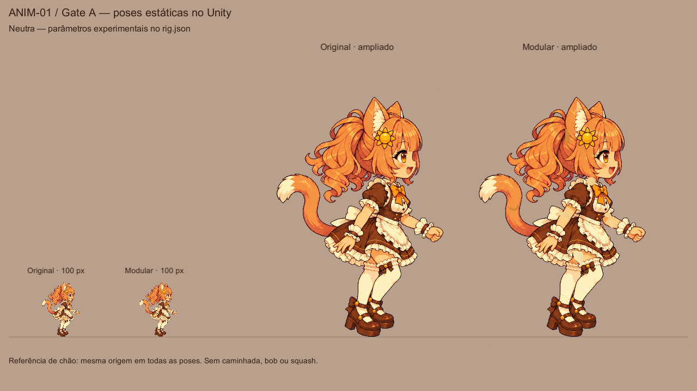

# ANIM-01 / Gate A — kit modular lateral da Mina

**Recomendação: precisa de correções; Gate A NÃO aprovado. Não avançar ao Gate B.**

O kit preserva a identidade na pose neutra e demonstra articulação independente no
Unity, mas a reconstrução da saia e do sapato distante ainda falha quando as regiões
ocultas aparecem. Uma primeira montagem e uma rodada artística focada foram feitas.
A expansão foi interrompida no limite solicitado. Aprovação estética: responsável do produto.

Base confirmada no GitHub em 2026-10-29: PR #18 `c550e66`, ainda aberto, baseado no
PR #15 `747e677`, também aberto. Branch própria `experiment/anim-01-gate-a`, worktree
separado. Nenhum dos PRs anteriores foi modificado.

## Resultado para avaliação

Cada captura contém referência original e composição modular a aproximadamente
**100 px**, além das duas ampliadas. São renders reais em PlayMode, câmera Unity em
RenderTexture, não prévias produzidas pelo compositor Python. Ampliação: 440 px a
1280×720 e 350 px a 960×600. A escala é fixa por montagem, independente de seus bounds.



- Folha de poses [1280×720](captures/poses_1280x720.png) e [960×600](captures/poses_960x600.png),
  montadas por Pixels MCP a partir das capturas reais. As folhas possuem bordas e não
  têm as dimensões dos frames individuais.
- [Braços opostos](captures/opposite_arms_1280x720.png),
  [joelhos e cotovelos](captures/joint_flexion_960x600.png),
  [cabeça](captures/head_rotation_1280x720.png),
  [oclusão](captures/occlusion_1280x720.png).
- [Rodada de correção: primeira montagem acima, corrigida abaixo](captures/correction_round.png).
- Frames completos: sete poses × duas resoluções em `captures/`.
  A subpasta `initial/` preserva três frames válidos da primeira montagem.

## Findings finais

| ID | Classe | Evidência e efeito |
| --- | --- | --- |
| A1 | **blocking** | [Detalhe da saia](captures/finding_opposite_arms.png): o tecido sob o braço/mão mantém recortes e continuidade incorreta da barra. Os dois patches locais reduziram a lacuna, mas não recuperaram o contorno/sombreamento de forma aceitável. Também aparece na flexão e no teste de oclusão. |
| A2 | **blocking** | [Sapato distante exposto](captures/finding_far_leg_forward.png): o recorte original estava parcialmente oculto pelo outro pé. O calcanhar/lateral não está completo; mover a perna revela o corte. A pele do pé não substitui a reconstrução da peça de couro. |
| A3 | **important** | Caps de braços e transições de pernas apresentam diferenças de tom e linhas de corte em ampliação. As aproximações locais não demonstraram o acabamento suave da referência em todas as poses. |
| A4 | **important** | Separar os módulos não prova uma troca futura de roupa sem defeitos: a anatomia/tecido ocultos ainda precisam ser completados. Sakura e equipamento não foram implementados. |
| A5 | **important** | EditMode tem dois contratos documentais antigos falhando por importações, como a base. Não foram alterados nem ignorados. A lista de arquivos importados agora inclui o kit. |
| A6 | **optional** | A cauda usa dois segmentos e a massa traseira visível do cabelo um segmento. Maior flexibilidade só deve ser considerada se uma pose necessária comprovar limitação. |

Não há evidência para declarar a arquitetura inviável em geral. Há evidência suficiente
para rejeitar **este acabamento** no Gate A. O trabalho remanescente é localizado na
arte oculta, porém não foi resolvido dentro da rodada autorizada. Não substituí a Mina
por outra personagem, não criei dezenas de correções por pose e não escondi falhas com efeitos.

## Kit e contrato

[Inventário completo, hashes, hierarquia e pivôs](INVENTORY.md).

- Sete originais preservados byte a byte em `sources/` e inventariados em `sources.json`.
- `lado`, `costas`, `idle`, `walk` e `carry` correspondem aos hashes do processamento do PR #18.
- `v01_chibi_side_b_v2.png` é a fonte preferencial 1254×1254: pose lateral de repouso,
  mesma identidade, membros menos afastados. A versão traseira adicional é arquivada,
  mas não foi misturada silenciosamente à montagem.
- 29 sprites e 21 nós: cabeça com rosto/orelhas/franja/presilha solar permanente,
  cabelo traseiro articulável, cauda em dois segmentos, anatomia segmentada e roupa
  separada em vestido, corpete, avental, laço, mangas, punhos e ligas.
- Headwear e Accessory possuem sockets sem item equipado. Não existe sistema de skins.
- Coxa/canela/pé e braço/antebraço/mão têm Transforms próprios.
- O root tem chão fixo em `(650,1215)` na referência; PPU 1175.
- O recorte de cada textura, offset do sprite e pivô anatômico são explícitos.
  A hierarquia converte o eixo Y do original para Unity. Texturas não são recentralizadas.
- Ordem interna explícita, sem SortingGroup: as instâncias da prancha não se sobrepõem
  e não foi demonstrada necessidade do componente neste harness.
- Texturas sem compressão e mipmaps, Clamp/Bilinear. Nenhuma deformação de malha,
  IK, Sprite Skin, física, AnimationClip, pacote ou MCP novo.

Os PNGs completos antigos em `Resources/Mina` não foram alterados. O experimento não
é chamado por MaidView, MaidCard, Boot ou restaurante. A cena é temporária, criada por
código, sem novo `.unity` versionado. Não contém GameRoot, sessão, Maid ou acesso ao save.
O harness verifica a ausência de GameRoot. Não há integração de equipamentos.

## Produção e reprodução

`build_kit.py` é a receita específica desta fonte, não um gerador genérico de personagens.
O processamento remove o magenta como no PR #18, segmenta por polígonos e preserva
pixels de borda próximos. Não redimensiona as peças. Reconstrói caps ocultos com a
paleta local e copia duas pequenas regiões de tecido da própria referência.

`recipe.json` registra polígonos, caps, correções de propriedade da pele e patches.
`Assets/_Game/Resources/Anim01GateA/rig.json` é o contrato consumido pelo Unity,
incluindo hashes, recortes, pais, pivôs e as sete poses. Os parâmetros são experimentais.

No Python existente com Pillow 13.0.0 e NumPy 2.5.3:

```sh
python docs/art/anim-01/gate-a/build_kit.py
python docs/art/anim-01/gate-a/build_kit.py --check
```

No Editor 6000.5.9f1, `Neko > Experiments > ANIM-01 Gate A preview` monta a pose neutra
em uma cena vazia. Recusa trocar uma cena que tenha alterações não salvas.
As sete poses são executadas automaticamente pelo capturador explícito.

Para reprodução automatizada, primeiro usar o lock/process detection de
`tools/unity-guard.sh` e confirmar também processos Windows com
`tools/unity-editor-processes.py` executado no Python Windows. Não iniciar outro Editor.
Definir as variáveis **no ambiente Windows que inicia Unity**:

```powershell
$env:NEKO_ISOLATED_SAVE = '1'
$env:NEKO_GATE_A_OUTPUT = '<caminho absoluto de saída>'
& '<Unity 6000.5.9f1>/Editor/Unity.exe' -batchmode -projectPath '<worktree>' -executeMethod Neko.Game.View.MinaKitGateAHarness.Begin -logFile '<log absoluto>'
```

Não passar `-quit` nem `-nographics`. `Begin` aguarda callbacks de startup antes de
entrar em PlayMode. O capturador descarta doze renders reais do alvo por frame aceito.
As saídas incluem PNG, JSON de Transforms/poses e `result.txt`; código de saída 0
significa captura concluída, **não** aprovação do Gate A.

## Verificação executada

| Etapa | Resultado |
| --- | --- |
| Implementado | Kit, dados, importação, harness e poses estáticas. Sem caminhada/cosméticos/restaurante. |
| Compilado | Unity 6000.5.9f1 Windows; captura final com saída 0. |
| Configurado | Importação somente dos assets novos; mesmos pacotes e cenas existentes. |
| Integridade do kit | **Passou:** sete hashes de fontes, 29 peças, dimensões e pais do contrato. |
| Reprodução completa | **Passou:** todos os PNGs e o rig.json foram reconstruídos byte a byte idênticos. |
| Neko.Sim | **Passou 257/257**, build standalone pelo SDK instalado e NUnitLite. |
| EditMode completo | **Falhou: 315/317**. Apenas `DocsTests.NoTextureOrAudioFileWasEverImported` e `DocsTests.TheReadmeStatesThatNoAssetWasImported`. |
| Testes novos do kit | **Passaram 4/4:** pais/peças, articulação sem mudar escala/comprimentos, reset/serialização e reconstrução da instância. |
| PlayMode existente | **Passou 20/20**, runner protegido com save isolado. |
| Cena e serialização | 14 capturas reais; 14 snapshots de Transforms; JSON round-trip e reassembly testados. Não há referências de cena persistidas no contrato. |
| Avaliação visual | Inspecionadas as sete poses. **Não aprovada:** A1/A2 permanecem. |
| WebGL / 60 FPS / caminhada | **Não executados**; fora desta produção Gate A. Capturas estáticas não provam esses requisitos. |

Resultados, hashes e casos falhos: [validation.json](evidence/validation.json).
Logs e XML completos permanecem em `Logs/`, fora do Git. Captura final em
`Logs/anim01/final-editor.log`; testes em `Logs/tests-EditMode.xml`,
`Logs/tests-PlayMode.xml` e `Logs/anim01/sim.xml`.

Pixels MCP foi usado de fato para comparação em fundo comum, folhas e detalhes.
[Chamadas e respostas](evidence/pixels-mcp.json). A diferença neutra em canvas completo
foi 0,58% dos pixels acima de 2%, erro médio 0,22/255. A grande área de fundo pesa nessa
medida; ela não certifica identidade, juntas ou regiões ocultas.

## Limitações operacionais e segurança da execução

- Node padrão da sessão: 18.19.1, incapaz de executar diretamente os servidores TS.
  Pixels foi conectado pelo SDK MCP com Node Windows 22.15.0, type stripping e um
  resolvedor temporário em memória para `@pocketslop/core`. Nenhuma instalação/configuração
  persistente foi feita. O script de chamadas ficou em `/tmp`.
- Variáveis WSL não chegaram automaticamente ao Unity Windows na primeira tentativa.
  A invocação final as definiu no processo Windows. A tentativa recusada não é evidência visual.
- Duas tentativas iniciais encontraram uma exceção de startup interna a Unity Search.
  Aguardar os callbacks antes de PlayMode resolveu a corrida observada; não foi adicionado
  filtro para ocultar erros. As capturas finais não apresentaram exceções da aplicação.
- O primeiro render offscreen de 1280×720 da montagem inicial teve bindings de textura
  incorretos e foi descartado. Não está nas evidências aceitas. A captura final aquece
  o próprio alvo e todos os frames finais foram inspecionados.
- EditMode/PlayMode usaram `tools/run-tests.sh`, sem alteração, com uma ponte temporária
  `/tmp/anim01-unity-editor` apenas para caminhos e ambiente Windows. O runner manteve
  seu guard e sua validação. Mensagens nativas de licença e warnings antigos de APIs
  obsoletas permanecem nos logs; isso não é declaração de Console universalmente limpo.
- O Editor reserializou o URP global no worktree de validação. Essa alteração automática
  foi excluída da entrega; o checkout original, inclusive sua alteração URP, foi preservado.
- Novos testes são permitidos pelo guard vigente. Nenhum teste existente, CI, runner,
  pacote, configuração, cena ou arquivo de Neko.Sim/EquipmentCatalog/SaveCodec foi alterado.
- Não houve serviço pago, geração externa, instalação, merge, publicação ou Gate B.
