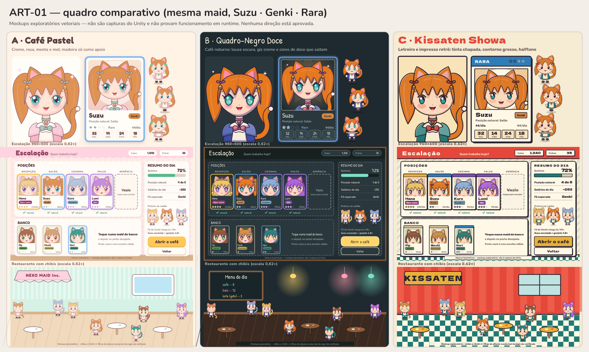

# ART-01 — três direções visuais para aprovação

**Estado:** as três direções (A, B e C) estão **`PROPOSED`** — **nenhuma está aprovada** e a **ART-02 permanece bloqueada**. Aguarda decisão explícita do responsável (ver [Decisão](#decisão-necessária)). Nenhuma biblioteca visual deve ser expandida até lá.
**Tarefa:** [ART-01](../../roadmap/ART-01_STYLE.md). **Decisão fixa neste experimento:** [Portrait + Chibi](../MAID_VISUAL_DECISION.md) (ACCEPTED). A stack de produção segue **aberta**.

> **Isto é mockup exploratório, não captura do Unity.** Tudo foi desenhado como vetor por um gerador determinístico (pasta [`generator/`](generator)) e rasterizado para PNG. Nada aqui prova que a direção funciona no runtime, em WebGL ou com a pipeline final de arte. Nenhum arquivo do jogo (`Palette.cs`, cenas, UI, GDD) foi alterado.

## O brief único (igual nas três propostas)
**Suzu** — personagem original, arquétipo **Genki** (GDD §2.6), raridade **Rara**, posição natural **Salão**. Gêmeas altas, orelhas e cauda de gato ruivas (ponta creme), olhos verde-água, sino dourado no pescoço e nos laços. Cada proposta mostra o mesmo conjunto de peças de identidade em **retrato**, **chibi** (5 poses: idle, andar ×2, carregar, cansada), **card composto** e **tela de Escalação 960×600**. Outras seis maids originais (Hana, Kuro, Lumi, Pip, Mochi, Nori) aparecem **só** na tela de Escalação/restaurante para dar hierarquia realista; não são designs propostos.

## Quadro comparativo


## Arquivos de prévia
| Direção | Identidade retrato↔chibi | Card + raridade | Escalação 960×600 | Restaurante (chibis) | Style tile (cores, botões, contraste) |
| --- | --- | --- | --- | --- | --- |
| **A · Café Pastel** | [png](A-cafe-pastel/identidade-retrato-chibi.png) | [png](A-cafe-pastel/card-e-raridade.png) | [png](A-cafe-pastel/escalacao-960x600.png) | [png](A-cafe-pastel/restaurante-960x420.png) | [png](A-cafe-pastel/style-tile.png) |
| **B · Quadro-Negro Doce** | [png](B-quadro-negro/identidade-retrato-chibi.png) | [png](B-quadro-negro/card-e-raridade.png) | [png](B-quadro-negro/escalacao-960x600.png) | [png](B-quadro-negro/restaurante-960x420.png) | [png](B-quadro-negro/style-tile.png) |
| **C · Kissaten Showa** | [png](C-kissaten-showa/identidade-retrato-chibi.png) | [png](C-kissaten-showa/card-e-raridade.png) | [png](C-kissaten-showa/escalacao-960x600.png) | [png](C-kissaten-showa/restaurante-960x420.png) | [png](C-kissaten-showa/style-tile.png) |

Em todas, **moldura, nome, arquétipo, raridade e atributos do card são texto/UI nativos**, fora da imagem do retrato. A cor de moldura por raridade segue o GDD §2.8 (bege · azul · violeta · dourado) e as cores de arquétipo são as de `Palette.cs`; raridade também é codificada por **número de gemas** (1–4), para não depender só de matiz.

## As direções
### A · Café Pastel — creme, rosa, menta e mel; madeira como apoio
Hipótese do ART-01 levada a sério: fundo xadrez creme/rosa, painéis claros e arredondados, sombras suaves, botão primário mel. Madeira só no piso/balcão. Retrato com contorno rosa-cacau fino, sombreado **suave** (gradiente/blur) e olhos grandes e glossy.
- **Vantagens:** maior apelo "moe"/colecionável imediato; maior continuidade com o café claro atual (Palette.cs já é creme).
- **Riscos:** tudo é claro e pastel, então planos (fundo/painel/plate) e o chibi se separam pouco — o cabelo da Suzu contra o piso mede 1,8:1 e só o contorno segura; molduras de raridade medem 1,7–2,7:1 contra o painel e Comum×Lendária ficam parecidas sem as gemas/brilhos; sombreado suave é a técnica mais cara de manter coerente quando peças são trocadas.

### B · Quadro-Negro Doce — lousa escura, giz creme, cores de doce
Outra solução com coerência de café: um café noturno com cardápio de giz. Fundo e painéis escuros com borda tracejada de giz, madeira só como moldura da tela, cores saturadas de doce como destaque. Retrato com contorno ameixa, sombreado **cel** (sombra dura), olhos estrela.
- **Vantagens:** as personagens são a coisa mais clara da tela; maior separação de planos; raridade lê melhor (brilho + gemas, 4,8–8,3:1 contra o painel); texto, texto fraco e botão de destaque passam AA (alarme/painel fica em 4,4:1, quase).
- **Riscos:** muda o clima do produto (de café aconchegante diurno para noturno) — é a maior ruptura com a identidade atual; fonte manuscrita de título (Patrick Hand) perde legibilidade em tamanhos pequenos; menos "doce" no conjunto.

### C · Kissaten Showa — letreiro e impresso retrô
Cor chapada, contorno grosso de tinta, halftone no lugar de sombreado, deslocamento de impressão (misregistro), painéis com sombra dura e piso xadrez. Reaproveita o tema `Showa` que já existe no jogo.
- **Vantagens:** identidade mais própria/memorável; chibi com contorno grosso lê bem pequeno; chapado + halftone é o mais barato e previsível de produzir por camadas (sem blur/gradiente, tolera pequeno desalinhamento entre peças); texto 14,3:1 no painel.
- **Riscos:** menos "fofo" e mais gráfico; contorno grosso + padrões podem poluir telas densas (Elenco, Loja — não testadas); o cabelo da Suzu contra a parede vermelha mede 1,3:1 (só o contorno segura); a fonte larga de título estourou uma linha no mockup (corrigido encurtando o texto) — risco real para textos longos em pt-BR; molduras Comum/Lendária medem 1,8:1 contra o painel (a faixa de cabeçalho e as gemas carregam a leitura).

## Quadro crítico (avaliação do agente — **não é aprovação**)
| Critério | A · Pastel | B · Quadro-Negro | C · Showa |
| --- | --- | --- | --- |
| Fofura / apelo | **Alto** — olhos glossy, sombreado suave | Alto — mais "estiloso" que doce | Médio — charme de mascote retrô |
| Identidade retrato↔chibi | Alto (olhos simplificam bem) | Alto (estrela vira ponto de brilho) | **Alto** — olhos/halftone são os mais fáceis de transferir |
| Legibilidade em 960×600 | Média — texto ok, mas planos e chibi com pouco contraste | **Alta** — melhor separação medida | Alta no texto; média no chibi sobre fundos quentes |
| Qualidade de UI | Coesa e doce; planos pouco separados | Planos claros; clima noturno | Mais forte graficamente; risco de ruído |
| Distinção de raridade | Média — depende de gemas/brilho | **Alta** | Média-alta — faixa + gemas |
| Viabilidade de produção modular por IA | Menor (gradiente/blur por camada) | Média (sombra dura exige luz consistente por peça) | **Maior** (chapado + halftone) |
| Continuidade com a identidade atual | **Maior** | Menor | Média (tema Showa já existe) |

Não há um vencedor único: **A** ganha em apelo e continuidade; **B** em legibilidade e raridade; **C** em custo de produção e identidade própria. A escolha depende de qual critério você quer priorizar; a coluna "produção" é inferência, não medida.

### Medições (reproduzíveis com `generator/metrics.mjs`, razão de contraste WCAG)
| Par | A | B | C |
| --- | --- | --- | --- |
| texto / painel | 9,4 | 10,5 | 14,3 |
| texto fraco / painel | 5,7 | 5,9 | 6,0 |
| texto do botão de destaque / destaque | 6,2 | 11,4 | 7,7 |
| alarme / painel | 3,2 | 4,4 | 3,7 |
| cabelo da Suzu / piso (parede) | 1,8 (2,3) | 4,6 (5,0) | 1,7–2,9 xadrez (1,3 parede) |
| molduras de raridade / painel (mín.–máx.) | 1,7–2,7 | 4,8–8,3 | 1,8–5,7 |

Na primeira passada, A tinha texto fraco a 4,2:1 (abaixo de AA); foi escurecido para 5,7:1 antes de gerar os arquivos finais.

## O que **não** foi testado
- Nada rodou no Unity/URP/WebGL; sem captura real, sem runtime, sem teste de build. O tamanho do chibi (≈ 90 px a 0,62×) é uma **suposição**; a escala real de `MaidView` não foi verificada.
- Retrato e chibi foram **desenhados por código como vetor paramétrico**. Isso não demonstra que PNG gerado por IA, SDF ou 2D Animation alcançará a mesma qualidade nem a mesma modularidade — essa decisão segue aberta (ART-02).
- Animação: só poses estáticas. Sem teste de sobreposição de camadas, recorte, atlas ou custo de troca de uma peça em pipeline real.
- Só 7 maids originais (5 arquétipos) foram desenhadas; os nove arquétipos do GDD não estão todos representados. Clientes, mobília, Loja, Elenco, Caixas, Salão, Balanço e Menu não foram mockados.
- Acessibilidade além de contraste (daltonismo, tamanho mínimo de toque) não avaliada; textos longos em pt-BR e renderização de fonte do Unity (TMP) diferem do rasterizador usado aqui.

## Origem, licenças e reprodução
- Todas as imagens foram geradas por código neste PR (Claude Code, modelo Sonnet 5.5); **nenhuma imagem externa, referência de franquia ou asset de terceiros**. Personagens e nomes são originais.
- **Fontes usadas só nas prévias** (instaladas via pacotes npm `@expo-google-fonts/*`, fora do repositório; licenças conferidas nos arquivos `LICENSE_FONT` dos pacotes). **Nenhuma fonte ou asset é incorporado ao jogo nesta etapa**; antes de qualquer uso no build é preciso revisar embutimento/TMP:

  | Fonte | Uso na prévia | Direitos autorais | Licença |
  | --- | --- | --- | --- |
  | Fredoka | títulos (A) | © 2016 The Fredoka Project Authors | SIL OFL 1.1 |
  | Nunito | corpo (A, B) | © 2014 The Nunito Project Authors | SIL OFL 1.1 |
  | Patrick Hand | títulos (B) | © 2010–2012 Patrick Wagesreiter | SIL OFL 1.1 |
  | Dela Gothic One | títulos (C) | © 2020 The Dela Gothic Project Authors | SIL OFL 1.1 |
  | Rubik | corpo (C) | © 2015 The Rubik Project Authors | SIL OFL 1.1 |

- Rasterizador de prévia: `@resvg/resvg-js` (MPL-2.0), usado apenas como ferramenta; não entra no repositório nem no build.
- Para regenerar (Node ≥ 18, fora do repositório):
  ```bash
  mkdir /tmp/art01 && cd /tmp/art01 && npm init -y
  npm i @resvg/resvg-js @expo-google-fonts/{fredoka,nunito,patrick-hand,dela-gothic-one,rubik}
  cd <repo>/docs/art/art-01/generator
  RESVG_PATH=/tmp/art01/node_modules/@resvg/resvg-js/index.js \
  FONTS_DIR=/tmp/art01/node_modules/@expo-google-fonts \
  node main.mjs <repo>/docs/art/art-01
  ```
  A saída é determinística: mesma entrada, mesmos PNGs.
- Estes arquivos são prévias e **não entram no build** do Unity (ficam em `docs/`, fora de `Assets/`).

## Decisão necessária
Marque no PR/comentário (nenhuma edição de imagem ou programação é pedida a você; só avaliar o resultado):
> Prioridade estética declarada pelo responsável: jogo **extremamente fofo, cativante e agradável de colecionar**. A direção A parece promissora pela descrição, mas **isso não é uma aprovação** — a decisão vem depois de comparar as imagens.

- [ ] Aprovar **A · Café Pastel**
- [ ] Aprovar **B · Quadro-Negro Doce**
- [ ] Aprovar **C · Kissaten Showa**
- [ ] Combinar (diga quais elementos, p.ex. paleta de A com raridade de B)
- [ ] Pedir **iteração** (diga o que mudar: mais fofo, mais contraste, outra paleta…)
- [ ] **Rejeitar** todas

**Gate para ART-02:** só após decisão explícita registrar a referência aprovada (`style_anchor` = caminhos acima) e, se a direção alterar materialmente a identidade do produto, atualizar a documentação de arte/GDD em PR próprio. Merge deste PR **não** equivale a aprovação estética.
