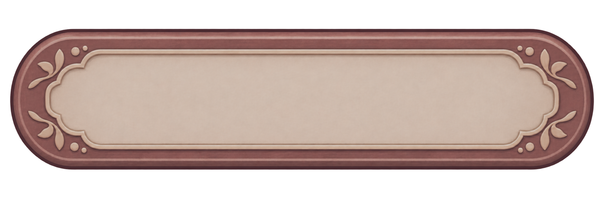
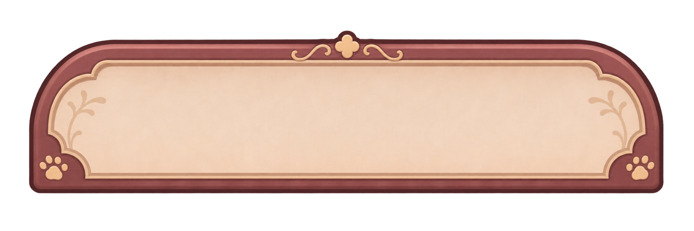
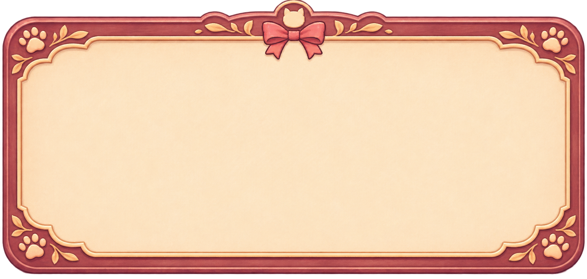
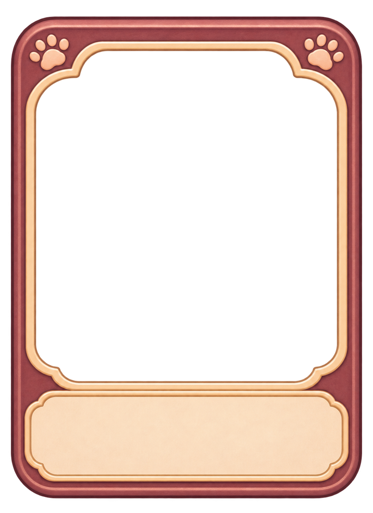
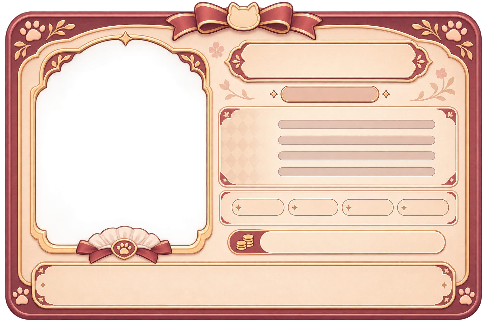
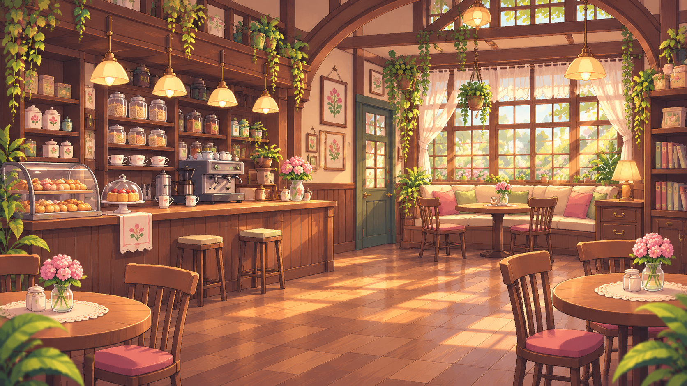
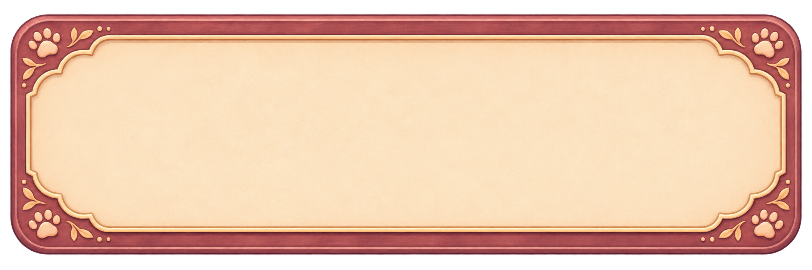
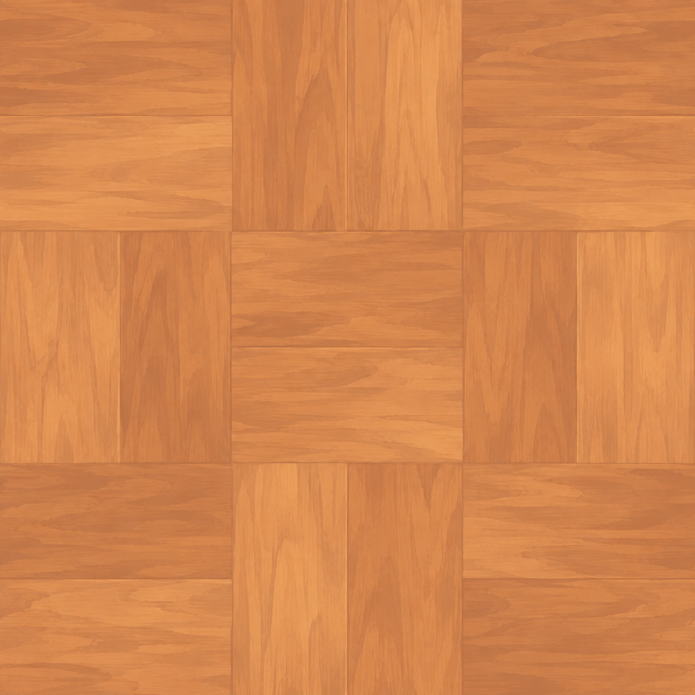
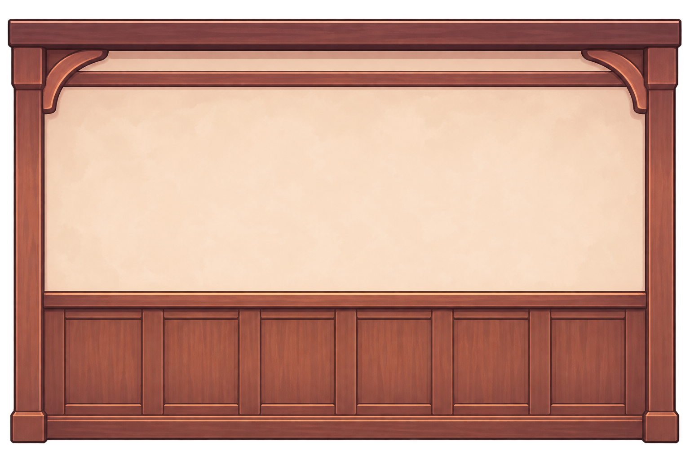
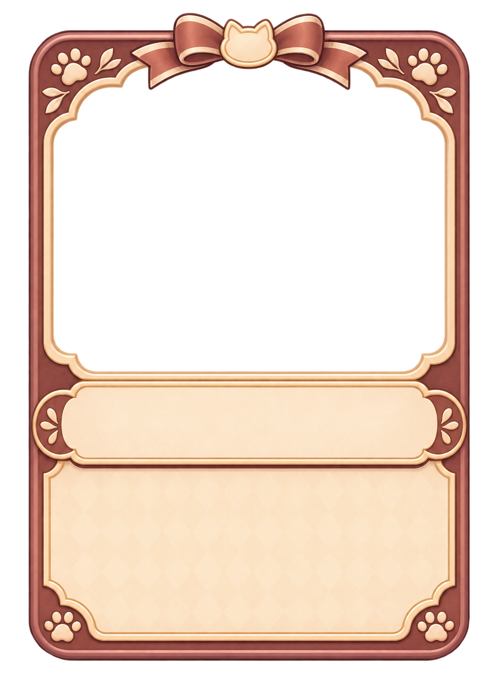

# Revisão visual individual — lote BATCH-2026-11-04

**PR #47: aberta para revisão do responsável, sem auto-merge.** Nove candidatos têm PASS técnico restrito e três v01 continuam REWORK. **Nenhum dos 12 está APPROVED ou INTEGRATED.** Copiar PNG para `incoming/` não constitui aprovação artística. Editor/WebGL abaixo são os resultados existentes; não foram repetidos neste handoff.

Cada miniatura abre o PNG CLEAN individual completo. As prévias usam os mesmos arquivos; não foram geradas novas imagens ou reamostragens. Para inspeção de alpha no GitHub, abra o PNG e use fundo contrastante/download quando necessário. Não confundir o CLEAN master com o export reduzido testado.

[Proveniência e hashes SHA-256 integrais](PROVENANCE.json) · [Relatório de QA](../../reviews/UI_BATCH_NEW_2026_11_04.md) · [Handoff Claude Code](../../HANDOFF_CLAUDE_CODE_2026_11_04.md).

| Prévia CLEAN (abrir individual) | Nome / arquivo | Estado e restrições | Export testado / RAW histórico |
| --- | --- | --- | --- |
|  | [UI-005_button_secondary_normal_v01.png](UI-005_button_secondary_normal_v01.png) | **PASS restrito**; aprovação PENDING. NORMAL; 120×44 Voltar, 150×44 Cancelar, 180×50 Detalhes, 230×54 Continuar; demais estados PENDING. | [Export](exports/UI-005_button_secondary_normal_v01.png) |
|  | [UI-006_tab_inactive_v01.png](UI-006_tab_inactive_v01.png) | **PASS restrito**; aprovação PENDING. Somente INACTIVE, Simple/preserveAspect em 210×44/54; em 210×44 arte ocupa ≈167u de largura dentro do hitbox 210u. Flor central não homologada para 9-slice; ACTIVE/HOVER PENDING. | [Export](exports/UI-006_tab_inactive_v01.png) |
|  | [UI-007_modal_dialog_v01.png](UI-007_modal_dialog_v01.png) | **REWORK**; aprovação PENDING. Silhueta superior cortada pelo canvas: 42 pixels opacos no limite y=0. Reenviar fonte não cortada ou regenerar com margem; não reconstruída. | [Export](exports/UI-007_modal_dialog_v01.png) · [RAW REWORK](raw/UI-007_modal_dialog_v01.png) |
|  | [UI-008_maid_card_lineup_minimal_v01.png](UI-008_maid_card_lineup_minimal_v01.png) | **PASS restrito**; aprovação PENDING. LINEUP MINIMAL: PASS técnico em 150×206 e 0,62× (93×127,72), Suzu real/nome curto dinâmico. Nome pequeno/mais pesado no WebGL exige avaliação artística; nomes longos/outros portraits/tela inteira NOT RUN. | [Export](exports/UI-008_maid_card_lineup_minimal_v01.png) |
|  | [UI-009_maid_card_detail_v01.png](UI-009_maid_card_detail_v01.png) | **REWORK**; aprovação PENDING. Barras, sinais + e moedas pintados em áreas de dados; contradizem símbolos/dados separados Unity. Render diagnóstico não aprova composição. | [Export](exports/UI-009_maid_card_detail_v01.png) · [RAW REWORK](raw/UI-009_maid_card_detail_v01.png) |
|  | [UI-010_rarity_badge_common_v01.png](UI-010_rarity_badge_common_v01.png) | **PASS restrito**; aprovação PENDING. Somente COMMON, Simple; 52,8×30,72 / 70,4×40,96 / 96,8×56,32. Outras raridades PENDING. | [Export](exports/UI-010_rarity_badge_common_v01.png) |
|  | [UI-011_icon_book_v01.png](UI-011_icon_book_v01.png) | **PASS restrito**; aprovação PENDING. BOOK: PASS restrito de silhueta em 32–44u; 24u foi renderizado, mas detalhes internos perdem leitura. Preferir 32–44u; simplificação depende do responsável se 24u for obrigatório. Demais ícones PENDING. | [Export](exports/UI-011_icon_book_v01.png) |
|  | [UI-012_menu_background_v01.png](UI-012_menu_background_v01.png) | **PASS restrito**; aprovação PENDING. Background uniforme cover em 16:9 e 16:10; crop central sem esticar. Overlays de teste não são layout aprovado; contraste/tela final dependem de composição. | [Export](UI-012_menu_background_v01.png) (mesmos bytes do CLEAN) |
|  | [UI-019_dialog_panel_v01.png](UI-019_dialog_panel_v01.png) | **PASS restrito**; aprovação PENDING. PANEL, Sliced em 1000×170, texto multiline dinâmico; TAIL e outros contextos PENDING/NOT RUN. | [Export](exports/UI-019_dialog_panel_v01.png) |
|  | [UI-022_floor_tile_warm_oak_v01.png](UI-022_floor_tile_warm_oak_v01.png) | **REWORK**; aprovação PENDING. Repetição não seamless: MAE bordas X=3,437/Y=7,097 versus vizinhos 1,439/1,485; seam Y≈4,78× baseline. Não mesclado/recolorido. | [Export](UI-022_floor_tile_warm_oak_v01.png) (mesmos bytes do CLEAN) · [RAW REWORK](UI-022_floor_tile_warm_oak_v01.png) |
|  | [UI-023_wall_straight_v01.png](UI-023_wall_straight_v01.png) | **PASS render isolado**; aprovação PENDING. STRAIGHT, dois segmentos Simple; encaixe no grid, perspectiva/câmera/sorting de produção NOT RUN. Outras paredes PENDING. | [Export](exports/UI-023_wall_straight_v01.png) |
|  | [UI-025_rarity_card_frame_common_v01.png](UI-025_rarity_card_frame_common_v01.png) | **PASS restrito**; aprovação PENDING. COMMON, Simple em 150×206, janela/máscara própria; IoU 97,44% contra janela da UI-008 detalhada, sem certificação de SpriteSwap direto. Outras raridades PENDING. | [Export](exports/UI-025_rarity_card_frame_common_v01.png) |

## Arquivos compartilhados, sem perda da fonte

- UI-012: o export testado é idêntico ao CLEAN, portanto o link de export aponta para o mesmo PNG.
- UI-022 v01: RAW = CLEAN = export byte a byte. O master versionado preserva também o RAW original para os anexos da v02; não é necessário um segundo arquivo em `raw/`.
- UI-007/UI-009 v01: seus RAWs diferem dos CLEANs e estão versionados individualmente em `raw/`.
- Resultado: **12 CLEAN masters + 10 exports distintos + 2 RAWs distintos = 24 PNGs únicos**. O manifesto identifica todos os papéis, caminhos locais originais, bytes, dimensões, hashes, operações e configuração Unity já testada.

## Versões e próximo aceite

UI-007/UI-009/UI-022 v01 permanecem REWORK. Os [prompts corrigidos da PR #48](https://github.com/NThuesen/jogos_digitais_2D/pull/48) geram **novos v02 PENDING**, não substituem/renomeiam v01. UI-009 v02 é opcional: a UI-008 existente já tem aceite detalhado restrito a 150×206.

A Maid Card detalhada existente continua aprovada somente em 150×206, REWORK em 0,62×. A LINEUP MINIMAL desta pasta é outra apresentação: possui QA técnico em 0,62×, mas sua aprovação artística permanece PENDING; nome pequeno no WebGL exige revisão. Não reutilizar uma decisão como aprovação da outra.

Os [contact sheets e capturas do QA](../../reviews/evidence/BATCH-NEW-2026-11-04/README.md) permanecem intactos. Esta publicação não integra assets em `Assets/` ou telas definitivas. Fontes RAW/CLEAN/exports locais não foram movidas, apagadas ou sobrescritas.

## Verificação de integridade do handoff

[Resultado e escopo](HANDOFF_VALIDATION.json) · [verificador somente leitura](VERIFY_HANDOFF.py.txt). O script usa os worktrees/caminhos locais declarados no topo; conferir ou ajustar esses caminhos em outro ambiente. Lê CRC, dimensões, bytes, SHA-256, links e diff, sem abrir Unity, reprocessar imagens ou gerar builds. SHA-256 integrais de cada papel estão em `PROVENANCE.json`.
