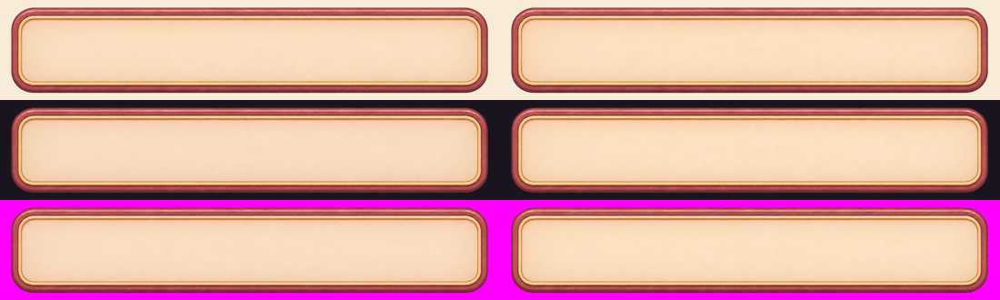
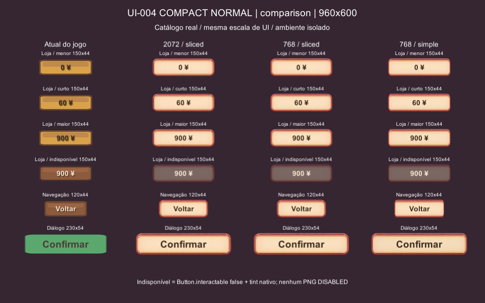
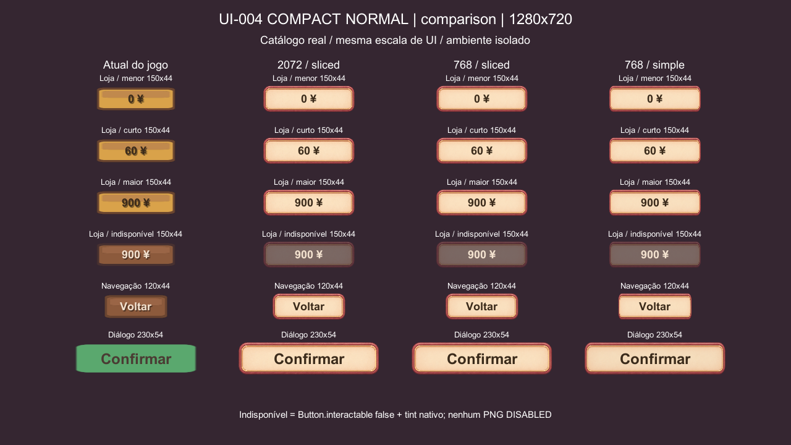
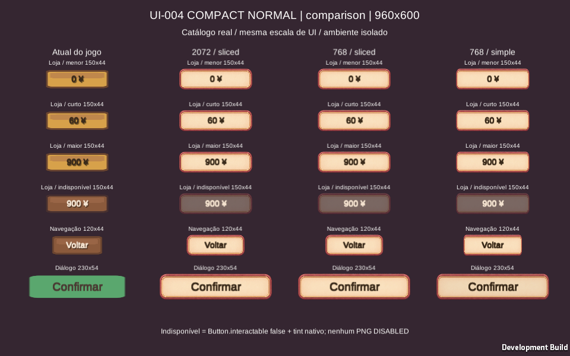
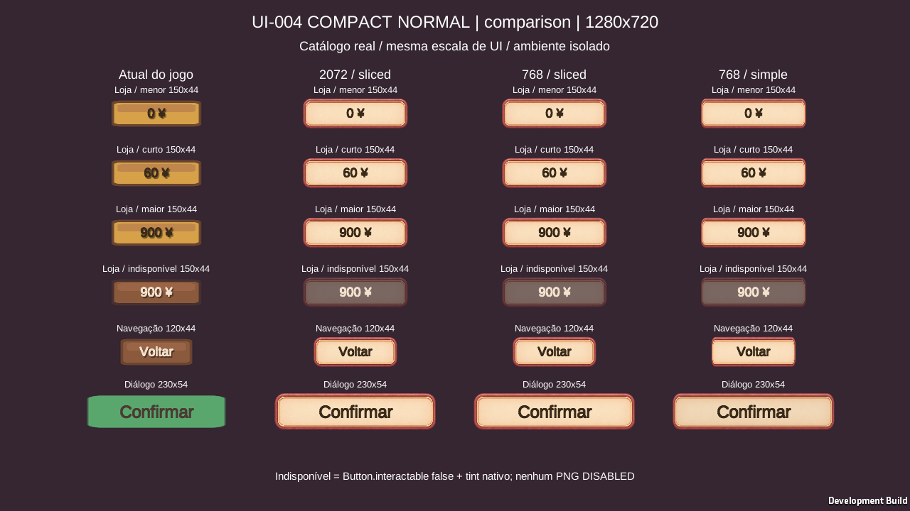

# UI-004 COMPACT NORMAL v01 — limpeza e QA

**Estado: UNITY_QA, aguardando decisão do responsável. Veredito técnico: PASS na configuração Sliced e nos casos Unity Editor e WebGL isolado descritos abaixo. Veredito visual do Codex: recomendar aprovação do NORMAL compacto, sob a configuração e os limites testados. Isso não constitui APPROVED nem INTEGRATED.** O ornamental anterior continua REWORK; são variantes distintas.

O compacto mantém moldura, superfície creme e texto legíveis em **150×44**, **120×44** e **230×54**, em **960×600 e 1280×720**. As capturas mostram o componente atual e o candidato na mesma escala. Não houve substituição de telas, UiKit, Scenery.Plank, lógica de compra ou save. Somente NORMAL foi produzido manualmente pelo responsável; esta tarefa não gerou arte.

Base: `origin/main` **5ed04af5a6ae911f695fac6051b49b94167045b9**, incluindo o [prompt compacto](../prompts/variants/04_BUTTON_PRIMARY_COMPACT_NORMAL.md) da PR #41 e a [decisão de duas famílias](../../CURRENT_VISUAL_DIRECTION.md). Branch `qa/ui-004-compact-normal`. QA em 03/11/2026, Unity **6000.5.9f1**, Windows. Crítica visual feita pelo Codex, conforme instrução específica do responsável nesta tarefa.

## 1. Bruto e limpeza reproduzível

| Dado | RAW preservado | Limpo local |
| --- | --- | --- |
| Nome | `UI-004_button_primary_compact_normal_v01.png` | mesmo nome |
| Diretório | `art_working/ui_modular/raw_gpt/` | `art_working/ui_modular/blender_clean/` |
| Dimensões | **2172×724 RGBA 8 bits** | **2072×380 RGBA 8 bits** |
| Bytes | 1.093.825 | 908.246 |
| SHA-256 | `72deadbfffbda54e1a6fc0a91a192916a42c7db91a9bc3cb769d9a80676e64b0` | `c82d06142b3953a97b9654d8b7bf53e611679a6ffb4822a3b268dff239c17eb6` |

**A preliminar 2048×682 não corresponde ao arquivo local efetivo.** A região alpha≥5 medida é x59–2113 / y176–544, coordenadas inclusivas. O corpo opaco alpha>128 é x62–2110 / y177–543: **2049×367**, proporção **5,58:1**, mais larga que os ~3,4:1 propostos no prompt. Esta diferença geométrica é acomodada pelo slice; não foi corrigida deformando ou redesenhando o master.

Auditoria em [analysis.json](evidence/UI-004-COMPACT/analysis.json), reprodução em [clean_compact.py.txt](evidence/UI-004-COMPACT/clean_compact.py.txt), Python/Pillow/NumPy/SciPy. Bboxes do JSON usam limite superior exclusivo.

- Alpha real: 815.854 pixels alpha 0 (51,88% do canvas); **681.995 em alpha253** (43,37%); 81 já em 255. Histogramas completos no JSON. Centro creme amostrado em x500–1499/y280–399: alpha mínimo 252, RGB mediano≈250/224/191; superfície a preservar.
- **775 componentes** alpha>0, vizinhança 4. Um corpo principal em x54–2121/y173–548; **774 resíduos desconectados**, somando **1.950 pixels**, alpha máximo3. Estes não são o creme nem a borda contínua.
- Remoção apenas dos 1.950 pixels desconectados →alpha 0; nenhum pixel conectado com alpha<250 foi alterado. Alpha≥250→255 em **736.036 pixels efetivamente alterados**; o centro fica sólido sem mexer em RGB. Os 81 pixels já 255 ficam iguais.
- **Recorte [52,171,2124,551)** no RAW: remove somente margens exteriores, conserva o corpo conectado inteiro e **2 px transparentes de segurança** em cada extremo do bounding box. Não houve resize do master, quantização, reconstrução de sombra, desenho ou alteração deliberada de cores. **RGB idêntico em todo o retângulo retido.** Nenhum pixel não transparente remanescente é cortado.
- Limpo: **1 componente**, zero buracos na máscara do corpo alpha>128. No RAW, pixels de borda alpha20–249 têm RGB médio≈120/50/54, zero com luminância>200. Inspeção clara/escura/magenta não mostrou halo claro ou chroma externo. Resíduos de alpha baixo ligados ao contorno foram preservados como parte da suavização, em vez de aplicar threshold global.

Bruto e limpo abaixo usam **o mesmo recorte e escala visual**, RAW à esquerda/limpo à direita; fundos claro, escuro e magenta. Esta é uma composição de auditoria, não o PNG do asset para integração.

A alteração máxima por canal na composição, sem resize, foi≈4,06/255 no fundo claro, 3,12/255 no escuro e 4,25/255 no magenta; hashes do limpo idênticos após repetir o script.

O corpo visível ocupa agora ≈96,6% da altura do canvas limpo: em 44 u, ≈42,5 u visíveis, contra ≈22,3 u se o canvas RAW fosse reduzido diretamente para44 u. A margem de segurança fica fora da sombra/AA conectados; não houve perda visual observada. O original permanece intacto, local e ignorado.

## 2. Geometria, export e configuração Unity

Medições: [geometry.json](evidence/UI-004-COMPACT/geometry.json), [script](evidence/UI-004-COMPACT/geometry.py.txt). **Não foram reutilizados os borders do ornamental.**

O raio/transição das extremidades termina aproximadamente em x120 do limpo e na região simétrica da direita. Desvio RGB por coluna contra a mediana da faixa reta x500–1599: percentil95 cai de77 em x80 para17,7 em x100, 7,0 em x120 e5,0 em x160. Escolha conservadora: **L160/R160**, já dentro da banda reta. **B110/T110** guardam o raio vertical de aproximadamente 100 px e o relevo, deixando centro 1752×160 px. Passos de cor nas emendas x160/x1912: 1,03/1,36 contra medianas próximas1,10/1,13; nenhuma costura foi percebida nas capturas.

| Parâmetro | Configuração testada/recomendada |
| --- | --- |
| Mesh / sprite | `Sprite.Create`, **Full Rect**, pivot 0,5/0,5, PPU 100 |
| Image | **Sliced**, cor branca (preserva a paleta do PNG), alpha hit threshold0 |
| Bordas do master 2072×380 | **L160 / B110 / R160 / T110** |
| Candidata recomendada | **768×141**, derivada somente depois do recorte; ainda não aprovada |
| Bordas dessa candidata | **L59,305 / B40,816 / R59,305 / T40,816** px, fracionárias |
| Multiplier, altura44 | **141/44 = 3,204545** |
| Multiplier, altura54 | **141/54 = 2,611111** |
| Filtro / wrap | **Bilinear / Clamp** |
| Import da textura de QA | Uncompressed RGBA32, sem mipmaps, NPOT None, Max Size 4096 (inclui master 2072), Alpha Is Transparency, Read/Write false |
| Canvas | Screen Space Camera, referência 1280×720, MatchHeight 1, referencePixelsPerUnit 100 |
| Texto | fonte real `Typeface`, tamanho 18 na Loja/navegação; 24 em 230×54, centralizado |
| Cores de texto | disponível `#3A2A1A`; indisponível `Palette.Cream` (`#F4E3D0`), sem Shadow no candidato |

Regra de escala para qualquer candidata `(W,H)`: borders `(160W/2072,110H/380,160W/2072,110H/380)` e multiplier`H/alturaDoRect`. Assim, escala vertical e cantos são preservados; o trecho central absorve a diferença horizontal. Não foi homologado estiramento vertical com multiplier fixo. Importer final Sprite Single com esses valores exigirá revalidação na futura integração: nesta tarefa a textura foi importada e o sprite Full Rect criado em runtime.

Insets de texto testados no harness, a partir do RectTransform: horizontal`160×altura/380+4`, vertical`62×altura/380+1`. Área do texto ≈**104,95×27,64 u** em 150×44; **74,95×27,64 u** em 120×44; **176,53×34,38 u** em 230×54. Não são garantia para textos arbitrários/localizações futuras. Não foram acrescentados ícones ou fontes alternativas.

Alternativas renderizadas:

- **9-slice — PASS:** raio/cantos inteiros, faixas contínuas, centro sem ornamentos, boa superfície para preço. Recomendado para a família nas três dimensões.
- **Simple esticada — restrição visual:** texto cabe, mas a proporção dos cantos varia, especialmente em 120×44; não recomendar para uso modular.
- **Simple com preserveAspect — FAIL de dimensionamento visual:** mantém a proporção5,45:1 do limpo, porém em 120×44 desenha só≈120×22 u; a altura visual não acompanha a hitbox e “Voltar” toca/invade a moldura. O teste de slot textual sozinho passa, demonstrando por que a inspeção visual é necessária.

## 3. QA real Unity Editor

Reuso de **Scenery.Plank** real para preço/navegação e **UiKit.Button** real para o diálogo. No candidato, só as instâncias temporárias têm as camadas procedurais desativadas, sprite atribuído, cor branca, insets e texto ajustados. Nenhum método global foi modificado. Perfis descartáveis para compra/refusa; nenhum `GameSession.Touch`, save ou PlayerPrefs alterado. **Não é QA da Loja completa com scroll/máscaras nem integração final da tela**; são os componentes reais isolados e os dados/regras reais da compra.

`Shop.StockFor(10)` retornou 49 itens. Casos capturados: **0 ¥** (`outfit_basic`), **60 ¥** (`stool`), **900 ¥** (`koi_pond`), disponível/indisponível; todos formatados por **Strings.Money(item.Price)**. A faixa real vai de0 a900, sem separador de milhar; não foi inventado um preço maior e chamado de catálogo. Houve **1.176 verificações de fit**, varrendo os 49 rótulos nos componentes de 150×44 de todas as matrizes/resoluções.

| Caso / configuração recomendada | 960×600 | 1280×720 |
| --- | --- | --- |
| Loja150×44, 0/60/900 ¥, fonte18 | **PASS** — linha única, centro e margens livres | **PASS** — linha única, centro e margens livres |
| Loja150×44 indisponível | **PASS** — leitura em creme, tint e bloqueio nativos | **PASS** — leitura em creme, tint e bloqueio nativos |
| Navegação120×44, Voltar18 | **PASS** — frame reconhecível, sem quebra | **PASS** — frame e texto nítidos |
| Diálogo230×54, Confirmar24 | **PASS** — moldura e texto inteiros | **PASS** — espaço confortável e centro estável |

Canvas medido: **1152×720 u/escala0,833333** em 960×600; **1280×720 u/escala1** em 1280×720. Medidas de preferredWidth/Height, slot, linhas e fit por botão no [log](evidence/UI-004-COMPACT/unity_qa_log.txt). Nenhum texto recomendado quebra; nenhuma saída do slot ou corte de glyph foi observado. Por exemplo, a 960×600, Voltar mede48×19,2 em slot74,95×27,64 e Confirmar109,2×25,2 em slot176,53×34,38. O teste de geometria não foi usado como aprovação artística automática.

**Sequência simulada Unity:** GraphicRaycaster identifica o Button correto; ExecuteEvents envia pointerDown, pointerUp e pointerClick separadamente, verificando que callback só ocorre no clique elegível. **288 down +288 up +288 tentativas de clique**, sendo **48 bloqueadas por interactable=false**; **144 pontos externos** não atingem o botão. Duas amostras por botão (centro e x2% do rect), seis matrizes de24 componentes. **Não é mouse físico nem passagem pelo módulo de input real** nesse teste Editor. Punch do componente aguardado antes da captura.

`Shop.Buy` real também foi exercitado em perfil descartável: compra de koi_pond debitou900 e adicionou1 ao inventário; segunda tentativa sem dinheiro foi recusada sem nova mutação. A regra de compra permanece no jogo; callback dos botões da matriz é um contador de QA, não uma substituição dessa regra.

**Resultado final PlayMode: PASS, 1 harness/0 falhas** ([XML](evidence/UI-004-COMPACT/unity_results.xml)). A suíte completa do projeto não foi executada. Rodada inicial teve erro de compilação por método de rótulo ausente no harness temporário; corrigido sem tocar o jogo. Primeiras capturas revelaram texto indisponível escuro demais; corrigido no harness para creme e rodada final repetida com sucesso. Não houve dispensa de asserções ou mudança de testes existentes.

## 4. Capturas e crítica visual

Cada linha usa o mesmo tamanho/fontes. Coluna1 = jogo atual;2 = master limpo slice;3 = candidata768 slice;4 = candidata768 Simple. A composição de alpha e as screenshots são evidências, **não publicação do RAW/limpo/export como asset aprovado**.

Comparação de resolução (atual /1024/768/512) e alternativa preserveAspect, também inspecionadas nas duas resoluções:

| Evidência | 960×600 | 1280×720 |
| --- | --- | --- |
| Reduções após recorte | [matriz](evidence/UI-004-COMPACT/unity_samples_960x600.png) | [matriz](evidence/UI-004-COMPACT/unity_samples_1280x720.png) |
| PreserveAspect | [matriz](evidence/UI-004-COMPACT/unity_aspect_960x600.png) | [matriz](evidence/UI-004-COMPACT/unity_aspect_1280x720.png) |

**Crítica visual do Codex, baseada nos frames reais:**

| Critério | Parecer |
| --- | --- |
| Consistência com UI-001 | **PASS:** mesmo creme quente, rosewood/terracota e dourado discreto. A ausência de folhas/patinhas é apropriada à família compacta. |
| Texto e contraste | **PASS na configuração final:** conteúdo limpo e central; remover Shadow da instância candidata evita o aspecto borrado do preço atual. Sobre amostra creme de frame 1280, texto#3A2A1A tem contraste estimado≈10,8:1; amostra indisponível com texto creme≈4,24:1. Amostras pontuais, não certificação de toda a superfície. |
| Espessura da moldura | **PASS:** aproximadamente6–7 u de relevo/faixas no topo/base, sem microornamentos que se perdem. O contorno externo é fino, porém reconhecível a 960×600. |
| Silhueta e hitbox | **PASS:** retângulo arredondado estável; 2px de padding do master representam≈0,23 u por lado em 44 u. Corpo visual muito mais próximo da hitbox que o ornamental anterior. Hitbox continua retangular. |
| Cores | **PASS:** RGB do master retido integralmente; render branco sem multiplicar por Brass/Board. A diferença cromática contra a prancha atual é intencional ao novo candidato, não recoloração do PNG. |
| Escala/densidade | **PASS:** moldura sem filigranas, creme livre; deixa de exigir leitura de pequenos ornamentos para preservar identidade. |
| Aparência clicável | **Favorável:** superfície clara delimitada e relevo moderado; mais coesa com o painel ilustrado do que a prancha procedural. Avaliação visual, não teste com usuários. |
| Slice | **PASS:** cantos e faixas estáveis nos três tamanhos; alongamento da textura de papel discreto, sem emenda perceptível. |
| Comparação atual | O atual é funcional, mais largo visualmente que alto, com brilho/shadow marcados; o compacto tem superfície de preço mais limpa e maior ocupação do rect. Não exige reduzir fonte real. |
| Cozy anime / visual novel | **Favorável:** material quente ilustrado sem aspecto de pixel art; botão discreto em vez de placa ornamental. A composição final com a Loja ilustrada ainda não foi validada. |

## 5. Problemas classificados e correções

| Classe | Achado | Tratamento / limite |
| --- | --- | --- |
| Limpeza | Margens grandes e resíduos alpha≤3; interior quase opaco | Recorte conservador, resíduos desconectados removidos, alpha≥250 solidificado; RGB/sombra/AA conectados preservados. Resolvido. |
| Configuração Unity | Tint Brass/Board e Shadow da prancha não servem ao PNG creme | Ajuste apenas nas instâncias de QA: Image branca, texto escuro disponível/creme indisponível, Shadow removida. Não substituir globalmente o helper. |
| Configuração Unity | Texto escuro ilegível após disabled tint | Corrigido para creme, seguindo a intenção do componente atual; tint nativo apenas, sem criar textura DISABLED. |
| Dimensionamento | RAW contém grande vazio; preserveAspect deixa só≈22u de altura em 120×44 | Recortar antes de derivar resolução e usar slice. Preservar o RAW. |
| Arte intrínseca | Silhueta5,58:1 difere dos≈3,4:1 desejados no prompt | Aceitável nos casos medidos por redução do centro no slice; **não exigiu regeneração**. Se o responsável rejeitar materialidade/forma, reabrir decisão artística. |

Não foi identificado defeito intrínseco que obrigue regeneração para os três casos de NORMAL. A recomendação visual permanece sujeita à revisão do responsável.

## 6. Resolução e memória

Derivadas por Lanczos **depois** do recorte. A candidata768×141 é o equilíbrio recomendado: mantém a leitura do filete e do relevo nas duas resoluções e custa menos que1024/master.512×94 também funciona tecnicamente, mas suaviza mais a hierarquia dos filetes, especialmente no caso230×54; não escolher apenas pela menor memória. Não se aplica a resolução768×256 do ornamental: é outro asset e outro recorte.

| Textura | RGBA32 sem mipmaps (MiB, estimativa) | Quatro estados hipotéticos (MiB) | Profiler Editor, bytes reportados |
| --- | --- | --- | --- |
| RAW2172×724 | 5,999 | 23,995 | não importado |
| Master2072×380 | 3,004 | 12,014 | 6.558.464 |
|1024×188 |0,734 |2,938 |1.623.168 |
| **768×141** | **0,413** | **1,652** |958.592 |
|512×94 |0,184 |0,734 |455.808 |

Estimativa`W×H×4` não inclui overhead, alinhamento, cópias ou atlas. Valores `Profiler.GetRuntimeMemorySizeLong` do Editor excedem o payload simples mesmo com Read/Write false: **não são memória GPU residente do navegador**. Os quatro estados são projeção; nenhum deles foi gerado. Compressão de bloco/mipmaps e orçamento GPU final continuam pendentes.

## 7. WebGL isolado

**PASS no ambiente isolado testado**, sem publicação do jogo. Uma build Development local, Unity 6000.5.9f1, cena exclusiva de QA, foi aberta em **Chromium 153.0.8010.12 headless**, via localhost, viewports 960×600/1280×720 e deviceScaleFactor 1. Renderer: **ANGLE/Vulkan SwiftShader (software)**. O teste não certifica GPU física ou todos os navegadores desktop.

O [script de navegador](evidence/UI-004-COMPACT/browser_qa.py.txt) enviou mouse move/down/up reais do navegador automatizado ao canvas e ao **InputSystemUIInputModule da Unity**. São eventos de automação, **não mouse físico**. Em cada viewport, 24 botões testados: 20 habilitados acionaram callback somente após soltar; 4 desabilitados não acionaram. Total **48 tentativas, 40 callbacks e 8 bloqueios**; pointerDown não gerou clique, nenhum erro JavaScript de página e nenhuma falha de fit relatada. Diferente do teste Editor, esta rodada atravessa o módulo de input real do player.

Resultado detalhado, posições, rótulos, contadores, renderer e diagnósticos em [webgl_qa.json](evidence/UI-004-COMPACT/webgl_qa.json). Capturas reais inspecionadas:

A moldura mantém forma, cor e continuidade; preços, Voltar e Confirmar continuam sem quebra/clipping nos candidatos Sliced. A fonte ficou mais encorpada que no Editor, também no componente atual; permaneceu legível. Houve um **warning de shader FSR/Edge Adaptive Spatial Upsampling não suportado** no renderer software (passes de pós-processamento indisponíveis); não foi observado efeito na UI. Não ocultar esse aviso nem extrapolar o resultado para GPU física.

[Resumo da build](evidence/UI-004-COMPACT/webgl_build_summary.txt): Succeeded, 0 erros, 143.755.302 bytes, 9min25,8s. Esse tamanho é do **player de QA Development**, com recursos do projeto e quatro candidatas; não é custo do botão ou download de produção. Compressão de download foi desativada somente para servir localhost; compressão de textura também permaneceu desativada. Memória GPU residente, compressão de bloco/mipmaps e download final **NOT RUN**.

Ambiente temporário e build removidos após as capturas. Template/compressão restaurados em finally; a entrada de batching WebGL e o Burst WASM rastreado que a Unity gerou foram restaurados aos bytes iniciais. O diff final não inclui ProjectSettings, Data, Assets, testes ou workflows.

## 8. Reprodução, limites e decisão

Os scripts temporários de runtime/teste/Editor, comandos com a guarda de processos do projeto e script de navegador estão arquivados como texto em [evidence/UI-004-COMPACT](evidence/UI-004-COMPACT/). O ambiente temporário em Assets, seus PNGs/metas e a build foram removidos após o QA e não entram no PR. Originais e limpo permanecem em art_working ignorados. Capturas reais e [manifesto de hashes](evidence/UI-004-COMPACT/screenshot_manifest.json) acompanham a documentação. Não houve modificação de testes/CI/configuração/cenas protegidos no diff final.

**Decisão proposta: recomendar aprovação do NORMAL compacto somente para os casos medidos, sem marcar APPROVED. Estado registrado: UNITY_QA.** Cabe ao responsável aceitar limpeza/recorte, arte em escala real, candidata768×141, parâmetros e cores de texto funcionais. Somente após essa decisão planejar integração própria e outros estados. O ornamental permanece REWORK; UI-001 mantém seu histórico de aprovação; abas são independentes.

**NOT RUN:** mouse físico; qualidade/comportamento em telas finais (incluindo scroll/clipping da Loja completa), foco/teclado/gamepad, outros idiomas/textos/dimensões, compressão de bloco/mipmaps, medição GPU residente e download de produção, suítes completas EditMode/PlayMode e simulação (sem alteração de jogo), Android/APK/AAB. Nenhuma publicação, merge ou auto-merge autorizado nesta tarefa.
