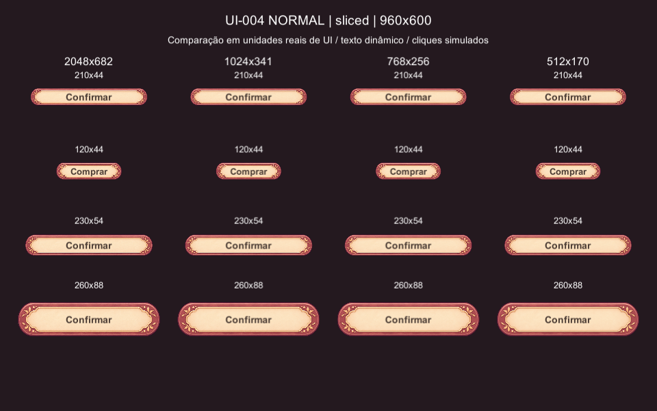
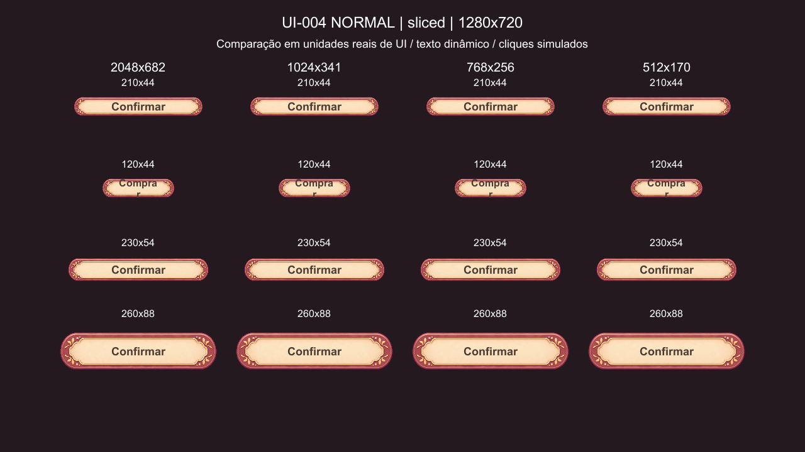

# Revisão técnica — UI-004 botão primário NORMAL v01

**Estado: REWORK; não APPROVED nem INTEGRATED. Recomendação: REWORK para os tamanhos atuais de botão.** A arte combina com o UI-001 e o slice funciona, mas a ornamentação perde leitura em 210×44 e 230×54; em 120×44 há também quebra de texto. O caso maior **260×88** preserva melhor folhas, bolinhas e relevo; seu eventual uso como CTA maior depende do responsável, sem alterar agora os layouts do jogo.

QA em 2026-11-03, Windows, **Unity 6000.5.9f1**, batch PlayMode com câmera → RenderTexture. Nenhuma tela, UiKit, cena, sistema, teste existente ou configuração de projeto foi alterada. Nenhuma imagem nova de arte ou outro estado foi gerado.

## 1. Proveniência e integridade

- Base: `main` local = `origin/main` após `git fetch origin`: `302bb9cf1cd57a2565a089ce8931add1a305b775`. Branch exclusiva: `qa/ui-004-primary-normal`.
- Bruto: `art_working/ui_modular/raw_gpt/UI-004_button_primary_normal_v01.png`, **1.487.500 bytes**, SHA-256 **`91466ecc77f6bb1d6b30540883961c5b1d0babbce7e3d9b83c9aef059e98f2bf`**. Conferido novamente após o QA: intacto.
- **A premissa 2048×682 não corresponde ao arquivo disponível nesta sessão:** medido **2172×724**, PNG RGBA 8 bits, proporção 3:1. A candidata 2048×682 foi derivada explicitamente; não foi apresentada como original. Não há outro bruto 2048×682 para preservar: o bruto real 2172×724 foi preservado.
- Referência artística: [UI-001 aprovado](../approved/UI-001_panel_large_v01.png); origem especificada no [prompt NORMAL](../prompts/variants/04_BUTTON_PRIMARY_NORMAL.md). Anexos efetivamente usados na geração original não são recuperáveis pelo PNG; não inferidos.
- Limpo: `art_working/ui_modular/blender_clean/UI-004_button_primary_normal_v01.png`, **2172×724**, **1.324.109 bytes**, SHA-256 **`03b58c3e2b500b8a48311cd3b3c75c8551c79d599693176ad5b5da664aeb0446`**.

## 2. Transparência e limpeza mínima

Medições e reprodução: [analysis.json](evidence/UI-004/analysis.json), [audit_alpha.py.txt](evidence/UI-004/audit_alpha.py.txt) (Python + Pillow/NumPy/SciPy; executar da cópia neste diretório).

| Medida | Bruto | Limpo |
| --- | --- | --- |
| Alpha | 0–255; 925.245 px em **253**, 2.529 já em 255 | 982.867 px em 255 |
| Componentes conexos alpha>0, vizinhança 4 | 457 | **1** |
| Fragmentos separados | 456 componentes, 1.094 px, alpha máximo **4** | removidos |
| RGB | original | **idêntico em todos os pixels** |
| Recorte / resize | nenhum | nenhum |

Operações: (1) alpha dos 1.094 px desconectados, todos ≤4, →0; (2) alpha≥250 →255 (980.338 pixels efetivamente alterados, além dos 2.529 já sólidos). **981.432 pixels de alpha alterados no total.** Nenhum pixel conectado com alpha<250 foi alterado. Não houve quantização, edição de desenho, preenchimento de buracos, alteração de sombra ou de antialiasing conectado. As reduções de teste, separadas do limpo, usam Lanczos RGBA do Pillow e naturalmente têm RGB reamostrado.

Bounding boxes inclusivos: bruto alpha>0 `(0,4)–(2139,691)`; corpo conectado `(36,99)–(2139,613)`; alpha>128 `(42,106)–(2129,603)`. Margens do corpo conectado: L36/R32/T99/B110 px; no corpo mais opaco: L42/R42/T106/B120. As margens consomem altura visível: a 44 u, o corpo alpha>128 mede aproximadamente **30,3 u** (25,2 px em 960×600); a 54 u, 37,1 u; a 88 u, 60,5 u. O centro visível está cerca de 7,5 px de origem acima do centro do PNG (≈0,46 u em altura 44), sem trim ou compensação aplicada.

Halos: composição inspecionada sobre creme, escuro e magenta em `alpha_before_after.png` (local). Pixels de borda alpha20–249 têm RGB médio ≈75,6/22,9/47,3; **zero** com luminância>200. Não foi observada franja clara/contaminação de fundo. O teste de fechamento da máscara alpha>128 encontra **zero buracos internos**. Os 4.013 vazios fechados pela máscara extremamente fraca alpha>0 pertencem à periferia semitransparente; não foram preenchidos. **PASS após limpeza.**

## 3. Geometria e slice

[Análise geométrica](evidence/UI-004/geometry.json) e [reprodução](evidence/UI-004/geometry.py.txt). Não foram usados os borders do UI-001.

As volutas/folhas e a transição para as bandas retas terminam aproximadamente em x360 e x1811. A comparação por coluna com a mediana da banda reta x700–1499 mostra desvio RGB no percentil 95 de ≈44,9 em x340, 9,1 em x360 e 5,7 em x400. O corte conservador **L400/R400** evita a transição ornamental. Passos de cor nas costuras x400/x1772: 1,05/0,93, contra medianas locais 1,07/1,02: sem salto anormal nessa medida; a inspeção Unity também não revelou ruptura das faixas.

**Borders de origem (L,B,R,T) = (400,360,400,360)**; centro = 1372×4 px. Topo/base guardam as metades completas das extremidades; a faixa vertical central de 4 px cruza a região média sem ornamentos. O teste mantém a escala vertical original e varia a largura: é um **uso predominantemente horizontal do 9-slice**, não evidência de estiramento vertical arbitrário.

Para cada textura derivada `(W,H)`, borders = `(400W/2172,360H/724,400W/2172,360H/724)`. PPU 100, canvas referencePixelsPerUnit 100, `Image.pixelsPerUnitMultiplier = H / alturaDoRect`. Assim, os ornamentos mantêm a proporção nas alturas testadas; apenas as bandas e o centro variam horizontalmente. Mudar a altura exige recalcular o multiplier, não apenas redimensionar o RectTransform.

| Textura | Borders L/B/R/T usados (px, aproximados) |
| --- | --- |
| 2172×724 | 400 / 360 / 400 / 360 |
| 2048×682 | 377,16 / 339,12 / 377,16 / 339,12 |
| 1024×341 | 188,58 / 169,56 / 188,58 / 169,56 |
| 768×256 | 141,44 / 127,29 / 141,44 / 127,29 |
| 512×170 | 94,29 / 84,53 / 94,29 / 84,53 |

Foram usadas bordas fracionárias por `Sprite.Create`, **Full Rect**, Bilinear/Clamp, RGBA32 sem mipmaps ou compressão. Não foi validado um TextureImporter final; ao integrar, manter NPOT sem reescala, mesh Full Rect, borders equivalentes e revalidar. Para 768×256 a 260×88: multiplier **2,909091**; inset horizontal seguro testado ≈51,62 u por lado (fim preservado +3 u), slot ≈156,76 u. Limite puramente geométrico da largura ≈97,24 u nessa altura; isso **não é um mínimo útil de texto**.

Alternativas realmente renderizadas:

- `Image.Type.Simple`, esticada: deforma horizontalmente as extremidades nas proporções largas; não recomendada.
- `Simple` com preserveAspect: preserva desenho, mas em 210×44 desenha apenas ≈132×44 dentro da hitbox 210×44, estreitando o creme sem adaptar a área de texto; não resolve o problema.
- 9-slice: mantém extremos e faixas contínuos nos quatro tamanhos. **PASS geométrico com restrição de escala**, sem resolver a perda de detalhe por tamanho final. Camadas independentes não foram construídas porque o slice já preservou a geometria.

## 4. Unity real e evidências

Harness isolado temporário, removido após execução; [fonte](evidence/UI-004/Ui004ButtonQa.cs.txt), [assembly](evidence/UI-004/Ui004.Qa.asmdef.txt), [comando com guarda](evidence/UI-004/run_qa.sh.txt), [log](evidence/UI-004/unity_qa_log.txt), [resultado final FAIL](evidence/UI-004/unity_results.xml). Reprodução: copiar fonte/assembly para `Assets/_QA_UI004_Temp/`, executar antes o script de alpha para criar candidatas, executar o comando arquivado (ajustando caminhos da máquina), depois remover apenas esse ambiente temporário. Não editar testes existentes.

Reuso de `UiKit.Button`, `UiKit.Label`, `SpriteFactory` e do método câmera/RenderTexture usado pelo Layout_Check e UI-001. Canvas Screen Space Camera, 1280×720, MatchHeight=1. Confirmado: **1152×720 u, escala 0,833333 em 960×600; 1280×720 u, escala 1 em 1280×720**. Textos dinâmicos “Confirmar”/“Comprar”, fonte do jogo; tamanho 18, exceto Comprar 16, mais comparação com Body 24. Texto centralizado pelo TextAnchor.MiddleCenter; quebra de linha também preserva esse alinhamento, sem torná-la aceitável.

Dimensões reais conferidas: `ShopScreen.cs` 210×44 (abas), `HubScreen.cs`/`HallScreen.cs`/`ShopScreen.cs` etc. 120×44 (voltar), `UiRoot.cs` 230×54 (diálogo); `DayHud.cs` 56×44 (velocidade/pular), fora da família avaliada. O 120×44 com “Comprar” é um stress test autorizado, não alegação de que esse texto já esteja nesse botão do jogo. Loja usa também compra 150×44, não renderizada nesta rodada.

**Duas capturas reais das matrizes 9-slice estão versionadas abaixo**, com publicação autorizada pelo responsável no fechamento da PR #40. São cópias byte a byte das capturas originais; dimensões e SHA-256 conferem com as entradas `unity_sliced_*` do [manifesto de origem](evidence/UI-004/local_png_manifest.json). Este fechamento apenas publica evidências existentes: não houve nova execução Unity ou build. O bruto, o limpo e as texturas reduzidas do botão permanecem locais/ignorados; nenhum deles é publicado como asset aprovado.

960×600 — matriz 9-slice (colunas 2048/1024/768/512; linhas 210×44,120×44,230×54,260×88):

1280×720 — mesma matriz, inclusive a quebra em 120×44:

Diretório local: `art_working/ui_modular/export_unity/UI-004_QA/`. As outras oito capturas permanecem locais/ignoradas e são `unity_{stretch,aspect,default24,original}_{960x600,1280x720}.png`; `original` substitui a primeira coluna por 2172×724 limpo, sem redução. Comparações inspecionadas em ambas as resoluções, inclusive o original real.

| Caso | 960×600 | 1280×720 |
| --- | --- | --- |
| 210×44, Confirmar 18 | texto legível; ornamentação minúscula, contorno pontilhado pela minificação | texto legível; ornamentos ainda pouco distinguíveis |
| 120×44, Comprar 16 | cabe nesta rasterização; ornamentos sem boa leitura | **FAIL**: largura preferida67 >slot≈65,2–65,4, quebra “Compra”/“r” |
| 230×54, Confirmar 18 | texto legível; folhas/bolinhas comprimidas perceptualmente pela escala | texto legível, mais detalhe; ainda insuficiente para aprovar a identidade ornamental nos dois alvos |
| 260×88, Confirmar 18 | folhas e bolinhas reconhecíveis, leitura boa | melhor leitura e relevo; Body 24 também legível neste tamanho |
| Body 24 nos tamanhos menores | texto ocupa/invade moldura, margem vertical ruim | mesma restrição; não é substituição direta da UI atual |

Interação: 10 matrizes ×16 botões ×2 pontos = **320/320 cliques simulados**, centro e x=2% do rect; **160/160 pontos externos** rejeitados pelo botão. Teste por `GraphicRaycaster` + `ExecuteEvents.pointerClickHandler`; **não mouse físico**, não valida a sequência completa pointerDown/up, foco/navegação ou hover. `Button.onClick` real chamado, callback contado, punch do UiKit aguardado antes da captura. A hitbox é retangular e inclui margem transparente: previsível, mas não coincide exatamente com o corpo visível. Texto não bloqueia raycasts.

O log “PASS [matriz]” significa somente canvas/hitboxes/cliques nessa matriz. **O teste final é FAIL**, com quatro violações de largura em 120×44 a 1280×720, uma por candidata. As falhas foram acumuladas e assertadas ao final para não impedir as capturas seguintes; não foram dispensadas. Rodadas anteriores: [fonte18 reprovada](evidence/UI-004/unity_initial_failure.xml) e [limite fonte16](evidence/UI-004/unity_font16_limit.xml). Nenhum teste/CI existente foi alterado ou enfraquecido.

Contraste/percepção: texto escuro `Palette.Text` sobre creme claro é legível nos casos sem quebra; a superfície com borda/relevo parece clicável, avaliação visual. Não foi medida razão de contraste por pixel nem realizado teste com usuários. Legibilidade de texto não equivale à aprovação dos ornamentos.

## 5. Resolução e memória

Estimativas **RGBA32 sem mipmaps**, `W×H×4`, sem compressão de bloco, atlas, overhead ou cópia CPU. Não são medições de memória residente WebGL; Read/Write e upload podem elevar o custo real. Quatro estados são apenas projeção: nenhum HOVER/PRESSED/DISABLED foi produzido.

| Textura | MiB / textura | MiB / 4 estados | Comparação no tamanho real |
| --- | --- | --- | --- |
| **2172×724 original** | 5,999 | 23,995 | preservado; detalhe de origem não torna o ornamento legível em altura44 |
| 2048×682 | 5,328 | 21,312 | praticamente a mesma percepção; minificação forte sem mipmaps |
| 1024×341 | 1,332 | 5,328 | mantém detalhes; não houve ganho decisivo sobre768 nos tamanhos avaliados |
| **768×256 candidata recomendada** | **0,750** | **3,000** | conserva folhas/relevo do caso260×88, suaviza minificação, reserva mais amostras que512 |
| 512×170 | 0,332 | 1,328 | suaviza mais; bolinhas, linhas finas e textura de papel ficam mais fundidas no caso maior |

**Resolução candidata, ainda não aprovada: 768×256, somente para o botão ornamental grande (~260×88)**, sem trim, com leitura favorável no caso testado **260×88**, Bilinear/Clamp, sem mipmaps, RGBA32, borders fracionários acima, PPU 100/multiplier2,909091, texto18 com insets seguros. Body 24 foi renderizado no caso maior, mas novos textos precisam de medição de largura e margens próprias. Não recomendar automaticamente512 pelo custo: o objetivo é preservar a identidade ornamental, já fragilizada em tamanho pequeno. Reduções continuam candidatas; o limpo integral e o bruto são conservados. 2048/2172 podem servir de masters, sem justificar sua memória em runtime nesses tamanhos.

**Compressão de textura e execução WebGL não foram validadas (NOT RUN). A candidata 768×256 não se aplica automaticamente à família compacta proposta nem às abas.**

Comparação visual qualitativa em frames Unity, não experimento de acuidade/SSIM ou benchmark. Um teste futuro de mipmaps/compressão pode mudar a escolha; nenhuma configuração dessas foi aprovada nesta tarefa.

## 6. Decisão e pendências

| Eixo | Resultado | Evidência / limite |
| --- | --- | --- |
| A. Arte e consistência | **PASS** | Rosewood/terracota, creme, dourado, folhas/bolinhas e relevo coerentes com UI-001; julgamento visual, direção geral já aceita pelo responsável. Sem patinhas nesta peça. |
| B. Transparência | **PASS** | Um componente após limpeza, RGB intacto, bordas conectadas preservadas, sem halo claro observado. |
| C. Modularidade/9-slice | **PASS** | Extremos preservados e faixas contínuas; somente sob regra de escala vertical testada. |
| D. Leitura/interação Unity | **FAIL** | Interação simulada PASS em ambos os alvos; ornamentação insuficiente em 44–54 u e texto120×44 reprovado a 1280×720. Maior260×88 é a exceção favorável, não aprovação global. |
| E. Resolução/orçamento | **PASS** (proposta técnica) | 768×256, 0,75 MiB/3 MiB para quatro estados hipotéticos; custo residente e qualidade WebGL **NOT RUN**. |

**REWORK para homologação como botão principal nos tamanhos existentes.** O gargalo é o tamanho visível dos motivos e da superfície, não falta de pixels do master. Sem redesenhar agora, o responsável pode decidir restringir este asset ao CTA maior 260×88; isso exigiria aprovação explícita desse uso e nova tarefa para eventual integração. Não alterar layouts existentes para acomodá-lo nesta PR. Para44–54 u, discutir família mais simples/ornamentos adequados e/ou export com margens menores, sempre como candidato novo e QA próprio; um trim não foi aplicado nem validado. 56×44 não é alvo deste asset.

**Proposta de arquitetura ainda não aprovada — duas famílias de botões:**

- **Ornamental grande (~260×88):** possível uso restrito do UI-004 NORMAL v01, preservando motivos e relevo; candidata 768×256 exclusiva deste caso maior. Não é botão universal.
- **Compacto simplificado (altura 44–54):** família própria, a definir, com desenho menos denso e área útil para texto dinâmico. Não foi produzida, implementada ou validada nesta PR.

**Abas continuam sendo componentes próprios**, fora dessas duas famílias de botões; a linha 210×44 da matriz é evidência de escala, não aprovação para reutilizar o ornamental nas abas. A proposta depende de aprovação do responsável e não autoriza alteração de telas ou produção de novos estados.

Ainda depende do responsável: aceite da limpeza; aceitar ou retrabalhar a arte no tamanho real; aprovação da proposta de duas famílias e do possível uso restrito maior; candidata 768×256 e parâmetros finais; eventual publicação das demais capturas ou texturas do botão. Depois disso, aprovação formal e integração em PR própria. **Não avançar aos três estados restantes antes de resolver o NORMAL.**

**NOT RUN:** WebGL/build/navegador, memória GPU residente/download, compressão e mipmaps, mouse físico, navegação por teclado/foco, sequência pointerDown/up e estados visuais; integração em telas definitivas; alturas/larguras além das quatro testadas. EditMode/PlayMode completos e simulação não executados por não haver mudança no jogo; somente este harness PlayMode foi executado e falhou conforme registrado. Android/APK/AAB não executados, fora do escopo. Nenhum merge ou auto-merge solicitado.
