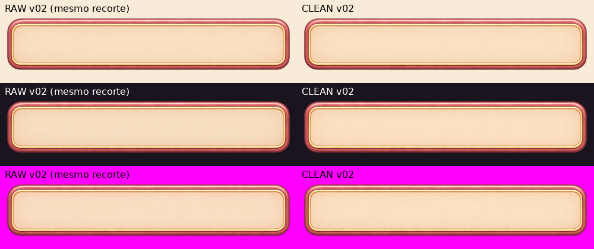
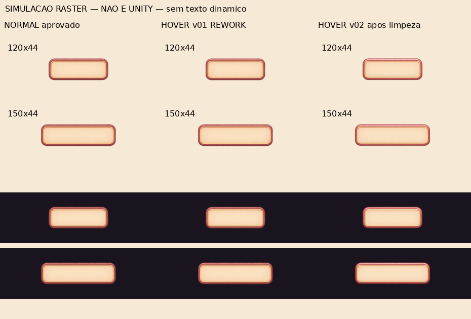
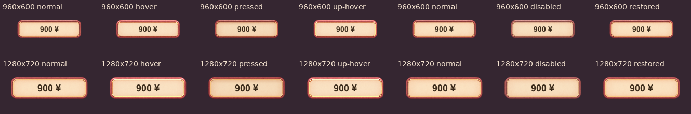
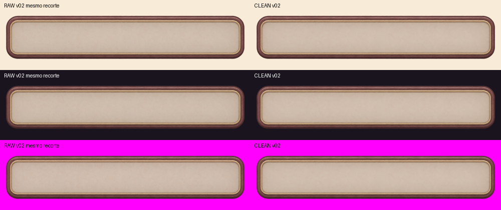

# Auditoria em lote — UI-002, UI-003, UI-008 e estados UI-004 COMPACT v01

**Escopo inicial (seções 1–7): arquivos PNG, limpeza conservadora e inspeção visual estática. Nenhum asset novo aprovado ou integrado.** As seções 8–11 acrescentam QA direcionado no Editor e uma build WebGL consolidada temporária. QA extensos anteriores não foram repetidos. UI-001 e UI-004 COMPACT NORMAL foram somente lidos como referências; seus arquivos e aprovações permanecem intactos. Não houve geração de arte, alteração de cenas/gameplay ou redesenho.

Base: `98688920fc6ea5595eadfb7becd8d07d6fe78302` (main remota, inclui prompts da PR #43); branch `qa/ui-modular-batch-six`. Inspeção em 03/11/2026. A skill de modificação segura e o fluxo branch→PR foram reaproveitados; nenhuma memória canônica alterada.

**Resultado atual (seções 9–11): HOVER v02/PRESSED v01/DISABLED v02/UI-002/UI-003 candidatos à aprovação, com limites; UI-008 REWORK para uso universal em 0,62×.** O lote v01 abaixo mantém seus resultados históricos, inclusive HOVER v01/DISABLED v01 REWORK. Nenhum novo asset aprovado.

## 1. Resultado consolidado — checkpoint estático histórico

`CLEAN` significa preparado para QA posterior, **não** aprovação artística ou validação Unity. Quando o RAW já tem alpha e padding adequados, não foi criada uma duplicata em blender_clean. Nenhum caso exigiu REJECTED: os arquivos são íntegros e não apresentam defeito irrecuperável demonstrado.

| Arquivo (nome sem .png) | RAW | Resultado em blender_clean | Classificação | Pronto para QA Unity? |
| --- | --- | --- | --- | --- |
| `UI-002_panel_medium_v01` | 1448×1086 | 1356×802 | **CLEAN** | Sim — painel, conteúdo creme e faixas preservados. |
| `UI-003_panel_small_label_v01` | 2172×724 | 2170×526 | **CLEAN** | Sim — label ornamentado; validar leitura pequena e limites de slice próprios. |
| `UI-008_maid_card_compact_v01` | 1070×1470 | 1070×1470 | **CLEAN** | Sim — janela transparente e zonas de texto sólidas; validar escala da card. |
| `UI-004_button_primary_compact_hover_v01` | 2048×375 | Não criado: RAW já tecnicamente limpo | **REWORK** | Não recomendado ainda — diferença de hover fraca no parecer estático. |
| `UI-004_button_primary_compact_pressed_v01` | 2048×375 | Não criado: RAW já tecnicamente limpo | **CLEAN** | Sim, condicionado ao export/import comum com NORMAL e teste da percepção de pressão. |
| `UI-004_button_primary_compact_disabled_v01` | 2048×375 | Não criado: RAW já tecnicamente limpo | **CLEAN** | Sim, condicionado ao export/import comum e teste combinado com texto/tint nativo. |

**RAWs preservados em** `art_working/ui_modular/raw_gpt/`; **apenas três limpos novos em** `art_working/ui_modular/blender_clean/`, com os mesmos basenames de UI-002/UI-003/UI-008. Todos continuam locais/ignorados. Este PR publica somente documentação, métricas e composições de evidência, não PNGs de produção aprovados.

## 2. Integridade, bytes e hashes

Todos os seis passaram `Pillow.verify()` e decodificação completa: **PNG RGBA8**, sem corrupção detectada. Hashes conferidos novamente após o processamento. Bboxes do JSON usam limites superiores exclusivos.

| Asset | Bytes RAW | SHA-256 RAW | Bytes CLEAN | SHA-256 CLEAN |
| --- | --- | --- | --- | --- |
| `UI-002_panel_medium_v01` | 1,463,362 | `a939d2bc990e56787fea85f0b543303ade489bddfbadb412a4c20a60a2288b16` | 1,228,521 | `00c44a34dca15be2cb61d994f05e32ec52775451bf80227bde5faa072683b2c9` |
| `UI-003_panel_small_label_v01` | 1,564,433 | `0775e22cfdfa766b25eafa68ec13cb819a961c5f63e6e02c367829bd80c1e3df` | 1,392,186 | `0a79225c60c61541f34c1d34f3d45f7e0685917d5d9c82cd19b9fec534b31a27` |
| `UI-008_maid_card_compact_v01` | 1,303,954 | `c849093964090779adc92a83f9880fcc0e72de 22622479f12b8917b733f118a2` | 1,138,752 | `74ea40f0b528580b4f809bd20a359bd1dbdacb02e4014f0d8ce0576676fb6342` |
| `UI-004_button_primary_compact_hover_v01` | 739,613 | `6c8dc92d2274419387301b7b1161920011032d9d0341256c935a694de718121c` | — | Não gerado / RAW inalterado |
| `UI-004_button_primary_compact_pressed_v01` | 745,104 | `291a26b50675ecce4670b77de3705a5f71a4eeffdf4d0b50734a58da910d038d` | — | Não gerado / RAW inalterado |
| `UI-004_button_primary_compact_disabled_v01` | 728,538 | `5ddb38f5275dfda5b95eb4ae73d06e9df468c5400310d20900e4c73df4e0cb60` | — | Não gerado / RAW inalterado |

Referências aprovadas, **somente leitura**:

- UI-001: `docs/art/ui-modular/approved/UI-001_panel_large_v01.png`, SHA-256 `ba300ece650f18e8ef4e938aa84e9c9df3146396dc82a91ba4551306a9ee85f8`. Autoridade de estilo dos painéis/card, sem copiar seus borders.
- UI-004 COMPACT NORMAL limpo: `art_working/ui_modular/blender_clean/UI-004_button_primary_compact_normal_v01.png`, **2072×380**, SHA-256 `c82d06142b3953a97b9654d8b7bf53e611679a6ffb4822a3b268dff239c17eb6`. **Única autoridade geométrica para HOVER/PRESSED/DISABLED.** Não foi usado o ornamental, o RAW maior ou o export reduzido como referência geométrica.

### Margens e conteúdo visível

Bboxes alpha≥5 em coordenadas RAW (x0/y0/x1/y1 exclusivo); margens L/T/R/B derivadas do canvas. Alpha1–4 é tratado separadamente no JSON e na limpeza, sem confundir essa névoa com o desenho principal.

| Asset | Bbox alpha≥5 | Margens RAW L/T/R/B (px) |
| --- | --- | --- |
| `UI-002_panel_medium_v01` | `[51, 146, 1391, 939]` | `[51, 146, 57, 147]` |
| `UI-003_panel_small_label_v01` | `[8, 98, 2164, 610]` | `[8, 98, 8, 114]` |
| `UI-008_maid_card_compact_v01` | `[62, 28, 1008, 1418]` | `[62, 28, 62, 52]` |
| `UI-004_button_primary_compact_hover_v01` | `[7, 4, 2038, 370]` | `[7, 4, 10, 5]` |
| `UI-004_button_primary_compact_pressed_v01` | `[7, 4, 2038, 370]` | `[7, 4, 10, 5]` |
| `UI-004_button_primary_compact_disabled_v01` | `[7, 4, 2038, 370]` | `[7, 4, 10, 5]` |

## 3. Limpeza e preservação

Método reaproveitado do compacto: [script reproduzível](evidence/BATCH-UI-002-003-008-004-STATES/audit_batch.py.txt), [dados completos/histogramas](evidence/BATCH-UI-002-003-008-004-STATES/analysis.json). Python + Pillow/NumPy/SciPy. Sem resize dos masters, quantização geral, preenchimento de fundo, edição de cores ou desenho.

A máscara de resíduos foi medida por componente e distância ao desenho alpha≥20: remover somente pixels alpha1–8 que (a) estejam em componentes separados e a mais de 2 px do desenho substancial ou (b) estejam a mais de 8 px desse desenho, inclusive névoa fraca conectada por resíduos. Distância euclidiana em pixels de origem. Isso preserva a banda próxima de AA/sombra; **não é threshold global de alpha**. Em seguida, alpha250–254→255 para corrigir o creme/superfície quase opaca. RGB permanece idêntico no recorte retido, inclusive nos pixels que ficaram transparentes.

| Asset | Alpha 253 no RAW | Resíduos removidos | Alpha250–254 solidificado | Transformação espacial |
| --- | --- | --- | --- | --- |
| UI-002 | 999,497 | 2,934 px (máximo alpha 1) | 1,039,574 px | crop [43, 142, 1399, 944]; padding adicional L/T/R/B [0, 0, 0, 0] |
| UI-003 | 919,797 | 735 px (máximo alpha 3) | 1,017,355 px | crop [4, 92, 2172, 618]; padding adicional L/T/R/B [0, 0, 2, 0] |
| UI-008 | 667,411 | 99,986 px (máximo alpha 7) | 736,727 px | crop [0, 0, 1070, 1470]; padding adicional L/T/R/B [0, 0, 0, 0] |

- **UI-002:** recorte das margens excessivas, sem perda do desenho/sombra remanescente; 2px transparentes em torno do conteúdo. Não há buracos internos no campo creme.
- **UI-003:** recorte vertical e lateral conservador; acrescentados **2px transparentes somente à direita**, porque uma franja alpha1 chegava ao limite do RAW. Nenhum pixel existente removido por esse padding; nenhuma reconstrução da borda. A linha externa final tem alpha0.
- **UI-008:** **canvas 1070×1470 preservado**, mantendo razão≈150:206 e as coordenadas relativas do portrait/textos. As margens externas não justificaram novo recorte. Resíduos fracos no exterior e na janela foram removidos sem apagar a moldura dourada ou as superfícies creme.
- **Estados UI-004:** superfície central já255, um componente e padding coerente. Os valores parciais próximos de 255 pertencem à borda interpolada; **nenhuma normalização de alpha, crop, resize ou recoloração foi aplicada** a esses arquivos. Eles não receberam CLEAN novo por falta de necessidade técnica.

Componentes alpha>0 antes/depois dos três frames: UI-002 706→20, UI-003 438→152, UI-008 2822→24. Permanecem 59/169/26 pixels desconectados, respectivamente, com alpha máximo 6/8/4, próximos ao desenho (UI-002/UI-003≤2px; UI-008≤7,62px). Foram preservados por conservadorismo de AA/sombra, não confundidos com ilhas opacas. Não há fragmentos soltos visíveis nas composições inspecionadas. A contagem bruta de componentes não é, isoladamente, critério de aprovação.

Halos: composições sobre creme, escuro e magenta inspecionadas. Nenhuma franja clara/chroma visível foi observada. UI-002/UI-003 e os estados têm zero pixels de borda alpha20–249 com luminância>200. UI-008 tem 23 pixels nessa condição, em tons quentes nos detalhes do laço/recorte dourado; não foi interpretado automaticamente como halo branco nem recolorido. A correção foi somente de alpha.

## 4. Arte, continuidade e áreas úteis

As três peças mantêm rosewood/terracota, dourado e creme coerentes com UI-001. UI-002 é deliberadamente mais simples; UI-003 tem folhas/bolinhas e centro livre; UI-008 retoma patinhas/laço sem portrait ou texto gravado. Faixas e contornos são contínuos na inspeção raster; nenhum rompimento opaco identificado. Borders de UI-002/UI-003 e comportamento de estiramento ainda devem ser medidos em QA próprio: não foram importados borders do painel grande.

| Área medida (coordenadas RAW, x0/y0/x1/y1 exclusivo) | Resultado |
| --- | --- |
| UI-002 creme `[150,260,1290,820)` | alpha252–254 no RAW, 255 após limpeza; RGB mediano≈252/227/191 preservado |
| UI-003 creme `[340,210,1830,505)` | alpha252–254 no RAW, 255 após limpeza; RGB mediano≈252/228/192 preservado |
| UI-008 portrait seguro `[200,210,850,700)` | 16.946 pixels alpha1–3 no RAW; **todos alpha0 no CLEAN**, sem preenchimento do recorte |
| UI-008 nome `[230,850,840,950)` | 61.000 pixels sólidos após limpeza; alpha255; RGB mediano252/225/195 |
| UI-008 stats `[170,1040,900,1260)` | 160.600 pixels sólidos após limpeza; alpha255; RGB mediano251/224/194 |

Para mapear essas amostras aos CLEANs: subtrair (43,142) no UI-002 e (4,92) no UI-003; o padding adicional à direita não desloca os pixels. UI-008 mantém as coordenadas originais. A card deve preservar proporções/ornamentos; não assumir 9-slice integral através do portrait e das duas zonas de texto.

O recorte grande do portrait tem bbox alpha≤128 fechada≈`[118,126,952,798)`, altura672px, perto de46% do canvas. A zona segura retangular é menor para evitar cantos/laço. Nome e stats continuam fundos opacos, não áreas a remover. Não há portrait/labels/valores impressos. Essas zonas são **amostras conservadoras de arquivo**, não insets de UI homologados.

Na escala do prompt de card 150×206, a zona segura de nome tem≈85,5×14u; em 0,62×,≈53×8,7u. A janela e os campos existem, porém a leitura dos ornamentos e de texto dinâmico nessa redução ainda exige QA Unity. Não redimensionei a arte para tentar certificar legibilidade por inspeção do master.

Composições RAW×CLEAN: mesmo recorte/escala nos dois lados, RAW à esquerda. O vazio do portrait deixa passar as três cores de fundo, enquanto nome/stats permanecem creme.

## 5. HOVER, PRESSED e DISABLED contra COMPACT NORMAL

Os três RAWs são **2048×375**, não o canvas 2072×380 do NORMAL. Todos têm exatamente a mesma máscara de alpha entre si; **715.993 pixels já255**, centro255 e um componente. Não há corte/offset diferente entre os três estados. A origem do redimensionamento não pode ser inferida apenas dos PNGs.

Para comparar dimensões diferentes, o NORMAL foi apenas reamostrado **em memória** para 2048×375. Nenhum NORMAL de produção foi regravado/reprocessado, nenhum export substituído. Em relação a essa referência normalizada:

- IoU da silhueta alpha>128: **99,9712%**; 209 pixels diferentes na máscara, erro máximo de contorno **1px**.
- Centroide: diferença≈**+0,0075px X/+0,0464px Y**; sem deslocamento visual relevante. Em altura 44, 1px de origem corresponde a≈0,117u.
- Razão de aspecto diverge≈**0,16%**; geometria suficientemente próxima para preparar QA, porém **não é igualdade pixel a pixel** ou conformidade literal com o canvas do prompt.
- Faixas retas, raios e área de texto preservados proporcionalmente, sem novos ornamentos. **Compatibilidade geométrica de slice: favorável**, não validada em Unity nesta tarefa.

Bordas proporcionais aos borders aprovados do NORMAL: **L158,1467/B108,5526/R158,1467/T108,5526** para 2048×375. Copiar literalmente 160/110 dos masters de dimensões diferentes seria incorreto. **Reutilizar o mesmo componente/configuração final exige export/import comum** (ex.: 768×141 com os borders aprovados), ou ajuste explícito de PPU/borders/multiplier por resolução. Nenhum export de estado ou `.meta` foi criado aqui; não tratar os RAWs como substituições diretas de master sem essa preparação.

| Estado | Centro: ΔY médio (0–255) | Contorno: ΔY médio | Saturação do contorno (range RGB médio) | Parecer |
| --- | --- | --- | --- | --- |
| HOVER | +0.006 | +3.944 | 84.17→84.39 | Centro mantido; realce coerente, mas fraco na simulação pequena. **REWORK visual** antes de homologar o feedback. |
| PRESSED | -5.995 | -7.844 | 84.17→85.70 | Face/contorno mais escuros sem mover a peça; diferença mais clara. **CLEAN**, testar sensação de pressão/interação depois. |
| DISABLED | -1.135 | +2.808 | 84.17→74.13 | Contorno menos saturado, creme sólido. **CLEAN**, testar percepção indisponível junto ao texto/tint do Button depois. |

ΔY é diferença de luminância codificada ponderada em RGB, **não ΔE perceptual, razão de contraste ou teste de usuário**. As regiões exatas estão no script/JSON. O HOVER deixa a face praticamente igual e muda o rim em≈+3,94/255; no parecer visual estático, o feedback é tímido em 120/150×44. Não foi fortalecido por recoloração: isso seria decisão artística fora da limpeza. PRESSED escurece moderadamente; DISABLED reduz o range cromático do rim em≈12%, sem tornar o centro translúcido. O DISABLED ainda parece uma superfície clara; a indisponibilidade funcional depende da combinação real com Button/texto e deve ser verificada no QA posterior.

**Simulação raster Python, não Unity**, sem texto, input ou shader, nos tamanhos 120×44/150×44/230×54. Arredondamento dos cortes de slice e filtro Bilinear aproximam somente a inspeção estática. As diferenças visuais são pareceres desta inspeção e não aprovação automática de nenhum estado.

Não foi feita troca de sprite em runtime, medição de percepção temporal ou teste de interação. O REWORK do HOVER é uma recomendação visual, reversível pela decisão do responsável; não prova falha funcional. A compatibilidade de silhueta não exige redesenho dos três estados.

## 6. Validação, pendências e entrega

- **PASS:** leitura/CRC/decodificação dos 6 PNGs; dimensões/bytes/hashes; histogramas; máscaras/componentes/margens; invariância RGB dos recortes; alpha do portrait/creme; hashes dos 6 RAWs e das referências após a execução; inspeção das composições e compatibilidade geométrica proporcional dos estados.
- **CLEAN:** UI-002, UI-003, UI-008, COMPACT PRESSED e COMPACT DISABLED; os dois últimos já estavam tecnicamente limpos no RAW. Preparados para **QA Unity posterior**, com as ressalvas descritas.
- **REWORK:** COMPACT HOVER, pela percepção fraca do realce nesta inspeção. Revisar intensidade com o responsável antes do QA final; sem regeneração/recoloração nesta tarefa.
- **NOT RUN por escopo:** Unity, WebGL, builds, testes de jogo/QA anteriores, UI real/textos/cliques/transições, compressão/memória GPU e homologação final de slice. Nenhuma evidência deste lote é screenshot Unity.
- **Preservado:** UI-001 e COMPACT NORMAL aprovados, ornamental REWORK, todos os RAWs e QA anterior. Não foram alterados gameplay, cenas, assets Unity, testes, workflows ou a main.
- **Gate:** responsável revisa classificações/limpeza e decide o próximo QA. Nenhum dos 6 recebe APPROVED/INTEGRATED. Uma única PR deste lote; sem merge/auto-merge.

O [manifesto das composições](evidence/BATCH-UI-002-003-008-004-STATES/evidence_manifest.json) registra paths/hashes. O script escreve somente três CLEANs e composições/métricas desta auditoria; não produz novos estados de arte. Dependências/versões e limites da reprodução no [README](evidence/BATCH-UI-002-003-008-004-STATES/README.md).

## 7. Adendo — UI-004 COMPACT HOVER v02

**Veredito: CLEAN, pronto para QA Unity direcionado; não APPROVED nem INTEGRATED.** A inspeção estática indica que v02 resolve o realce insuficiente de v01 em **120×44 e 150×44**. A borda fica mais luminosa, o creme continua discreto e não aparecem ornamentos novos ou uma nuvem de glow. **A geometria é próxima, porém não idêntica ao NORMAL:** preparar export/import comum e verificar a troca real de sprites antes de qualquer aprovação.

Somente v02 foi auditado/limpo nesta atualização. HOVER v01 permanece **REWORK**, como registro histórico. NORMAL limpo/aprovado foi a única referência geométrica; v01 serviu à comparação do realce. Nenhuma auditoria anterior, Unity, WebGL ou build foi repetida. Arquivos e evidências anteriores permanecem intactos.

### Arquivo e limpeza mínima

| Dado | RAW v02 preservado | CLEAN v02 local |
| --- | --- | --- |
| Caminho | `art_working/ui_modular/raw_gpt/UI-004_button_primary_compact_hover_v02.png` | `art_working/ui_modular/blender_clean/UI-004_button_primary_compact_hover_v02.png` |
| Dimensões / formato | **2172×724 RGBA8** | **2176×408 RGBA8** |
| Bytes | 1.205.847 | 1.006.994 |
| SHA-256 | `4beaadaf15870747b92f1bd8ea323d442e0b7e083d9ca8cba4e1730369ac6e6a` | `c47a56f4f1a83c12eb9a64644a38a9dba66a55cefbb2d15e7913f3f88000d45e` |

PNG íntegro/decodificado. RAW: bbox alpha≥5 `[0,161,2172,555)`; bbox alpha>128 `[8,162,2164,554)`; 280 componentes alpha>0, 682 pixels separados com alpha máximo 3. Centro em alpha253; 755.407 pixels nessa cobertura e apenas 10 já 255. Há grandes margens verticais; reduzir diretamente o canvas RAW não representaria o tamanho visual do botão.

Limpeza pelo mesmo critério conservador já documentado, **aplicado apenas ao v02**: removeu 985 pixels de resíduos (máximo alpha 3) separados/distantes do desenho e solidificou 824.139 pixels alpha250–254. **RGB retido idêntico; alpha9–249 inalterado; nenhum resize/recoloração/desenho.** Recorte `[0,157,2172,565)` e padding adicional **L2/T0/R2/B0**, para garantir exterior transparente inclusive nas laterais. A pequena expansão horizontal do CLEAN é padding, não largura desenhada nova.

Nas laterais do RAW, apenas alpha≤5/7 chegava ao canvas; o contorno opaco estava dentro do arquivo. O padding não reconstrói informação ausente. CLEAN: bbox alpha>0 `[2,2,2174,406)`, alpha>128 `[10,5,2166,397)`; zero buracos no corpo opaco. Permanecem 28 componentes/155 pixels fracos separados (alpha≤3), próximos à borda, preservados como AA/sombra conservadores. Zero pixels alpha20–249 de borda com luminância>200. Composições sobre claro, escuro e magenta não mostraram halo claro/chroma visível.

### Comparação de intensidade e identidade

Referências preservadas: NORMAL SHA-256 `c82d06142b3953a97b9654d8b7bf53e611679a6ffb4822a3b268dff239c17eb6`; HOVER v01 SHA-256 `6c8dc92d2274419387301b7b1161920011032d9d0341256c935a694de718121c`. Para separar margens do desenho, esta comparação usa **bbox alpha>128 normalizada apenas em memória para 2049×367**, com regiões de centro/rim iguais entre as três imagens. É um método comparativo específico deste adendo; **não substitui os números da auditoria v01**, que usava outro recorte/ROI.

| Comparação com NORMAL | ΔY médio no centro | ΔY médio no rim | Parecer estático |
| --- | --- | --- | --- |
| HOVER v01 | −0,002/255 | +3,260/255 | Feedback fraco; REWORK histórico mantido |
| HOVER v02 | +0,759/255 | **+10,202/255** | Realce do rim≈3,1 vezes maior que v01 nesta medida; visível nos dois tamanhos |

ΔY é amostra RGB ponderada, não ΔE/estudo perceptual. O centro v02 muda pouco: ΔRGB médio≈−0,56/+0,90/+3,22, MAE≈1,97/255. A intenção permanece creme quente/rosewood/dourado; o realce mais marcado está no relevo, não em símbolos novos. No parecer visual, **não é necessário aumentar novamente a intensidade antes de testar em Unity**.

### Silhueta, alinhamento e 9-slice

- Corpo opaco v02: 2156×392, razão 5,500; NORMAL: 2049×367, razão≈5,583. **Diferença de proporção do corpo≈−1,49%**, não corrigida deformando os pixels do master.
- Após normalizar somente as bboxes para diagnóstico: IoU≈**99,9184%**, maior distância de contorno≈**2,83px** na grade 2049×367. Essa normalização remove a diferença de proporções do diagnóstico; não significa identidade literal dos masters.
- Na **simulação raster de slice**, que usa os masters com padding e cortes proporcionais arredondados, o NORMAL e v02 têm 42px de altura visível em 44px. O v02 ocupa **1px a mais na largura visível**; centroide≈**+0,37px X**, diferença vertical<0,03px. IoU de máscara≈**99,24% em 120×44** e **99,39% em 150×44**. Os valores não são medidas Unity nem uma tolerância aprovada.
- Bandas horizontais e cantos permanecem contínuos; não foram observadas novas deformações grosseiras na simulação. Compatibilidade de 9-slice **favorável para QA**, com ressalva de alinhamento. **Não é substituição direta do master 2072×380** com metadados copiados literalmente.
- Borders proporcionais de investigação para CLEAN 2176×408: **L168,0309/B118,1053/R168,0309/T118,1053** (a partir do NORMAL L160/B110/R160/T110). São metadados candidatos, não homologados. Preparar um export/import comum com NORMAL, preservando cantos/faixas; não forçar um resize do canvas RAW nem considerar esses valores certificados em runtime.

**Recomendação objetiva:** seguir com v02 ao QA Unity de troca NORMAL↔HOVER nos dois tamanhos, com preço/texto real, sobre fundos claros/escuros. Confirmar percepção do hover, ausência de salto/piscada da silhueta e alinhamento após a preparação do export/import comum. Se o desvio pequeno observado aparecer em runtime, corrigir a normalização geométrica antes de aprovação; não redesenhar a peça nem reforçar novamente o brilho por antecipação.

**NOT RUN:** Unity/WebGL/builds, texto/hitbox/interação reais, transição temporal e QA anterior. **Não aprovado nem integrado.** RAW, NORMAL, v01 e todas as evidências anteriores preservados. [Dados/transformações](evidence/BATCH-UI-002-003-008-004-STATES/HOVER-v02/analysis.json), [script exclusivo v02](evidence/BATCH-UI-002-003-008-004-STATES/HOVER-v02/audit_hover_v02.py.txt), [classificação](evidence/BATCH-UI-002-003-008-004-STATES/HOVER-v02/classification.json), [hashes das composições](evidence/BATCH-UI-002-003-008-004-STATES/HOVER-v02/evidence_manifest.json).

## 8. QA Unity — estados COMPACT

**Resultado atual: HOVER v02 PASS; PRESSED v01 PASS; DISABLED v01 REWORK visual. Nenhum estado aprovado ou integrado.** O responsável pode avaliar a aprovação dos dois primeiros sob a configuração testada. O DISABLED precisa de feedback visual mais claro antes de aprovação. A auditoria estática anterior permanece como histórico.

### Export/import comum e geometria

O export NORMAL aprovado 768×141 foi copiado byte a byte, SHA-256 `e69e548a1d67a9e23b89b4f3849046f1720fe61db03c87c384fd9893c82388f6`. Nenhum RAW/CLEAN foi alterado. Os demais exports locais registram o corpo alpha>128 à bbox NORMAL [4,2,763,138). A escala dos cantos é uniforme em X/Y; somente a banda central horizontal absorve a diferença de proporção. Processamento premultiplicado, bicubic em 4× e redução Lanczos; sem recoloração ou substituição da máscara alpha. É preparação de candidatos, não novo master aprovado. Transformações, fontes e hashes integrais: [manifesto](evidence/BATCH-UI-002-003-008-004-STATES/UNITY-STATES/export_manifest.json).

Todos: Sprite Single/Full Rect, PPU100, borders L/R59,3050193 e B/T40,8157895, Bilinear/Clamp, RGBA32 sem compressão/mipmaps, Alpha Is Transparency, Image branca/Sliced; multiplier141/altura (3,204545 em44; 2,611111 em54). Quatro texturas custam aproximadamente1,652MiB RGBA32 sem mipmaps, estimativa teórica; memória GPU residente não medida. Os quatro corpos têm a mesma bbox; IoU contra NORMAL99,9207% HOVER e99,9325% PRESSED/DISABLED. Máscaras não são idênticas; desvio máximo do centroide≈0,062px na textura, inferior a0,024u no botão de54u.

### Execução e interação

Unity6000.5.9f1, Editor PlayMode, câmera/RenderTexture e CanvasScaler1280×720/MatchHeight1 reutilizando a metodologia anterior. Harness temporário isolado removido após execução; fontes arquivadas como texto. Native Button/SpriteSwap, Image de arte filha e hitbox transparente fixa; sem ColorTint adicional. UiKit.Label, Typeface, Strings.Money e catálogo real reutilizados. Nenhuma tela ou helper de produção alterado. O Punch dos helpers atuais não foi aplicado: sua integração e efeito sobre hitbox continuam pendentes.

**Interação simulada via ExecuteEvents e GraphicRaycaster, não mouse físico.** Sequência NORMAL→pointerEnter/HOVER→pointerDown/PRESSED→pointerUp/HOVER→click→pointerExit/NORMAL→DISABLED→tentativa bloqueada→NORMAL. Um teste direcionado passou:512 verificações de estado/malha (36vértices),6.656 amostras de raycast,64 cliques disponíveis e64 tentativas indisponíveis bloqueadas, zero falhas de ajuste de texto. RectTransform, posição, escala, malha e hitbox constantes. Recortes NORMAL/restaurado e HOVER/após pointerUp são RGB idênticos em ambas as resoluções. Compilação inicial do harness exigiu corrigir a chamada GetMesh para a API desta Unity; teste final passou sem alterar produção ou enfraquecer assertions.

| Caso | Texto real | 960×600 | 1280×720 |
| --- | --- | --- | --- |
| Navegação120×44 | Voltar, fonte18 | Geometria/texto/interação PASS | Geometria/texto/interação PASS |
| Loja150×44 | 60¥ e900¥ via Strings.Money, fonte18 | Geometria/texto/interação PASS | Geometria/texto/interação PASS |
| Maior230×54 | Confirmar, fonte24 | Geometria/texto/interação PASS | Geometria/texto/interação PASS |

O catálogo consultado fornece stool60 e koi_pond900; não foi repetida a varredura extensa ou Shop.Buy. Textos centralizados, sem clipping/quebra e moldura contínua nos casos acima. Texto escuro #3A2A1A em todos os estados; contraste pontual estimado nas capturas≈9,47–10,21:1 (face mediana/pixel escuro do texto), não certificação de todos os pixels/glifos.

### Capturas reais e parecer visual

| Fundo | 960×600 | 1280×720 |
| --- | --- | --- |
| Escuro | [Matriz](evidence/BATCH-UI-002-003-008-004-STATES/UNITY-STATES/unity_states_dark_960x600.png) | [Matriz](evidence/BATCH-UI-002-003-008-004-STATES/UNITY-STATES/unity_states_dark_1280x720.png) |
| Claro | [Matriz](evidence/BATCH-UI-002-003-008-004-STATES/UNITY-STATES/unity_states_light_960x600.png) | [Matriz](evidence/BATCH-UI-002-003-008-004-STATES/UNITY-STATES/unity_states_light_1280x720.png) |

[Animação960×600](evidence/BATCH-UI-002-003-008-004-STATES/UNITY-STATES/unity_transition_960x600.webp) · [Animação1280×720](evidence/BATCH-UI-002-003-008-004-STATES/UNITY-STATES/unity_transition_1280x720.webp). Composição de recortes reais ampliados2× por nearest; duração escolhida para inspeção, não medição de latência.

| Estado | Técnico | Visual / veredito | Recomendação |
| --- | --- | --- | --- |
| HOVER v02 | PASS | PASS: brilho da moldura perceptível mesmo em120×44; creme, identidade e alinhamento preservados | Candidato à aprovação do responsável, na configuração testada |
| PRESSED v01 | PASS | PASS: escurecimento discreto contra NORMAL, queda clara a partir de HOVER; sem deslocar peça/texto | Candidato à aprovação do responsável, na configuração testada |
| DISABLED v01 | PASS funcional | REWORK: bloqueia clique, mas dessaturação isolada é fraca e a peça ainda parece disponível | Rever arte ou aprovar styling complementar explícito e repetir somente QA afetado |

O problema DISABLED é de feedback visual da arte/configuração de estado, não limpeza ou hitbox. Não se aplicou tint para ocultar essa limitação; SpriteSwap e ColorTint não operam simultaneamente como transição nativa única. Qualquer styling adicional exige decisão posterior. Nenhum redesenho/recoloração nesta tarefa.

**NOT RUN:** mouse físico; elegibilidade de clique/drag/cancel pelo módulo de input completo; teclado/gamepad/foco; WebGL/navegador/builds; compressão e memória GPU residente; integração nas telas/helper Punch; Loja completa/gameplay/QA extensos anteriores. NORMAL aprovado e ornamental REWORK preservados. PASS do harness não aprova automaticamente a arte nem a integração.

[Fontes e reprodução](evidence/BATCH-UI-002-003-008-004-STATES/UNITY-STATES/README.md) · [Resultado XML](evidence/BATCH-UI-002-003-008-004-STATES/UNITY-STATES/unity_states_results.xml) · [Log](evidence/BATCH-UI-002-003-008-004-STATES/UNITY-STATES/unity_states_log.txt) · [Vereditos](evidence/BATCH-UI-002-003-008-004-STATES/UNITY-STATES/verdict.json) · [Comparação de frames](evidence/BATCH-UI-002-003-008-004-STATES/UNITY-STATES/frame_analysis.json).

## 9. Continuação P0/P1 — DISABLED v02 e componentes no Editor

**Nenhuma aprovação automática.** HOVER v02/PRESSED v01 mantêm o PASS anterior; seu QA Editor não foi repetido. DISABLED v01 permanece REWORK histórico. NORMAL aprovado, RAWs/CLEANs anteriores, UI-001 e ornamental REWORK preservados. Esta continuação usa somente novas evidências em [FOLLOWUP](evidence/BATCH-UI-002-003-008-004-STATES/FOLLOWUP/README.md).

### P0 — auditoria e preparação do DISABLED v02

RAW íntegro RGBA8 **2172×724**, 1.185.854 bytes, SHA-256 `7d937f5757e7044f8184cf58dbf0d910405d5fce894c3eb45bf2b5f1e548d1fb`. Bbox alpha≥5 [0,164,2171,560), alpha>128 [8,166,2164,557); 1.433 componentes de alpha>0. Resíduos de alpha baixo existem fora da peça. Interior cinza/creme intencional preservado.

CLEAN local **2176×410**, 941.613 bytes, SHA-256 `3709ee3a696aa5b929a315fcacec31c2457736a068e34352bea11cd2dc51074d`. Removidos 4.374 px, todos alpha≤2 e afastados do corpo pelo método conservador anterior; alpha 250–254 solidificado em 818.047 px. Crop RAW [0,158,2172,568), padding L/R2. RGB retido e alpha 9–249 inalterados; sem resize/recoloração do CLEAN. AA/sombra conectados mantidos. Inspeção RAW×CLEAN sobre claro/escuro/magenta não revelou novo halo claro/escuro, quebra de borda ou perda visual relevante. [Dados integrais](evidence/BATCH-UI-002-003-008-004-STATES/FOLLOWUP/disabled_v02_audit.json).

Export candidato **768×141**, SHA-256 `be482f46bdb9479c476cdcf11cb6ac8a627ff0acbbacbdfde091614ded9d6c5a`: método comum da seção8, cantos uniformes X/Y, somente centro ajustado horizontalmente. Bbox alpha>128 igual ao NORMAL [4,2,763,138), IoU99,8825%; sem forçar igualdade da máscara. NORMAL/HOVER/PRESSED foram copiados byte a byte dos exports já testados. Não reutilizar o canvas RAW como resize direto. A superfície do v02 difere claramente: ΔY médio≈−36,79/255 contra NORMAL, versus≈−1,65/255 do v01, na mesma região da textura; medida RGB, não estudo perceptual.

**Editor PASS técnico e visual:** NORMAL↔DISABLED v02↔NORMAL nos três tamanhos e duas resoluções;6 sequências,18 verificações de estado/malha,90 amostras de raycast;6 cliques reativados e6 tentativas desabilitadas bloqueadas. Malha36 vértices, posição/escala/hitbox constantes. **Simulado via ExecuteEvents/GraphicRaycaster, não mouse físico.** Texto #3A2A1A, sem tint, rótulos 18/24; 60/900¥ dinâmicos cabem. Contraste pontual estimado nas capturas≈6,87–10,24:1 entre estados (face amostrada/pixel escuro de texto), não certificação de todos os glifos. O v02 comunica indisponibilidade sem depender de tint adicional. **Candidato à aprovação do responsável**, sem aprovar/integrar nesta PR.

### P1 — painéis, etiqueta e card

As imagens CLEAN existentes não foram alteradas. A primeira renderização mostrou aliasing na redução dos masters grandes e salário próximo da moldura da card. Correções técnicas limitadas ao harness/exports: derivados exatos a 50% com Lanczos premultiplicado, e salário reposicionado dentro do creme; nenhum redesenho. Teste direcionado repetido após essa evidência, sem suíte extensa. Exports finais em [component_exports.json](evidence/BATCH-UI-002-003-008-004-STATES/FOLLOWUP/component_exports.json); RAW/CLEAN intactos. A redução melhora a amostragem, mas não torna ornamentos finos legíveis em qualquer escala.

| Componente | Casos Editor nas duas resoluções | Parecer atual |
| --- | --- | --- |
| UI-002 |330×170,380×220,330×270; Image Sliced, título Escalação de hoje20, nome/salário18¥/Química75/100 em18 | **PASS, candidato à aprovação nos limites testados.** Creme sólido, cantos/escalonamentos preservados e faixas contínuas; variações de altura/largura não deformam cantos. |
| UI-003 |180×44 Voltar;260×54 Escalação de hoje;360×64 Química; fonte 18 | **PASS com restrições, candidato à aprovação.** Texto cabe sem invadir ornamentos; moldura contínua. Detalhes finos perdem leitura a44u; usar54–64u quando sua leitura importar. Texto longo pede largura maior, não aprovação universal para180×44. |
| UI-008 |150×206 e93×127,72 (0,62×); Simple/preserveAspect; Suzu real + nome/stats/salário dinâmicos, comparação com MaidCard.Build | **REWORK para uso universal na escalação.** Transparência/recorte/ajuste de texto PASS; em 150×206 é candidato a avaliação visual, porém em 0,62× legenda 6 u (~5px a960×600) e ornamentos densos são pequenos demais. Não aprovar o uso reduzido com base no fit técnico. |

Suzu vem de `MaidAnimCatalog`, `Maids/suzu_walk`, idle 6, frame 156×252; não portrait novo. Janela retangular segura sob a moldura, RectMask2D, preserveAspect; frame não recebe slice. Foram usados dados reais de `Maid.Create`, sem perfil/save. O teste não reproduz toda a tela de escalação nem seleciona/remove maids reais. A composição não tenta homologar ainda os campos de papel, raridade, arquétipo, traits ou todos os nomes/localizações da card de produção.

**1 teste PlayMode direcionado PASS**, zero falhas de fit nos rótulos testados. Fit não prova legibilidade: a ressalva da card é visual. Paleta creme/rosewood/dourado conversa com UI-001; detalhes da card/etiqueta são mais densos que os painéis. Não foi identificada necessidade técnica de regenerar UI-002/003/DISABLED v02. UI-008 pode exigir outra apresentação compacta ou simplificação se o responsável exigir todos os detalhes em 0,62×; nova geração não é obrigatória antes de decidir layout/uso mínimo.

### Capturas reais Editor

| Evidência nova |960×600|1280×720|
| --- | --- | --- |
| NORMAL / DISABLED v01 / v02 |[Captura](evidence/BATCH-UI-002-003-008-004-STATES/FOLLOWUP/editor_disabled_960x600.png)|[Captura](evidence/BATCH-UI-002-003-008-004-STATES/FOLLOWUP/editor_disabled_1280x720.png)|
| Painéis e etiquetas |[Captura](evidence/BATCH-UI-002-003-008-004-STATES/FOLLOWUP/editor_panels_labels_960x600.png)|[Captura](evidence/BATCH-UI-002-003-008-004-STATES/FOLLOWUP/editor_panels_labels_1280x720.png)|
| Card atual × candidata |[Captura](evidence/BATCH-UI-002-003-008-004-STATES/FOLLOWUP/editor_cards_960x600.png)|[Captura](evidence/BATCH-UI-002-003-008-004-STATES/FOLLOWUP/editor_cards_1280x720.png)|

As seis capturas foram inspecionadas; [log](evidence/BATCH-UI-002-003-008-004-STATES/FOLLOWUP/editor_log.txt), [XML](evidence/BATCH-UI-002-003-008-004-STATES/FOLLOWUP/editor_results.xml), [medições](evidence/BATCH-UI-002-003-008-004-STATES/FOLLOWUP/followup_measurements.json). O toolbar do harness pode quebrar seu título; não é componente candidato nem teste de tela final.

## 10. P3 — preparação para integração futura

**Proposta técnica documentada, sem implementação ou decisão estrutural em nome do responsável.** Reutilizar Image/Label/Button nativos, uma configuração por família, exports com metadados consistentes e referências partilhadas; evitar processamento em runtime ou cópias por tela. Não substituir globalmente UiKit/Scenery. Todos os valores abaixo são candidatos para os casos medidos, sujeitos à aprovação artística/integração própria.

| Asset | Export e borders L/B/R/T | Image / escala | Conteúdo / limites |
| --- | --- | --- | --- |
| UI-004 estados |768×141,59,3050/40,8158/59,3050/40,8158 |Sliced; multiplier141/altura, PPU100 |120×44/150×44/230×54, texto18/24 escuro, SpriteSwap sem ColorTint adicional; hitbox fixa e arte filha; NORMAL aprovado, HOVER/PRESSED/DISABLED v02 aguardam decisão. |
| UI-002 |678×401,80/75/80/75; master1356×802,160/150/160/150 |Sliced; multiplier1,5, PPU100 |Cantos≈53,3×50u constantes. Conteúdo com margem≥45u nos casos330×170–380×220–330×270; confirmar outros layouts. |
| UI-003 |1085×263,160/50/160/50; master2170×526,320/100/320/100 |Sliced; multiplier263/altura, PPU100 |Margem horizontal160×altura/263+6u; fonte 18.180×44 só título curto; longo testado em 260×54. Preferir54–64u para detalhe ornamental. |
| UI-008 |535×735, sem borders; master1070×1470 |Simple, preserveAspect, escala uniforme |150×206 candidato visual;0,62× exige decisão de apresentação. Janela segura master[145,185,925,795), fundo/portrait sob moldura, nome y≈900; stats e salário no creme inferior. |

Todos Full Rect, Bilinear/Clamp, alpha correto, sem mipmaps/compressão de bloco. Memória RGBA32 estimada sem mipmaps: estados4×0,413 MiB≈1,652MiB; UI-0021,037 MiB; UI-0031,089 MiB; UI-0081,500 MiB. Total incremental dessas sete texturas≈5,278 MiB, exclui referências/duplicatas de QA, fontes, Suzu e recursos já existentes. **Não é memória GPU residente medida**, nem orçamento aprovado. O uso dos masters grandes em produção não foi recomendado automaticamente.

Borders medidos de cada geometria: UI-002 isola cantos com degrau e faixas retas; UI-003 isola todo ornamento lateral antes do trecho central. [Guias UI-002](evidence/BATCH-UI-002-003-008-004-STATES/FOLLOWUP/UI-002_panel_medium_v01_geometry.png), [UI-003](evidence/BATCH-UI-002-003-008-004-STATES/FOLLOWUP/UI-003_panel_small_label_v01_geometry.png), [janela UI-008](evidence/BATCH-UI-002-003-008-004-STATES/FOLLOWUP/UI-008_maid_card_compact_v01_geometry.png). Valores próprios, não copiados do UI-001/ornamental.

Pontos reais de integração: `ShopScreen.cs` compra150×44 e navegação120×44 via `Scenery.Plank`; botões de filtros210×44 não foram homologados nesta continuação. `Scenery.Plaque`/`UiKit.Panel`, caixas de informação e `UiRoot.Dialog` são pontos potenciais de UI-002, mas dialog620×300 e placas grandes atuais não foram testados aqui. UI-003 pode compor títulos/headers atuais (por exemplo grupos em `LineupScreen`); não é aba nem substituição de todos os textos. UI-008 passa por `MaidCard.Build`, usado por `LineupScreen` board0,62×/banco1,02×, `RosterScreen`0,82×/0,72×, `HubScreen`0,72× e `BoxScreen`1×. As outras escalas e telas completas seguem pendentes.

Dependências/riscos da futura integração: preservar lógica de compra/seleção e dados dinâmicos; rever Punch do helper para não mover hitbox; foco/teclado/gamepad e cancelamento de clique pelo módulo de input; nomes longos/localização, raridade/papel/traits/equipamentos; máscaras/scroll e sobreposições; imagens/GUIDs de produção somente após autorização. Rever estilização de texto indisponível herdada: este QA usa texto escuro em todos os estados. Nenhum save ou gameplay alterado. Não gerar novas artes antes das decisões pendentes de card/uso mínimo; não há motivo demonstrado para gerar DISABLED v03.

## 11. P2 — WebGL consolidado e fechamento

**Uma única build temporária Succeeded**,146.733.404 bytes,4 min 30,189 s,0 erros de build; Development/WebGL, servidor local efêmero, sem publicação. [Resumo](evidence/BATCH-UI-002-003-008-004-STATES/FOLLOWUP/webgl_build_summary.txt), [diagnósticos de build](evidence/BATCH-UI-002-003-008-004-STATES/FOLLOWUP/webgl_build_diagnostics.txt). A build inclui recursos compartilhados existentes e referências de QA: seu tamanho não é o custo incremental destes assets. Nenhum APK/AAB ou segunda build.

Chromium153.0.8010.12 headless, ANGLE/Vulkan/SwiftShader software. **Mouse automatizado do navegador, não mouse físico.** Duas sessões em960×600/1280×720: NORMAL→HOVER→PRESSED→HOVER→NORMAL pelo input real do player,6 cliques disponíveis,6 tentativas DISABLED v02 bloqueadas (e6 do v01 como controle comparativo). Nenhum clique no down, somente após up; estado e retângulo estáveis, retorno ao NORMAL ao sair do botão. Sem tint adicional. A mudança NORMAL↔DISABLED v02 por interactable foi testada no Editor; no navegador os indisponíveis são os controles estáticos da matriz, sem toggle automatizado.

| Componente | Editor | WebGL nas duas resoluções | Veredito para decisão |
| --- | --- | --- | --- |
| HOVER v02 |PASS anterior, não repetido |PASS transição/feedback/alinhamento |PASS, aguarda responsável |
| PRESSED v01 |PASS anterior, não repetido |PASS down/up/feedback/alinhamento |PASS, aguarda responsável |
| DISABLED v02 |PASS |PASS render/texto/bloqueio de input |PASS, candidato à aprovação |
| UI-002 |PASS |PASS slice/creme/texto nas três variações |PASS, candidato nos limites testados |
| UI-003 |PASS restrito |PASS títulos/ornamentos/moldura nos casos testados |PASS, candidato com restrição de altura/largura |
| UI-008 |PASS técnico, REWORK visual0,62× |Transparência/Suzu/dados PASS; leitura pequena mantém REWORK |REWORK para uso universal na escalação;150×206 restrito à avaliação visual |

Zero page errors e zero console errors nas duas sessões. **Warning presente:** shader Hidden/Universal Render Pipeline/Edge Adaptive Spatial Upsampling não suportado pelo SwiftShader; postprocessing correspondente não executado. Build também avisou sobre compatibilidade WebGPU/Firefox anterior149 e símbolo JS stackTrace deprecado; Firefox/WebGPU não testados. Estes resultados não certificam GPU física, desempenho ou suporte geral a browsers. [Resultado e snapshots de estado](evidence/BATCH-UI-002-003-008-004-STATES/FOLLOWUP/webgl_qa.json).

As seis capturas WebGL foram comparadas com as seis Editor: sem diferença visual relevante de silhueta, posição, transparência ou recorte dos assets. Amostras das bordas de botão excluindo região central de texto têm MAE RGB≤1,33/255 e diferença pontual máxima15/255; não são imagens pixel-identical. [Método/dados](evidence/BATCH-UI-002-003-008-004-STATES/FOLLOWUP/editor_webgl_border_comparison.json). **Diferença visível:** rasterização de texto WebGL mais pesada/compacta, especialmente nos menores rótulos da card; não foi alterada a tipografia de produção nem inferida uma causa definitiva. Fit continuou PASS, mas isto reforça o REWORK visual0,62×. Separadores decimais dos rótulos diagnósticos diferem por cultura; dados inteiros/preços permanecem corretos. A redução a 50% não elimina a densidade da arte em escalas minúsculas.

| Capturas reais WebGL |960×600|1280×720|
| --- | --- | --- |
| Estados / comparação v01×v02 |[Captura](evidence/BATCH-UI-002-003-008-004-STATES/FOLLOWUP/webgl_disabled_960x600.png)|[Captura](evidence/BATCH-UI-002-003-008-004-STATES/FOLLOWUP/webgl_disabled_1280x720.png)|
| UI-002 / UI-003 |[Captura](evidence/BATCH-UI-002-003-008-004-STATES/FOLLOWUP/webgl_panels_labels_960x600.png)|[Captura](evidence/BATCH-UI-002-003-008-004-STATES/FOLLOWUP/webgl_panels_labels_1280x720.png)|
| UI-008 / Suzu |[Captura](evidence/BATCH-UI-002-003-008-004-STATES/FOLLOWUP/webgl_cards_960x600.png)|[Captura](evidence/BATCH-UI-002-003-008-004-STATES/FOLLOWUP/webgl_cards_1280x720.png)|

**Limpeza do ambiente concluída:** build140 MiB, cena, harness, imports e template temporários removidos. PlayerSettings restaurado; três linhas de batching WebGL serializadas automaticamente foram inspecionadas e revertidas ao HEAD inicial. Nenhum arquivo de código/cena/configuração de produção permanece alterado. RAWs, CLEANs e exports candidatos locais preservados; somente documentação, provas e fontes como texto versionadas. [Hashes finais dos exports](evidence/BATCH-UI-002-003-008-004-STATES/FOLLOWUP/final_export_manifest.json) prevalecem sobre o checkpoint de cópia de masters; [hashes das imagens de evidência](evidence/BATCH-UI-002-003-008-004-STATES/FOLLOWUP/evidence_manifest.json), [vereditos](evidence/BATCH-UI-002-003-008-004-STATES/FOLLOWUP/verdict.json).

**Pendências do responsável:** aprovar/reprovar HOVER v02, PRESSED v01, DISABLED v02, UI-002 e UI-003 com seus limites; decidir uso mínimo/apresentação da UI-008 antes de autorizar integração universal ou nova geração. Não há necessidade demonstrada de DISABLED v03. Aprovar esta documentação não integra PNGs nem autoriza mudanças de layout/telas. **NOT RUN:** mouse físico, GPU física/performance/memória residente, compressão de bloco, Firefox/Safari, teclado/gamepad/foco/drag-cancel, telas completas/scroll/save/regras de compra e escalas não listadas. QA extensos anteriores não repetidos. Sem merge/auto-merge.
