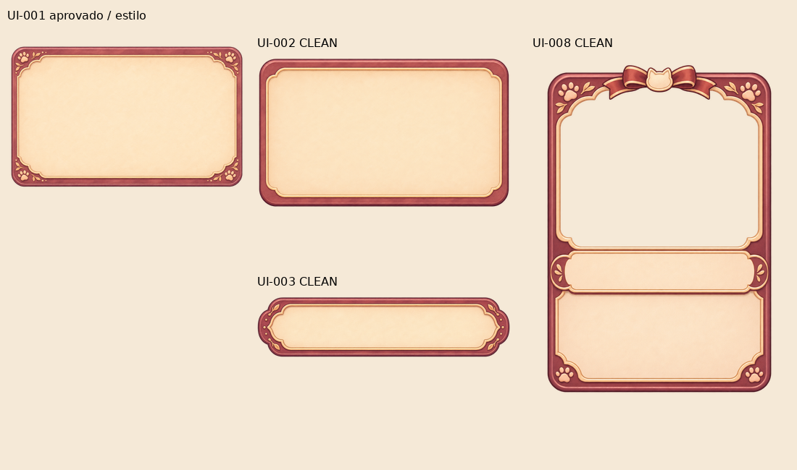
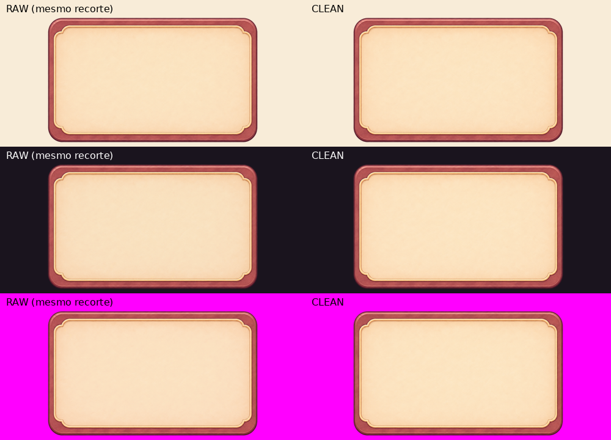
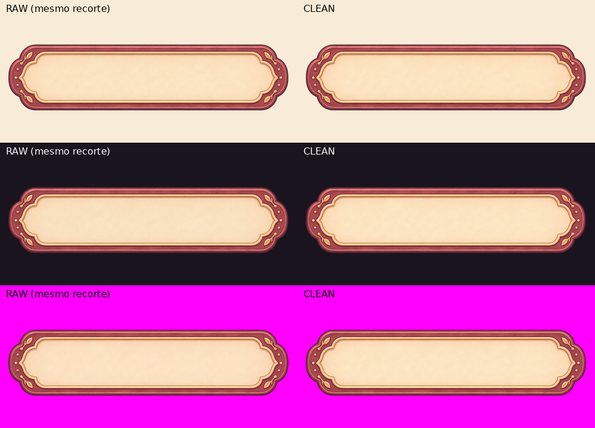
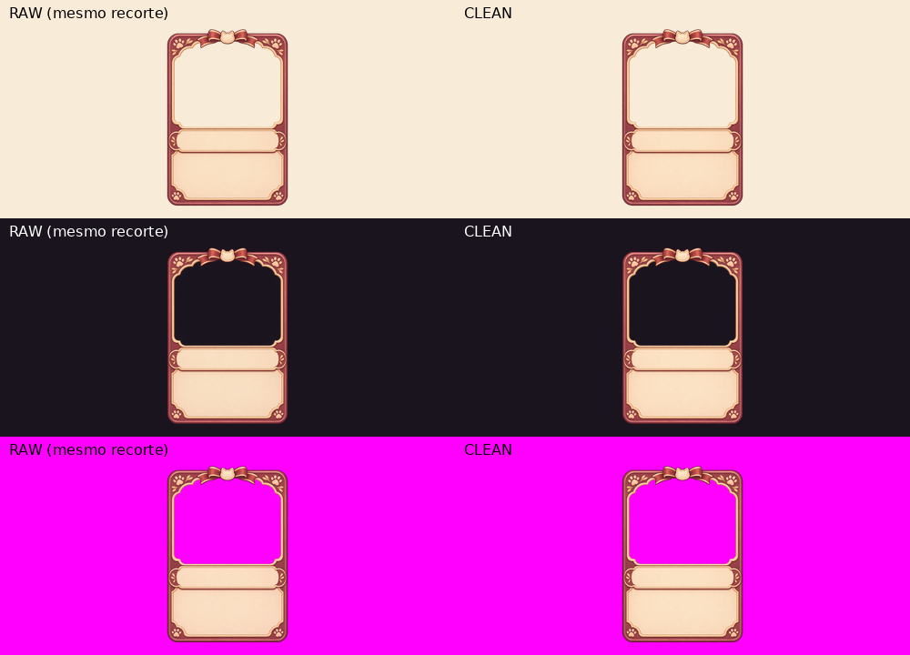
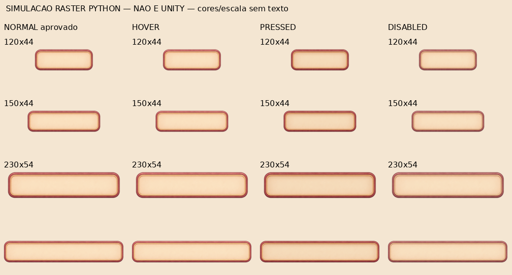
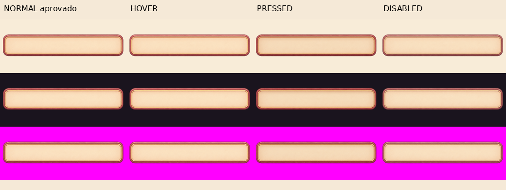

# Auditoria em lote — UI-002, UI-003, UI-008 e estados UI-004 COMPACT v01

**Escopo: arquivos PNG, limpeza conservadora e inspeção visual estática. Nenhum asset novo aprovado ou integrado.** Unity, WebGL, builds e QA/runtime anteriores **não foram executados ou repetidos**. UI-001 e UI-004 COMPACT NORMAL foram somente lidos como referências; seus arquivos e aprovações permanecem intactos. Não houve geração de arte, alteração de cenas/gameplay ou redesenho.

Base: `98688920fc6ea5595eadfb7becd8d07d6fe78302` (main remota, inclui prompts da PR #43); branch `qa/ui-modular-batch-six`. Inspeção em 03/11/2026. A skill de modificação segura e o fluxo branch→PR foram reaproveitados; nenhuma memória canônica alterada.

## 1. Resultado consolidado

`CLEAN` significa preparado para QA posterior, **não** aprovação artística ou validação Unity. Quando o RAW já tem alpha e padding adequados, não foi criada uma duplicata em blender_clean. Nenhum caso exigiu REJECTED: os arquivos são íntegros e não apresentam defeito irrecuperável demonstrado.

| Arquivo (nome sem .png) | RAW | Resultado em blender_clean | Classificação | Pronto para QA Unity? |
| --- | --- | --- | --- | --- |
| `UI-002_panel_medium_v01` | 1448×1086 | 1356×802 | **CLEAN** | Sim — painel, conteúdo creme e faixas preservados. |
| `UI-003_panel_small_label_v01` | 2172×724 | 2170×526 | **CLEAN** | Sim — label ornamentado; validar leitura pequena e limites de slice próprios. |
| `UI-008_maid_card_compact_v01` | 1070×1470 | 1070×1470 | **CLEAN** | Sim — janela transparente e zonas de texto sólidas; validar escala da card. |
| `UI-004_button_primary_compact_hover_v01` | 2048×375 | Não criado: RAW já tecnicamente limpo | **REWORK** | Não recomendado ainda — diferença de hover fraca no parecer estático. |
| `UI-004_button_primary_compact_pressed_v01` | 2048×375 | Não criado: RAW já tecnicamente limpo | **CLEAN** | Sim, condicionado ao export/import comum com NORMAL e teste da percepção de pressão. |
| `UI-004_button_primary_compact_disabled_v01` | 2048×375 | Não criado: RAW já tecnicamente limpo | **CLEAN** | Sim, condicionado ao export/import comum e teste combinado com texto/tint nativo. |

**RAWs preservados em** `art_working/ui_modular/raw_gpt/`; **apenas três limpos novos em** `art_working/ui_modular/blender_clean/`, com os mesmos basenames de UI-002/UI-003/UI-008. Todos continuam locais/ignorados. Este PR publica somente documentação, métricas e composições de evidência, não PNGs de produção aprovados.

## 2. Integridade, bytes e hashes

Todos os seis passaram `Pillow.verify()` e decodificação completa: **PNG RGBA8**, sem corrupção detectada. Hashes conferidos novamente após o processamento. Bboxes do JSON usam limites superiores exclusivos.

| Asset | Bytes RAW | SHA-256 RAW | Bytes CLEAN | SHA-256 CLEAN |
| --- | --- | --- | --- | --- |
| `UI-002_panel_medium_v01` | 1,463,362 | `a939d2bc990e56787fea85f0b543303ade489bddfbadb412a4c20a60a2288b16` | 1,228,521 | `00c44a34dca15be2cb61d994f05e32ec52775451bf80227bde5faa072683b2c9` |
| `UI-003_panel_small_label_v01` | 1,564,433 | `0775e22cfdfa766b25eafa68ec13cb819a961c5f63e6e02c367829bd80c1e3df` | 1,392,186 | `0a79225c60c61541f34c1d34f3d45f7e0685917d5d9c82cd19b9fec534b31a27` |
| `UI-008_maid_card_compact_v01` | 1,303,954 | `c849093964090779adc92a83f9880fcc0e72de 22622479f12b8917b733f118a2` | 1,138,752 | `74ea40f0b528580b4f809bd20a359bd1dbdacb02e4014f0d8ce0576676fb6342` |
| `UI-004_button_primary_compact_hover_v01` | 739,613 | `6c8dc92d2274419387301b7b1161920011032d9d0341256c935a694de718121c` | — | Não gerado / RAW inalterado |
| `UI-004_button_primary_compact_pressed_v01` | 745,104 | `291a26b50675ecce4670b77de3705a5f71a4eeffdf4d0b50734a58da910d038d` | — | Não gerado / RAW inalterado |
| `UI-004_button_primary_compact_disabled_v01` | 728,538 | `5ddb38f5275dfda5b95eb4ae73d06e9df468c5400310d20900e4c73df4e0cb60` | — | Não gerado / RAW inalterado |

Referências aprovadas, **somente leitura**:

- UI-001: `docs/art/ui-modular/approved/UI-001_panel_large_v01.png`, SHA-256 `ba300ece650f18e8ef4e938aa84e9c9df3146396dc82a91ba4551306a9ee85f8`. Autoridade de estilo dos painéis/card, sem copiar seus borders.
- UI-004 COMPACT NORMAL limpo: `art_working/ui_modular/blender_clean/UI-004_button_primary_compact_normal_v01.png`, **2072×380**, SHA-256 `c82d06142b3953a97b9654d8b7bf53e611679a6ffb4822a3b268dff239c17eb6`. **Única autoridade geométrica para HOVER/PRESSED/DISABLED.** Não foi usado o ornamental, o RAW maior ou o export reduzido como referência geométrica.

### Margens e conteúdo visível

Bboxes alpha≥5 em coordenadas RAW (x0/y0/x1/y1 exclusivo); margens L/T/R/B derivadas do canvas. Alpha1–4 é tratado separadamente no JSON e na limpeza, sem confundir essa névoa com o desenho principal.

| Asset | Bbox alpha≥5 | Margens RAW L/T/R/B (px) |
| --- | --- | --- |
| `UI-002_panel_medium_v01` | `[51, 146, 1391, 939]` | `[51, 146, 57, 147]` |
| `UI-003_panel_small_label_v01` | `[8, 98, 2164, 610]` | `[8, 98, 8, 114]` |
| `UI-008_maid_card_compact_v01` | `[62, 28, 1008, 1418]` | `[62, 28, 62, 52]` |
| `UI-004_button_primary_compact_hover_v01` | `[7, 4, 2038, 370]` | `[7, 4, 10, 5]` |
| `UI-004_button_primary_compact_pressed_v01` | `[7, 4, 2038, 370]` | `[7, 4, 10, 5]` |
| `UI-004_button_primary_compact_disabled_v01` | `[7, 4, 2038, 370]` | `[7, 4, 10, 5]` |

## 3. Limpeza e preservação

Método reaproveitado do compacto: [script reproduzível](evidence/BATCH-UI-002-003-008-004-STATES/audit_batch.py.txt), [dados completos/histogramas](evidence/BATCH-UI-002-003-008-004-STATES/analysis.json). Python + Pillow/NumPy/SciPy. Sem resize dos masters, quantização geral, preenchimento de fundo, edição de cores ou desenho.

A máscara de resíduos foi medida por componente e distância ao desenho alpha≥20: remover somente pixels alpha1–8 que (a) estejam em componentes separados e a mais de 2 px do desenho substancial ou (b) estejam a mais de 8 px desse desenho, inclusive névoa fraca conectada por resíduos. Distância euclidiana em pixels de origem. Isso preserva a banda próxima de AA/sombra; **não é threshold global de alpha**. Em seguida, alpha250–254→255 para corrigir o creme/superfície quase opaca. RGB permanece idêntico no recorte retido, inclusive nos pixels que ficaram transparentes.

| Asset | Alpha 253 no RAW | Resíduos removidos | Alpha250–254 solidificado | Transformação espacial |
| --- | --- | --- | --- | --- |
| UI-002 | 999,497 | 2,934 px (máximo alpha 1) | 1,039,574 px | crop [43, 142, 1399, 944]; padding adicional L/T/R/B [0, 0, 0, 0] |
| UI-003 | 919,797 | 735 px (máximo alpha 3) | 1,017,355 px | crop [4, 92, 2172, 618]; padding adicional L/T/R/B [0, 0, 2, 0] |
| UI-008 | 667,411 | 99,986 px (máximo alpha 7) | 736,727 px | crop [0, 0, 1070, 1470]; padding adicional L/T/R/B [0, 0, 0, 0] |

- **UI-002:** recorte das margens excessivas, sem perda do desenho/sombra remanescente; 2px transparentes em torno do conteúdo. Não há buracos internos no campo creme.
- **UI-003:** recorte vertical e lateral conservador; acrescentados **2px transparentes somente à direita**, porque uma franja alpha1 chegava ao limite do RAW. Nenhum pixel existente removido por esse padding; nenhuma reconstrução da borda. A linha externa final tem alpha0.
- **UI-008:** **canvas 1070×1470 preservado**, mantendo razão≈150:206 e as coordenadas relativas do portrait/textos. As margens externas não justificaram novo recorte. Resíduos fracos no exterior e na janela foram removidos sem apagar a moldura dourada ou as superfícies creme.
- **Estados UI-004:** superfície central já255, um componente e padding coerente. Os valores parciais próximos de 255 pertencem à borda interpolada; **nenhuma normalização de alpha, crop, resize ou recoloração foi aplicada** a esses arquivos. Eles não receberam CLEAN novo por falta de necessidade técnica.

Componentes alpha>0 antes/depois dos três frames: UI-002 706→20, UI-003 438→152, UI-008 2822→24. Permanecem 59/169/26 pixels desconectados, respectivamente, com alpha máximo 6/8/4, próximos ao desenho (UI-002/UI-003≤2px; UI-008≤7,62px). Foram preservados por conservadorismo de AA/sombra, não confundidos com ilhas opacas. Não há fragmentos soltos visíveis nas composições inspecionadas. A contagem bruta de componentes não é, isoladamente, critério de aprovação.

Halos: composições sobre creme, escuro e magenta inspecionadas. Nenhuma franja clara/chroma visível foi observada. UI-002/UI-003 e os estados têm zero pixels de borda alpha20–249 com luminância>200. UI-008 tem 23 pixels nessa condição, em tons quentes nos detalhes do laço/recorte dourado; não foi interpretado automaticamente como halo branco nem recolorido. A correção foi somente de alpha.

## 4. Arte, continuidade e áreas úteis

As três peças mantêm rosewood/terracota, dourado e creme coerentes com UI-001. UI-002 é deliberadamente mais simples; UI-003 tem folhas/bolinhas e centro livre; UI-008 retoma patinhas/laço sem portrait ou texto gravado. Faixas e contornos são contínuos na inspeção raster; nenhum rompimento opaco identificado. Borders de UI-002/UI-003 e comportamento de estiramento ainda devem ser medidos em QA próprio: não foram importados borders do painel grande.

| Área medida (coordenadas RAW, x0/y0/x1/y1 exclusivo) | Resultado |
| --- | --- |
| UI-002 creme `[150,260,1290,820)` | alpha252–254 no RAW, 255 após limpeza; RGB mediano≈252/227/191 preservado |
| UI-003 creme `[340,210,1830,505)` | alpha252–254 no RAW, 255 após limpeza; RGB mediano≈252/228/192 preservado |
| UI-008 portrait seguro `[200,210,850,700)` | 16.946 pixels alpha1–3 no RAW; **todos alpha0 no CLEAN**, sem preenchimento do recorte |
| UI-008 nome `[230,850,840,950)` | 61.000 pixels sólidos após limpeza; alpha255; RGB mediano252/225/195 |
| UI-008 stats `[170,1040,900,1260)` | 160.600 pixels sólidos após limpeza; alpha255; RGB mediano251/224/194 |

Para mapear essas amostras aos CLEANs: subtrair (43,142) no UI-002 e (4,92) no UI-003; o padding adicional à direita não desloca os pixels. UI-008 mantém as coordenadas originais. A card deve preservar proporções/ornamentos; não assumir 9-slice integral através do portrait e das duas zonas de texto.

O recorte grande do portrait tem bbox alpha≤128 fechada≈`[118,126,952,798)`, altura672px, perto de46% do canvas. A zona segura retangular é menor para evitar cantos/laço. Nome e stats continuam fundos opacos, não áreas a remover. Não há portrait/labels/valores impressos. Essas zonas são **amostras conservadoras de arquivo**, não insets de UI homologados.

Na escala do prompt de card 150×206, a zona segura de nome tem≈85,5×14u; em 0,62×,≈53×8,7u. A janela e os campos existem, porém a leitura dos ornamentos e de texto dinâmico nessa redução ainda exige QA Unity. Não redimensionei a arte para tentar certificar legibilidade por inspeção do master.

Composições RAW×CLEAN: mesmo recorte/escala nos dois lados, RAW à esquerda. O vazio do portrait deixa passar as três cores de fundo, enquanto nome/stats permanecem creme.

## 5. HOVER, PRESSED e DISABLED contra COMPACT NORMAL

Os três RAWs são **2048×375**, não o canvas 2072×380 do NORMAL. Todos têm exatamente a mesma máscara de alpha entre si; **715.993 pixels já255**, centro255 e um componente. Não há corte/offset diferente entre os três estados. A origem do redimensionamento não pode ser inferida apenas dos PNGs.

Para comparar dimensões diferentes, o NORMAL foi apenas reamostrado **em memória** para 2048×375. Nenhum NORMAL de produção foi regravado/reprocessado, nenhum export substituído. Em relação a essa referência normalizada:

- IoU da silhueta alpha>128: **99,9712%**; 209 pixels diferentes na máscara, erro máximo de contorno **1px**.
- Centroide: diferença≈**+0,0075px X/+0,0464px Y**; sem deslocamento visual relevante. Em altura 44, 1px de origem corresponde a≈0,117u.
- Razão de aspecto diverge≈**0,16%**; geometria suficientemente próxima para preparar QA, porém **não é igualdade pixel a pixel** ou conformidade literal com o canvas do prompt.
- Faixas retas, raios e área de texto preservados proporcionalmente, sem novos ornamentos. **Compatibilidade geométrica de slice: favorável**, não validada em Unity nesta tarefa.

Bordas proporcionais aos borders aprovados do NORMAL: **L158,1467/B108,5526/R158,1467/T108,5526** para 2048×375. Copiar literalmente 160/110 dos masters de dimensões diferentes seria incorreto. **Reutilizar o mesmo componente/configuração final exige export/import comum** (ex.: 768×141 com os borders aprovados), ou ajuste explícito de PPU/borders/multiplier por resolução. Nenhum export de estado ou `.meta` foi criado aqui; não tratar os RAWs como substituições diretas de master sem essa preparação.

| Estado | Centro: ΔY médio (0–255) | Contorno: ΔY médio | Saturação do contorno (range RGB médio) | Parecer |
| --- | --- | --- | --- | --- |
| HOVER | +0.006 | +3.944 | 84.17→84.39 | Centro mantido; realce coerente, mas fraco na simulação pequena. **REWORK visual** antes de homologar o feedback. |
| PRESSED | -5.995 | -7.844 | 84.17→85.70 | Face/contorno mais escuros sem mover a peça; diferença mais clara. **CLEAN**, testar sensação de pressão/interação depois. |
| DISABLED | -1.135 | +2.808 | 84.17→74.13 | Contorno menos saturado, creme sólido. **CLEAN**, testar percepção indisponível junto ao texto/tint do Button depois. |

ΔY é diferença de luminância codificada ponderada em RGB, **não ΔE perceptual, razão de contraste ou teste de usuário**. As regiões exatas estão no script/JSON. O HOVER deixa a face praticamente igual e muda o rim em≈+3,94/255; no parecer visual estático, o feedback é tímido em 120/150×44. Não foi fortalecido por recoloração: isso seria decisão artística fora da limpeza. PRESSED escurece moderadamente; DISABLED reduz o range cromático do rim em≈12%, sem tornar o centro translúcido. O DISABLED ainda parece uma superfície clara; a indisponibilidade funcional depende da combinação real com Button/texto e deve ser verificada no QA posterior.

**Simulação raster Python, não Unity**, sem texto, input ou shader, nos tamanhos 120×44/150×44/230×54. Arredondamento dos cortes de slice e filtro Bilinear aproximam somente a inspeção estática. As diferenças visuais são pareceres desta inspeção e não aprovação automática de nenhum estado.

Não foi feita troca de sprite em runtime, medição de percepção temporal ou teste de interação. O REWORK do HOVER é uma recomendação visual, reversível pela decisão do responsável; não prova falha funcional. A compatibilidade de silhueta não exige redesenho dos três estados.

## 6. Validação, pendências e entrega

- **PASS:** leitura/CRC/decodificação dos 6 PNGs; dimensões/bytes/hashes; histogramas; máscaras/componentes/margens; invariância RGB dos recortes; alpha do portrait/creme; hashes dos 6 RAWs e das referências após a execução; inspeção das composições e compatibilidade geométrica proporcional dos estados.
- **CLEAN:** UI-002, UI-003, UI-008, COMPACT PRESSED e COMPACT DISABLED; os dois últimos já estavam tecnicamente limpos no RAW. Preparados para **QA Unity posterior**, com as ressalvas descritas.
- **REWORK:** COMPACT HOVER, pela percepção fraca do realce nesta inspeção. Revisar intensidade com o responsável antes do QA final; sem regeneração/recoloração nesta tarefa.
- **NOT RUN por escopo:** Unity, WebGL, builds, testes de jogo/QA anteriores, UI real/textos/cliques/transições, compressão/memória GPU e homologação final de slice. Nenhuma evidência deste lote é screenshot Unity.
- **Preservado:** UI-001 e COMPACT NORMAL aprovados, ornamental REWORK, todos os RAWs e QA anterior. Não foram alterados gameplay, cenas, assets Unity, testes, workflows ou a main.
- **Gate:** responsável revisa classificações/limpeza e decide o próximo QA. Nenhum dos 6 recebe APPROVED/INTEGRATED. Uma única PR deste lote; sem merge/auto-merge.

O [manifesto das composições](evidence/BATCH-UI-002-003-008-004-STATES/evidence_manifest.json) registra paths/hashes. O script escreve somente três CLEANs e composições/métricas desta auditoria; não produz novos estados de arte. Dependências/versões e limites da reprodução no [README](evidence/BATCH-UI-002-003-008-004-STATES/README.md).
